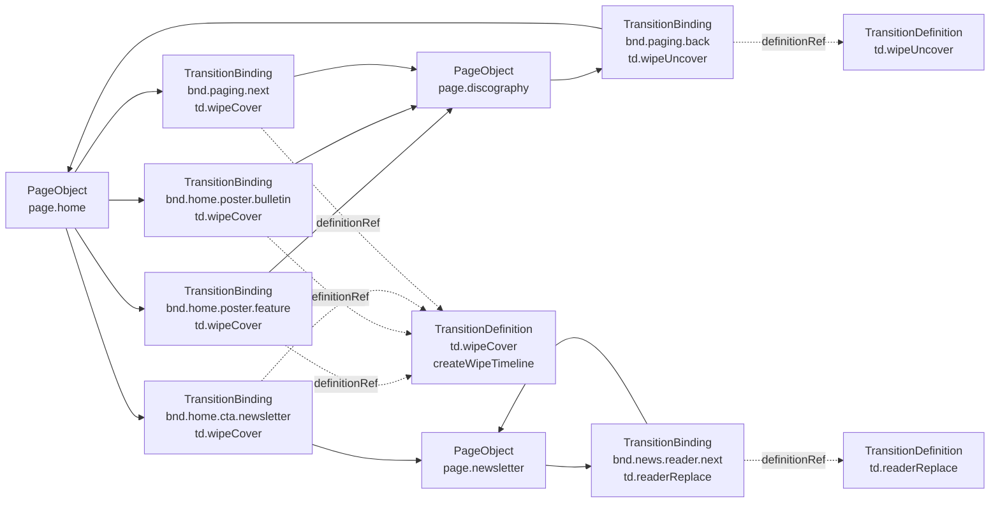
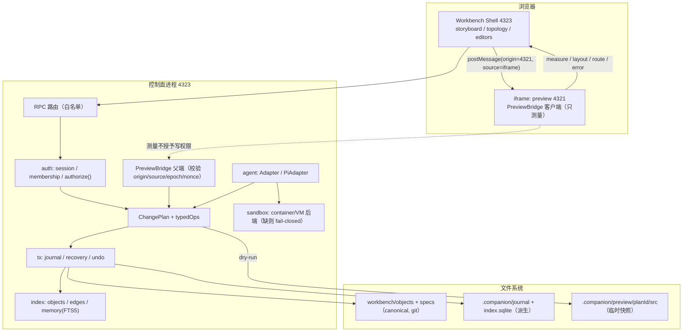
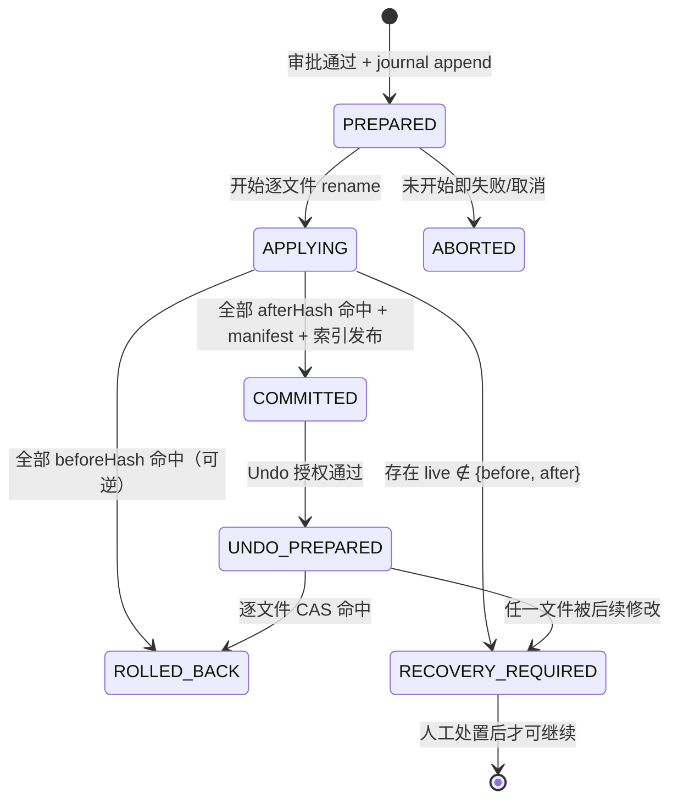
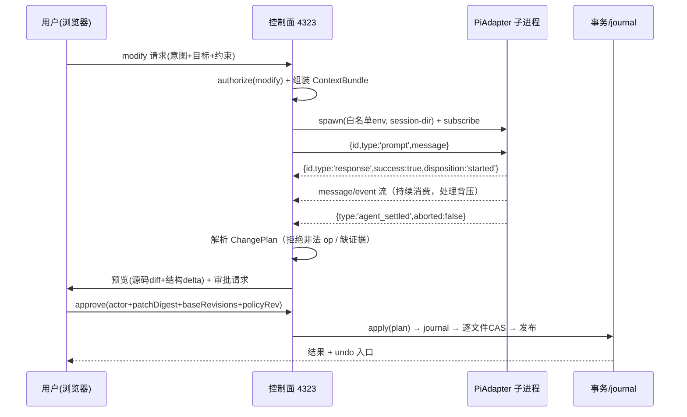
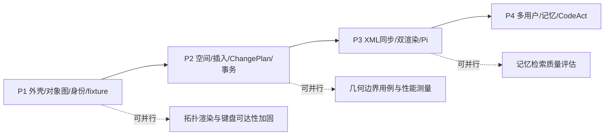

# 《Companion Workbench（伴生 Agent 网页架构编辑器）重构调研与策划案》

> 本稿是**最终主稿**，优先于同目录 `01`–`08` 号过程稿。过程稿保留用于追溯证据与审查记录，冲突时以本稿为准。
> 配套文件：`spec/companion-workbench-architecture.spec.xml`（完整详细 XML）、`evidence-map.md`（证据地图）、`research-execution.md`（执行与验证记录）、`sql-validation.json`（node:sqlite 窄验证输出）。

---

## 0 定位、证据口径与阅读方式

### 0.1 本稿是什么

用户已明确：**Workbench 的所有能力都是新功能**。因此本稿 80% 以上篇幅是**具体实现设计**（数据结构、算法、目录、进程、协议、状态机、失败处理、验收），现状只作为"约束面"与"可复用内核"出现，不做逐项缺失盘点。

### 0.2 证据口径（关键：本批调研并非"全程未联网"）

| 来源类型 | 谁做的 | 可用于什么 | 不能用于什么 |
| --- | --- | --- | --- |
| 仓库只读代码审计 | Pi 子 Agent（无 web 工具）+ 主 Agent | 【事实】行号级断言 | 运行时行为 |
| 本机 Pi 包文档 `docs/rpc.md` 等 | Pi 子 Agent + 主 Agent | RPC 协议事实（E1） | 付费端到端可用性 |
| **主审在线核验的一手文档**（Web） | 主审（非 Pi 子 Agent） | 外部规范/API 语义 | 本项目已实现的证明 |
| 主审本机实测 | 主审 | `53/53`、`27/27·693`、node:sqlite 窄验证 | 浏览器交互、生产构建 |
| 本稿设计 | 主 Agent | 目标架构 | 已实现/已验收 |

主审在线核验的一手来源（原文见 `lead-verified-evidence.md`）：

1. [Astro compiler-rs](https://github.com/withastro/compiler-rs) — 提供 ESTree 兼容 AST 与 transform；**不提供**无损 AST printer，结构编辑仍需精确切片与自校验。
2. [Astro v7 升级文档](https://docs.astro.build/en/guides/upgrade-to/v7/) — Astro 7 使用 Rust compiler、更严格处理未闭合标签（仅支持这一窄结论）。
3. [Mermaid Flowchart 文档](https://mermaid.js.org/syntax/flowchart.html) — `click` 属于交互特性，`strict` 安全级别禁用；`loose` 才启用。
4. [Node.js 权限模型](https://nodejs.org/api/permissions.html) — Node 权限模型**不是**恶意代码沙箱；隔离需 OS/容器/VM。
5. [CodeAct 原论文](https://arxiv.org/abs/2402.01030) — CodeAct（Executable Code Actions）范式来源，不含项目记忆或安全保证。
6. [W3C CSS Grid 规范](https://www.w3.org/TR/css-grid-2/) — Grid 视觉排布可独立于源码顺序（implicit tracks/subgrid/gap/auto-placement）。
7. [MDN getBoundingClientRect](https://developer.mozilla.org/en-US/docs/Web/API/Element/getBoundingClientRect) — 返回**相对 viewport 的 border-box** AABB（含 padding/border）。
8. [MDN postMessage](https://developer.mozilla.org/en-US/docs/Web/API/Window/postMessage) — 发送需精确 `targetOrigin`，接收需校验 `origin`/`source`。
9. [SQLite WAL 文档](https://sqlite.org/wal.html) — WAL 仍只允许单 writer；不提供跨文件事务，不适合网络文件系统协作。

调研方法学来源（主审在线核验作者与 DOI，仅作工具来源，不支撑架构正确性）：
Kassis, T., Agarwal, V., He, Y., Patel, D., & Brueckner, A. M. (2026). *[Scientific Agent Skills: A Library of Procedural Knowledge for Research Agents](https://doi.org/10.48550/arXiv.2609.00065).*

### 0.3 三类标注

| 标注 | 含义 |
| --- | --- |
| 【事实】 | 可由 `文件:行` 或上述一手来源复核 |
| 【推断】 | 由事实推出、未实测的工程判断 |
| 【设计】 | 目标设计，未实现 |

本稿**没有**做：浏览器交互、`npm run build`、付费 Agent 调用、容器级沙箱。凡涉及这些的结论一律标【设计】或"待实施验证"。

---

## 1 推荐裁决（直接给结论，不把常规工程选择推回用户）

| # | 裁决 | 一句话理由 |
| --- | --- | --- |
| V1 | **canonical 身份与 Spec 放版本控制目录**：`workbench/objects/**`、`workbench/specs/**`；`.dev-studio/` 只放派生索引、journal、记忆、会话 | `.dev-studio/` 已被 `.gitignore` 忽略（`.gitignore:39-40`），身份不能住在被忽略的目录 |
| V2 | **一套对象模型**：PageObject / ComponentObject / TransitionObject（含 Definition/Binding/Instance 四层）共用同一 `ObjectGraph`，三种入口（空间选区、对象节点、XML diff）统一产出 `ChangePlan` | 避免三套并行真相；审批、事务、审计只需实现一次 |
| V3 | **导航图允许有环**；**继承树、包含树、数据依赖的环禁止** | HOME→NEWSLETTER→HOME 是正常产品行为；继承/包含成环是建模错误 |
| V4 | **外壳双 origin**：控制面 `127.0.0.1:4323`，站点 preview `127.0.0.1:4321`；父窗口**不读** `contentDocument` | 现状同源同文档导致事件/样式/生命周期耦合 |
| V5 | **稳定身份只存 versioned registry**；dev transform 按 registry 在**内存/响应**里注入 runtime 标记；**生产不注入** | 现有 integration 只在 serve 阶段插桩，不会剥离作者写进源码的持久标记；现有 53 项测试也未覆盖这种新属性 |
| V6 | **几何用"可解释量化 + 边界测试 + 关键操作重测"**，不承诺任意亚像素抖动 fingerprint 不变 | 任何固定量化桶都有边界；把边界写成不变量就是造假证明 |
| V7 | **插入是纯插入 + 拒绝优先**：`append` 用父元素 `closingElement.start`，自闭合父元素必须显式 `expandSelfClosing` | 绝不能把元素插进 opening tag 内部 |
| V8 | **remap = patch offset transform + 新 AST 校验 + typed operation 的显式 objectId 映射**；`ordinalPath` 只作候选辅助 | 插入同 tag 兄弟会让后续 ordinal 全变，ordinal 不能当身份 |
| V9 | **转场实例身份 = `sessionId + 单调 instanceSeq`**；seeded RNG 与 poster deck 状态**收进 session**，不改全局 `Math.random` | 现状模块级牌堆使 bake 依赖导航历史 |
| V10 | **多用户是既定需求**：本地账户 + 成员资格 + 角色 + 会话；UI 的 userId 下拉**不是**认证 | 现有 token 是进程级单例且 `/session` 免 token |
| V11 | **CodeAct 强隔离 fail-closed**：没有可验证 container/VM 后端就不默认执行不可信脚本；Windows 上不搞 best-effort 默认执行 | Node 权限模型不是沙箱；`taskkill`/Job Object 不是权限边界 |
| V12 | **多文件事务不声称 ACID**：单 writer 协调器 + 每文件 CAS + journal + 启动恢复 + 发布门控 | 普通文件系统没有跨文件原子性 |
| V13 | **四阶段**：P1 外壳/对象图/身份/fixture 时间轴 → P2 空间/插入/ChangePlan/预览/journal/Undo → P3 XML 双向同步/双渲染契约/Pi 三能力 → P4 多用户完备/三层记忆/强隔离 CodeAct；基础 actor/scope/event 契约从 P1 就存在 | XML、Pi、多用户都是必需项，不能推到 Future；**拖拽排版**才是 Future |
| V14 | 保留既有 `53/53` 与 `27/27·693` 作为回归门槛，但**不把它们当新功能证据** | 现有测试只覆盖文本/样式补丁与确定性烘培内核 |

---

## 2 现状基线（约束面，不展开盘点）

| 项 | 值 | 证据 |
| --- | --- | --- |
| 框架/动效/编译器 | Astro 7.3.8 / GSAP 3.15.0 / compiler-rs 0.5.2 | `package.json:12,13,19` |
| 路由 | `/`、`/discography/`、`/newsletter/`，`trailingSlash:'always'` | `astro.config.mjs:5-6`；`src/scripts/app.js:9` |
| dev 集成 | 仅 `command==='dev'` 挂载；serve 期 Vite 插桩 | `astro.config.mjs:2-4`；`docs/DEV_STUDIO_SOURCE_BRIDGE.md:26` |
| 生产入口 | `if (import.meta.env.DEV) import('../dev-studio/index.js')` | `src/layouts/SiteLayout.astro:31-33` |
| 写入面 | 仅 `replaceStaticText` / `replaceInlineStyle` | `src/dev-studio/source-engine.js:446-451` |
| 运行时 id | `hashId(file, start, tag)`，随偏移漂移 | `source-engine.js:28-31`（**注意：不是 38-41**） |
| RPC | 7 条白名单；`/session` 免 token；token 进程级单例；body 32KiB/192KiB | `src/dev-studio/server.js:153,168,169,173` |
| Undo | 内存 100 条、重启即失；写盘在登记前 | `server.js:86-88` |
| 通讯内容 | 示例写作，页面标注 `DEMO ISSUES / ILLUSTRATIVE CONTENT` | `src/lib/data.js:1-2`；`newsletter.astro:15,36,78` |
| SSR 首屏期号 | `ISSUES[0]` = **04**（`03 // NEWSLETTER` 是导航编号） | `newsletter.astro:6`；`SiteLayout.astro:6` |
| 翻页 | 3 页、4 条有向邻接、首末不循环 | `app.js:9,20-25` |
| 测试基线（主审本机实测） | `node --test` 53/53；`motion-baker` 27/27、693/693 断言 | `baseline-tests.tap`、`motion-baker-baseline.txt` |
| 构建/浏览器 | **未重新构建**、**未开浏览器**；dist 扫描针对既有 `dist/` | 主审记录 |
| node:sqlite 窄验证 | Node 22.21.0，`:memory:` 建表/FTS5/触发器成功（有 experimental warning） | `sql-validation.json` |
| 源码格式 | 三个 `.astro` 全 CRLF；`index.astro` 顶格、`newsletter.astro` 2/4/6 空格 | 本次实测 |

---

## 3 统一对象模型

### 3.1 一套模型、一条写入管线【设计】

```
三种入口                          统一中间表示                      统一执行
─────────────                    ─────────────                    ────────
空白/框选 SpatialSelection  ┐
对象节点编辑 ObjectEdit      ├→  ChangePlan(objectId, baseRevisions,
XML/Spec diff SpecEdit      ┘     scope, constraints, typedOps)
                                        │
                    resolve identity & scope → typed operations → read/write set
                    → validate(L1/L2/L3) → isolated preview → approval(actor+patchDigest+baseRevisions+policyRev)
                    → serialized transaction(journal) → rebuild indices & publish(HMR gate)
                    → undo = guarded inverse transaction
```

Agent（Pi/DSH/CodeAct）**只能**产出 `ChangePlan` 或 `Clarification`，没有第二条写源码路径。自然语言只作意图输入与规划依据；最终字节补丁必须可审计。

### 3.2 环规则（必须区分三张图）【设计】

| 图 | 环 | 处理 |
| --- | --- | --- |
| 导航图（PageObject + TransitionBinding） | **合法** | HOME→NEWSLETTER→HOME 正常；不得因环报渲染错误；图算法必须用 visited 集合而非假设 DAG |
| 继承图（`extendsRef`） | 禁止 | DFS 染色检测，成环报 `INHERITANCE_CYCLE` 并拒绝加载 |
| 包含图（PageObject→ComponentZone→Node） | 禁止 | 同一 objectId 在祖先链上重复出现即 `CONTAINMENT_CYCLE` |
| 数据依赖（binding expression → 对象） | 禁止 | 依赖图强连通分量检测，报 `DATA_CYCLE` |

### 3.3 对象与转场（四层身份）【设计】

```ts
// workbench-core/objects/types.ts
export type ObjectId = string;   // 点分式，前缀↔类型强绑定

export interface ObjectBase {
  objectId: ObjectId;
  version: number;                       // 与 spec 提交同步递增
  extendsRef?: ObjectId;                 // 单继承（仅 ComponentObject / PageObject）
  overrides?: Override[];                // 字段级覆盖
  locked?: string[];                     // 不可被覆盖/解除的字段名
  provenance: { sourceRef: string; specHash: Sha256 };
}

export interface Override {
  field: string;
  value: unknown;
  strategy: 'replace' | 'merge' | 'append';   // 数组默认 replace，不隐式深合并
}

export interface PageObject extends ObjectBase {
  kind: 'page';
  route: string; pageKey: string;
  layoutRef: ObjectId;                   // -> cmp.siteLayout
  zones: ObjectId[];                     // -> zone.*
  mechanisms: ObjectId[];                // -> mech.*
}

export interface ComponentObject extends ObjectBase {
  kind: 'component';
  tag: string;
  params: Record<string, ParamSpec>;
  zones: ObjectId[];
}

/** 身份层：一个转场"是什么"，可被多页/多锚点复用 */
export interface TransitionObject extends ObjectBase {
  kind: 'transition';
  transitionKind: 'wipe' | 'decode' | 'entrance' | 'inPlace';
  reusable: boolean;
  instancePolicy: 'perNavigation' | 'perGesture' | 'perClick' | 'perLoad' | 'perBinding';
  deckRef?: ObjectId;                    // -> deck.*
}

/** 类型层：参数与实现符号，可独立版本化 */
export interface TransitionDefinition {
  definitionId: ObjectId;                // td.*
  implSymbol: string;                    // createWipeTimeline
  implSourceRef: string;                 // src/scripts/motion.js:36-43
  phase: 'beforeSwap' | 'afterSwap' | 'inPlace';
  params: Record<string, ParamSpec>;
}

/** 绑定层：一条"从哪到哪、由谁触发"的边（many-to-one 就发生在这里） */
export interface TransitionBinding {
  bindingId: ObjectId;                   // bnd.*
  transitionObjectId: ObjectId;          // -> tx.*
  definitionRef: ObjectId;               // -> td.*
  fromPageId: ObjectId; toPageId: ObjectId;
  linkRef?: ObjectId;                    // -> lnk.*
  trigger: 'click' | 'wheel' | 'touch' | 'pageLoad' | 'componentEvent';
  effect: 'cover' | 'uncover' | 'inPlace' | 'none';
  enabled: boolean;                      // 自链接/同文档锚点必须 false
  deckCursor?: string;
  guard?: string;
}

/** 实例层：一次真实发生或一次夹具 */
export interface TransitionInstance {
  instanceId: ObjectId;                  // ti.*
  bindingRef: ObjectId; definitionRef: ObjectId;
  instanceSeq: number;                   // sessionId + 单调 seq，唯一身份来源
  sessionId: string;
  startedAtSource: string;               // 时间只作字段
  deckCursorAtStart?: number;
  recordedBy: 'runtime' | 'fixture';
}
```

**继承/覆盖统一规则**（对 PageObject、ComponentObject 完全相同）：

| 规则 | 内容 |
| --- | --- |
| 单继承 | `extendsRef` 至多一个；解析顺序 root→leaf |
| 环检测 | 加载时 DFS 三色标记，发现回边即 `INHERITANCE_CYCLE`，整份 Spec 拒绝加载 |
| 字段级覆盖 | 只有 `overrides` 里显式列出的字段被改；其余继承父值 |
| 数组语义 | 默认 **整体替换**（`strategy:'replace'`）；需要追加必须显式 `'append'`；**不做隐式深合并** |
| 新增字段 | 覆盖不得引入 schema 未声明的字段（`OVERRIDE_UNKNOWN_FIELD`），加字段必须走 schema 版本升级 |
| locked | 父对象 `locked` 字段被覆盖 → `OVERRIDE_LOCKED_FIELD`；`locked` 不可被继承层解除，只能由 `owner` 改 spec 并留审计 |
| 参数覆写 | 转场的 `params` 与组件的 `params` 走同一套 `ParameterSlot` 优先级（instance > binding > definition > project > user），不可变约束在合并后统一校验 |

### 3.4 宏观拓扑：转场必须是可选中的中间节点【设计】

需求要"宏观缩略故事板 + Mermaid 拓扑"，且能点 Page 下钻、点转场进入时间轴。因此拓扑**不能**画成 `Page→Page` 的边标签（那会把 many-to-one 与 definition reuse 藏在标签里）。

三层视图，同一份 canonical graph：

1. **缩略故事板**：每页一张结构缩略 SVG（wireframe 卡片），来自对象图的 zone/node tag 序列——这本身就是第一版"Wireframe"，不依赖位图截图。
2. **拓扑**：`PageObject ── TransitionBinding(中间节点) ── PageObject`；`TransitionBinding` 节点上标 `td.*` 定义 id，从而"两条边共用同一定义"肉眼可见。
3. **时间轴**：点 `TransitionBinding` 或 `TransitionObject` 节点 → 进入该定义的 fixture 时间轴（帧序列、seek、reroll、对比）。



上图即"many-to-one + definition reuse"的真实形态：4 条 binding 指向同一个 `td.wipeCover`；`HOME→DISCO` 有 3 条不同 binding（3 个真实锚点），实例身份互不相同。

交互实现（**不依赖 Mermaid 的 click**）：Mermaid 仅在 `securityLevel:'strict'` 下渲染受控 SVG；Workbench 在外部通过"渲染器适配层"把 SVG 节点的 `data-node-id` 映射到 `objectId`，并自己绑定 pointer/键盘事件。若适配失败，右侧等价的可聚焦对象列表必须能完成同样跳转（`aria` 完整），保证功能不因渲染器退化而丢失。

下钻与返回：`WorkbenchRoute` 用显式栈；进入页面/转场时把宏观视图的 `{zoom, pan, selectionId, focusedObjectId}` 存进栈帧，返回时恢复（不是浏览器 history 猜）。

```ts
export type WorkbenchRoute =
  | { view: 'macro'; focusObjectId?: ObjectId; selectionId?: string }
  | { view: 'page'; pageId: ObjectId; zoneId?: ObjectId; selectionId?: string }
  | { view: 'transition'; bindingId: ObjectId; definitionId: ObjectId; frameIndex?: number }
  | { view: 'spec'; specId: ObjectId; conflictId?: string };

export interface NavFrame { route: WorkbenchRoute; macroViewport: { zoom: number; panX: number; panY: number }; selectionId?: string; }
export interface NavStack { frames: NavFrame[]; index: number; }
```

### 3.5 存储形态：registry 是事实，索引是投影

对象图不能只活在内存或 SQLite，也不能把 JSON 当“第二个 Spec”。三者职责分开：

| 载体 | 内容 | 可变性 | 重建方式 |
| --- | --- | --- | --- |
| `workbench/specs/*.spec.xml` | 权威 Spec（含 Description/Addition/Invariant） | 仅通过审批的事务 | 人工/工具编辑，git 历史可追溯 |
| `workbench/objects/*.object.json` | objectId、继承、override、binding、instance 夹具、deck 引用 | 同上 | 可由 Spec 编译生成（单向），但一旦生成即独立版本化 |
| `.companion/index.sqlite` | 对象/边/记忆/索引状态 | 仅索引器 | 随时可 drop 重建 |

关键约束：**索引永远不能成为唯一真相**。任何“只能从索引里查到”的信息（例如某次选区），都是可丢失的派生数据；反过来说，如果评审需要在索引里改变一个对象的身份，那就是设计错误。对象 JSON 与 Spec 之间用 `specHash + objectId` 双向引用，L2 校验里检查“每个 objectId 在 Spec 中有定义、每个 PageObject/ComponentObject 有对应 registry 条目”，任一缺失即 `REGISTRY_DRIFT`（不自动修复）。


---

## 4 进程、目录与外壳架构

### 4.1 目录与进程边界【设计】

```
workbench/                          # 版本控制，canonical
  objects/<projectId>/*.object.json  # objectId、继承、override、binding、instance 夹具
  specs/<projectId>/*.spec.xml       # 权威 Spec 文档
  fixtures/<projectId>/*.frames.json # 转场 fixture 帧（可选，体积大时只存 hash + 生成器）
  policy/<projectId>.json            # 硬约束：不可变槽、允许的 op、审批角色
.companion/                           # 机器本地，gitignore（派生/runtime）
  index.sqlite                        # 对象/边/记忆索引（可重建）
  journal/<txId>.jsonl                # 事务 journal（append-only）
  sessions/<userId>/<sessionId>/       # 会话态（选区、草稿、Pi 子进程 session-dir）
  sandbox/<runId>/{in,out,script}      # CodeAct 沙箱工作区
  preview/<planId>/src                 # 候选补丁的**临时源码快照**（隔离构建）
src/workbench/                        # 编辑器壳（浏览器侧）
  shell/ canvas/ storyboard/ topology/ transition-editor/ spec-editor/ diff-view/
src/workbench-core/                   # 同构核心（可被壳与服务端共用）
  objects/ spatial/ spec/ changes/ transactions/ motion/ text/
src/workbench-server/                 # 控制面（4323）
  auth/ rpc/ tx/ agent/ memory/ sandbox/ preview-bridge/ index/
```

进程与端口：

| 进程 | 端口 | 职责 | 凭据 |
| --- | --- | --- | --- |
| Astro dev（preview） | 4321 | 渲染 demo；注入 PreviewBridge 客户端；**不持有**审批/写令牌 | 无 |
| Workbench 控制面 | 4323 | 身份/会话/授权/ChangePlan/审批/事务/journal/记忆/Pi 子进程 | 会话 cookie（HttpOnly, SameSite=Strict） |
| PiAdapter 子进程 | 无常驻端口 | `pi --mode rpc`，每用户独立进程与 `--session-dir` | 继承**白名单环境**，无宿主 provider key 外泄 |
| 候选构建子进程 | 无常驻端口 | 在 `.companion/preview/<planId>/src` 快照上 `astro build` | 无网络（若不可强制则 fail-closed，见 §11.5） |

### 4.2 系统进程与数据流



### 4.3 PreviewBridge 消息协议【设计】

```ts
export const BRIDGE_SCHEMA = 1 as const;

export type BridgeMessage =
  | { schemaVersion: 1; kind: 'hello'; frameEpoch: number; sessionNonce: string; pathname: string; docRevision: Sha256 }
  | { schemaVersion: 1; kind: 'measure'; frameEpoch: number; selectionId: string;
      rects: Partial<Record<'viewport' | 'document' | 'container' | 'canvas', Rect>>;
      frames: SpaceFrame[]; polygon: Point[] | null; hitIds: ObjectId[]; runtimeSourceIds: string[] }
  | { schemaVersion: 1; kind: 'geometry'; frameEpoch: number; geometryFingerprint: Sha256; breakpointKey: string; fontsReady: boolean }
  | { schemaVersion: 1; kind: 'route'; frameEpoch: number; pathname: string; navigationType: 'push' | 'replace' | 'traverse' | 'load' }
  | { schemaVersion: 1; kind: 'error'; frameEpoch: number; code: string; detail: string };

export type BridgeReject = 'ORIGIN' | 'SOURCE' | 'SCHEMA' | 'EPOCH' | 'NONCE' | 'SHAPE' | 'STALE_DOC';

export function acceptBridgeMessage(
  ev: MessageEvent,
  expect: { origin: string; source: Window; frameEpoch: number; nonce: string }
): BridgeMessage | { reject: BridgeReject };
```

规则：

1. `targetOrigin` 必须是字面常量 `http://127.0.0.1:4321`，禁止 `'*'`。
2. 校验 `ev.origin`、`ev.source === iframe.contentWindow`（**唯一允许出现 `contentWindow` 的地方**）、`schemaVersion`、`frameEpoch`、`sessionNonce`、字段形状。
3. 父窗口**不读** `contentDocument`、不注入事件、不 `eval`；子页只测量并上报。
4. 测量消息**不授予**任何写权限：服务端仍按 `objectId/sourceId/revision/scope` 重新校验。
5. `docRevision` 变化（HMR/重导航）→ `frameEpoch++`，旧 epoch 消息一律丢弃（防止"旧 DOM 的矩形"被当作当前选区）。

可 CI 的静态断言：

```bash
grep -rn "contentDocument" src/workbench/ | wc -l            # 期望 0
grep -rn "postMessage([^)]*'\*'" src/workbench/ | wc -l       # 期望 0
grep -rn "contentWindow" src/workbench/ | wc -l              # 期望 1（身份比较）
grep -rn "__dev_studio_api/commit" src/workbench-server/preview | wc -l   # 期望 0
```

### 4.4 信任边界（必须原样写进设计文档）【设计】

> 同源 iframe 隔离的是 CSS、事件冒泡与生命周期，**不构成脚本安全边界**。`sandbox="allow-scripts allow-same-origin"` 同时给时，同源子页可以反向访问父页。本架构的威胁模型**不包含**"在 preview 里运行不可信代码"；不可信代码只允许进入 §11.5 的强隔离后端。

凭据只在控制面：审批令牌、写权限、记忆读写密钥都不下发到 4321。迁移完成后，4321 侧原有的写源码 RPC（`/__dev_studio_api/commit`、`/undo`、`/export-task`）**关闭**，只保留只读渲染与 Bridge 客户端。

### 4.5 候选补丁的预览必须隔离构建【设计】

待审批补丁的 SSR/`astro build` 会**执行应用代码**（包括可能被 Agent 生成的片段），因此：

1. 把计划写入 `.companion/preview/<planId>/src`（复制受影响的文件 + 依赖的最小闭包），**不写真实 `src/`**。
2. 在该快照上跑 `astro build`/`astro dev`（独立端口，如 4331），进程环境白名单化、无凭据、无宿主 `node_modules` 之外的写权限。
3. 产出的 before/after DOM 树 + 源码 diff 才进入审批界面。
4. 审批通过后才走 §9 的事务写入真实目录。

在 Windows 上若无法建立可验证的隔离（无容器/无受限账户），**预览构建降级为"静态 AST + 结构断言 + 手工确认"**，并明确标注"未执行 SSR 预览"；不得声称已做隔离构建。

---

## 5 空间选区与几何

### 5.1 四个空间与三条不可混用的量【设计】

| 量 | 语义 | 不能与什么混用 |
| --- | --- | --- |
| `DOMRect` | 相对 **viewport** 的 **border-box AABB**（含 padding/border，不含 transform 溢出） | 不能直接当 content-box 归一化分子 |
| `frame zoom` | 浏览器/设备缩放（改变 `innerWidth`、`devicePixelRatio`） | 不能与 CSS `transform: scale()` 合并成一个 `scale` |
| CSS `transform` | 元素自身/祖先的矩阵（rotate/scale/skew/translate） | 不能假设可逆；rotate/skew 保留多边形并拒绝自动布局 |
| `dpr` | 物理像素比 | **不参与 CSS 像素坐标换算**，只用于位图/画布采样 |

归一化基准显式声明：`normalized` 的分母是**容器 content-box**（`clientWidth/clientHeight` 扣滚动条；rect 需先减 padding+border 偏移），并在 `SpaceFrame.denominator` 里写明 `'content-box' | 'canvas-px'`。

```ts
export interface SpaceFrame {
  space: 'viewport' | 'document' | 'container' | 'canvas';
  matrix: [number, number, number, number, number, number]; // a,b,c,d,e,f
  denominator: 'content-box' | 'canvas-px';
  scroll: { x: number; y: number };
  frameZoom: number;      // 浏览器缩放（layout viewport / visual viewport 比）
  dpr: number;            // 只用于采样，不参与坐标换算
}

export interface SpatialSelection {
  selectionId: string;
  raw: { kind: 'rect'; rect: Rect } | { kind: 'polygon'; polygon: Point[] };
  rects: Partial<Record<SpaceFrame['space'], Rect>>;
  normalized: Rect | null;              // 分母 = content-box
  frames: SpaceFrame[];
  nonInvertible: boolean;               // rotate/skew/matrix3d → true
  objectIds: ObjectId[];                // 可为空（空白区）
  runtimeSourceIds: string[];           // 可为空
  geometryFingerprint: Sha256;          // 见 5.2
  sourceRevisions: Record<string, Sha256>;
  frameEpoch: number;
  mode: 'pick' | 'box' | 'lasso' | 'empty';
}
```

### 5.2 三个独立量：`geometryFingerprint` / `frameEpoch` / `sourceRevisions`

必须**分离**，不能塞进同一个 hash：

| 量 | 何时变 | 用途 | 变了是否等于选区失效 |
| --- | --- | --- | --- |
| `geometryFingerprint` | 量化后的布局几何变化 | 缓存键、漂移提示 | 否（仅提示"布局已变，请重测"） |
| `frameEpoch` | iframe 重载 / HMR / 重导航 | 丢弃旧帧消息 | 是（必须重测） |
| `sourceRevisions` | 源文件字节变化 | 写入前置条件（CAS） | 是（拒绝写入） |
| `layoutVersion`（派生） | 见下 | 与 geometry 一起用于"是否需要重测" | 否 |

**量化的诚实定义**（修正 06 号过程稿的错误证明）：设 `q(v) = 2 * Math.round(v / 2)`，则桶边界在奇数点：`q(101) = 102`、`q(100.9) = 100`。因此"任意 `|δ| < 0.5px` 都不变"是**假命题**——`100.9 → 101.0` 只移动 0.1px 就跨桶。本稿只承诺：

| 测试用例 | 输入 → 输出 | 期望 |
| --- | --- | --- |
| 桶内 | `100.2 → 100.6` | `q = 100` 两侧相同（不变） |
| 边界 | `100.9 → 101.0` | `100 → 102`（**变**，且这是可接受行为） |
| 负坐标 | `-1.4 → -0.9` | `-2 → -0`（`Math.round(-0.45)=-0`，需规范化 `-0` 为 `0`） |
| 大坐标 | `12345.6 → 12346.2` | `12346` 两侧相同（不变） |

结论：fingerprint 只用于**可解释的缓存/提示**；**关键操作（apply/undo/insert）必须重测几何**（重新 `getBoundingClientRect` 并比对容差 `1px`），不能只靠 fingerprint 相等就认为"没变"。若需要"稳定不抖动"的语义，另做以**已接受几何为锚**的 hysteresis：只有当偏移超过 `max(1px, 0.5%)` 才更新 accepted geometry；这**不是**内容 hash 的等价关系，必须单独命名（`acceptedGeometry`）。

### 5.3 网格推断（观测 + 置信度，不写回 CSS）【设计】

```ts
export interface GridInference {
  containerObjectId: ObjectId | null;
  source: 'computedStyle' | 'flexOrder' | 'absoluteCluster' | 'domOrderFallback' | 'none';
  columns: Array<{ index: number; start: number; end: number; size: number }>;
  rows: Array<{ index: number; start: number; end: number; size: number }>;
  gaps: { row: number; column: number };
  confidence: number;                    // 0..1
  reasons: string[];                     // 给 UI 的解释，必须可读
  ambiguity: Array<'implicitTracks' | 'autoPlacement' | 'subgrid' | 'writingMode' | 'staggered'>;
}
```

算法：容器候选取最近 `display:grid|flex` 祖先；grid 先读 `gridTemplateColumns/Rows`，不可解析则用子项起点聚类（容差 `max(2px, 0.25% 容器宽)`）；有 `repeat/minmax/auto` 或聚类与声明不一致 → `implicitTracks` 且置信度下降；flex 用视觉顺序（`order` 与 DOM 不同则记 `autoPlacement`）；`writing-mode` 非 `horizontal-tb` → 置信度 0 并拒绝。**低置信度（<0.6）不生成布局插入建议**，只允许 append 到容器末尾并提示原因。

### 5.4 方向性兄弟【设计】

视觉方向与源码顺序分离：`byDirection` 给几何候选（打分 = 主轴邻近 0.55 + 副轴对齐 0.30 + 重叠 0.15 − 遮挡/变换/跨 zone 惩罚），`sourceBefore/sourceAfter` 只来自 AST。只在同一父或同一 `ComponentZone` 内产生"兄弟"语义；两候选分差 `<0.05` 返回空并要求键盘显式选择；被遮挡（中心点覆盖 ≥60%）降权并标注。

### 5.5 失败模式与口径（几何部分的验收纪律）【设计】

| 失败模式 | 表现 | 处理 |
| --- | --- | --- |
| 容器不可反解 | 祖先 rotate/skew/matrix3d | `nonInvertible=true`，只允许选中与说明，禁止自动生成布局建议 |
| 缩放混算 | 把浏览器缩放当 CSS scale | 分别记录 `frameZoom` 与 matrix；断言用"同一 `frameZoom` 下的换算" |
| DPR 混入 | 用 `devicePixelRatio` 缩放 CSS 像素 | 禁止；DPR 只进采样字段，坐标断言里不出现 |
| content-box 基准错 | 用 border-box 值除以 content 尺寸 | 断言：对已知 padding/border 的夹具，归一化误差 < 0.5% |
| 选区跨 iframe | 消息 epoch 过期 | `STALE_DOC`/`EPOCH` 拒绝，要求重测 |
| 关键操作靠缓存 | 只比较 fingerprint 就 apply | 禁止：apply/undo/insert 前必须重测并比对 1px 容差 |

一句话：几何结果"可解释、可重测、可拒绝"，而不是"一个 hash 相等就代表没变"。


---

## 6 空白插入与 remap（R1 的核心交付）

### 6.1 偏移量规则（修正版，绝不进入 opening tag）

| 位置 | 计算 | 备注 |
| --- | --- | --- |
| `before` | 目标兄弟的 `node.start`（若该行前缀全空白，前移到 `lineStart`） | 不能插到 opening 内部 |
| `after` | 目标兄弟的 `node.end` | — |
| `append`（父有子节点） | 父的 `closingElement.start` | 插在最后一个子节点之后、闭标签之前 |
| `append`（父为空容器） | 父的 `closingElement.start` | **不是** `opening.end`；空元素同样有开/闭标签边界 |
| 父自闭合（如 ``） | 先执行 `op.expandSelfClosing` 生成 `</img>`（或按标签语义拒绝） | 独立 typed op，必须显式审批 |
| 空元素且无闭标签可扩展 | 拒绝 `PARENT_NOT_EXPANDABLE` | 例：`<br/>`、`<hr/>` 内部没有内容模型 |

**全部 offset 都是 UTF-16 code unit**（JS string index / MagicString 语义）。这带来两个必须处理的后果：

1. 星号面（astral，如 emoji、部分 CJK 扩展 B 字）在字符串里占 2 个 code unit；用字节数或 `Buffer.length` 计偏移会错位。
2. 插入文本的"字节预算"与"偏移预算"是两个量：`maxInsertUtf8Bytes = 2048`（新结构插入的设计限制；现有静态补丁的 MAX_BYTES 为 8192），偏移用 `text.length`（UTF-16）。

### 6.2 格式策略（CRLF / 缩进 / Unicode）

`detectFormat(source)` 只做检测，不做全文件格式化：

```
crlf = count("\r\n"); lfOnly = count("\n") - crlf
crlf > 0 && lfOnly > 0  → MIXED_EOL（拒绝）
存在 tab 缩进行 且 存在 space 缩进行 → MIXED_INDENT（拒绝）
全部行前导空白为 0 → flat（unit = ""）
否则 unit = " ".repeat(gcd(所有正前导空格数))
```

插入文本生成（`EOL` 取该文件实际换行符，三个 `.astro` 均为 CRLF）：

| 模式 | 触发条件 | 插入文本 |
| --- | --- | --- |
| `line-after` | 锚点后到行尾只有空白 | `EOL + indent + markup`（原行 EOL 负责收尾） |
| `line-before` | 锚点行前缀全空白 | `markup + EOL + indent` |
| `append-line` | 父有子节点且闭标签独占一行 | `EOL + childIndent + markup`，`childIndent = closingIndent + unit` |
| `append-empty-line` | 空容器且开/闭标签间含换行 | `EOL + (openingIndent + unit) + markup + EOL + openingIndent` |
| `inline-*` | 行内空白敏感文本 | `markup`（不加任何空白），或拒绝并要求计划 |

Unicode 处理：文本走 `encodeText` 语义（`& < > { }` 转义，花括号转义用于防止"文本变表达式"）；属性值额外拒绝 `{ } \`` 与换行；`href` 只允许 `^/(?!/)` 或 `^#`；`class` 不得以 `ds-`/`cw-` 前缀开头（避免污染摘要与 runtime 标记命名空间）。

### 6.3 插入伪代码（可执行口径）

```ts
export type InsertReject =
  | 'REVISION_STALE' | 'ANCHOR_UNMAPPED' | 'ANCHOR_IN_EXPRESSION' | 'PARENT_NOT_EXPANDABLE'
  | 'SELF_CLOSING_REQUIRES_EXPAND' | 'PARENT_OVERFLOW_CLIP' | 'GRID_DENSE_AUTO_FLOW'
  | 'WRITING_MODE_VERTICAL' | 'ANCESTOR_TRANSFORM_ROTATE' | 'ANIMATION_IN_FLIGHT'
  | 'CROSS_SLOT' | 'CONTENT_MODEL_VIOLATION' | 'INDENT_UNDETECTABLE' | 'MIXED_EOL'
  | 'INLINE_WHITESPACE_SENSITIVE' | 'BUDGET_EXCEEDED' | 'INSERT_PARSE_FAILED' | 'PATH_OUT_OF_SCOPE';

export function insertSibling(
  source: string, file: RelPath, plan: InsertPlan
): { ok: true; code: string; at: number; markup: string; records: AnalyzeRecordV2[] }
| { ok: false; code: InsertReject; detail: string } {
  // 1. CAS + 作用域
  if (revision(source) !== plan.expectedRevision) return { ok: false, code: 'REVISION_STALE', detail: '' };
  if (!isInWriteScope(file)) return { ok: false, code: 'PATH_OUT_OF_SCOPE', detail: file };
  // 2. 解析锚点（objectId → 当前 AST record）
  const parent = resolveRecord(plan.parentObjectId);
  if (!parent) return { ok: false, code: 'ANCHOR_UNMAPPED', detail: plan.parentObjectId };
  // 3. 拒绝：表达式容器 / slot / 组件调用
  if (insideExpression(source, anchorOffset(parent, plan))) return { ok: false, code: 'ANCHOR_IN_EXPRESSION', detail: '' };
  // 4. 父容器能力
  if (parent.selfClosing) return { ok: false, code: 'SELF_CLOSING_REQUIRES_EXPAND', detail: parent.tag };
  const at = plan.position === 'append' ? parent.closingElementStart : anchorStartOrEnd(parent, plan);
  // 5. 布局约束（几何来自控制面的最近一次重测）
  const layout = plan.layoutFacts;   // overflow/writingMode/transform/animation/slot
  if (layout.overflowClip && plan.predictedOverflow) return { ok: false, code: 'PARENT_OVERFLOW_CLIP', detail: '' };
  if (layout.writingMode !== 'horizontal-tb') return { ok: false, code: 'WRITING_MODE_VERTICAL', detail: '' };
  if (layout.ancestorRotate) return { ok: false, code: 'ANCESTOR_TRANSFORM_ROTATE', detail: '' };
  // 6. 格式
  const fmt = detectFormat(source);
  if (typeof fmt === 'string') return { ok: false, code: fmt === 'MIXED_EOL' ? 'MIXED_EOL' : 'INDENT_UNDETECTABLE', detail: fmt };
  const built = buildInsertion(source, at, plan, fmt);
  if ('code' in built) return { ok: false, code: built.code, detail: built.detail };
  // 7. 纯插入断言（前缀/后缀/长度），再切片断言，再整体解析
  assertPureInsertion(source, built.code, at, built.text);
  assertSlice(built.code, at, at + built.text.length, built.text, 'insertion');
  const ast = parseAst(built.code);                    // 0 error diagnostics
  // 8. 重建索引（fresh runtime sourceId）
  const records = analyzeSourceV2(built.code, file);
  // 9. 结构断言：新节点必须落在预期父下、没有改变既有节点语义
  assertInsertedShape(records, plan, built.mapping);
  return { ok: true, code: built.code, at, markup: plan.markup, records };
}
```

`assertPureInsertion` 是**构造性**的（长度 + 前缀 + 插入段 + 后缀四项），所以"diff 只有新增行"不需要事后比较文本。

### 6.4 remap：patch offset transform 为主，ordinalPath 只作候选

插入/替换会改变后续所有 offset。正确做法是**把补丁本身当作坐标变换**：

```ts
export interface PatchSegment { at: number; removedLen: number; insertedLen: number; } // UTF-16

export function applyOffsetTransform(oldOffset: number, segments: PatchSegment[]): {
  offset: number; insidePatched: boolean;
} {
  let delta = 0;
  for (const s of segments) {
    if (oldOffset < s.at) break;
    if (oldOffset < s.at + s.removedLen) return { offset: s.at + delta, insidePatched: true };
    delta += s.insertedLen - s.removedLen;
  }
  return { offset: oldOffset + delta, insidePatched: false };
}

export interface BindingRemap {
  objectId: ObjectId;
  state: 'bound' | 'moved' | 'ambiguous' | 'unbound';
  oldRuntimeSourceId: string | null;
  newRuntimeSourceId: string | null;
  newAnchorRevision: Sha256;
}

export function remapBindings(
  before: AnalyzeRecordV2[], after: AnalyzeRecordV2[],
  segments: PatchSegment[], ops: TypedOp[]
): BindingRemap[];
```

算法（四步，缺一不可）：

1. **offset transform**：对每个旧 record 的 `start/end` 应用 `applyOffsetTransform`。若 `insidePatched` → 该节点被修改，按 `ops` 的显式 `objectId` 处理（`moved`/`unbound`）。
2. **新 AST 校验**：在变换后的位置读取 `after` 里对应的 record，校验 `tag` 相同 + **语义指纹**（`domId`、`data-grid`、`class` 签名、文本 hash）一致。不一致 → 进入候选搜索。
3. **候选搜索（辅助）**：仅在同一父下，用 `ordinalPath`/tag 序列在**变换后的父区间**内找候选；唯一命中 → `moved`；多命中 → `ambiguous`。
4. **显式映射**：新增节点由 `TypedOp.resultObjectId[]` 直接给出；删除节点 `unbound`（tombstone，不静默丢弃）。

承诺边界（必须写进验收）：

- **受支持的 typed op 集合内**（insertSibling / replaceAttrLiteral / replaceText / removeUnbound / insertImport / insertCssRule），要求**所有受影响的既有对象仍可绑定**。
- **不承诺**任意手工改代码都能 100% 自动绑定；`ambiguous`/`unbound` 一律禁止提交并转人工或 Agent 计划。
- `ordinalPath` 之所以不能当唯一依据：插入一个同 tag 兄弟会让后续所有同 tag 兄弟的序号 +1，路径字符串全变，但它们并非新节点。

### 6.5 附带的结构操作

| op | 语义 | 约束 |
| --- | --- | --- |
| `op.insertImport` | 在 frontmatter 的 import 区插入 `import X from '…'` | 去重（同名/同源）、只允许 `src/` 内相对路径、插入后必须仍可解析 |
| `op.insertCssRule` | 在指定 CSS 文件或 `<style>` 块追加一条规则 | 只允许新增，不重写既有规则；选择器必须来自新节点 class；不修改 `!important` |
| `op.replaceAttrLiteral` | 替换静态属性字面量（如 `href`） | 属性白名单（`href`/`aria-label`/`class`），值校验见 6.2 |
| `op.removeUnbound` | 删除未绑定子树 | 子树内不得有 `DataBinding`/`set:html`/表达式；删除后必须仍可解析 |
| `op.expandSelfClosing` | `` → `</img>` | 仅对内容模型允许的标签；必须与后续 insert 同一事务 |

### 6.6 父容器候选与失败处理

候选打分（由高到低）：① 命中节点的父；② 同 `ComponentZone` 的容器；③ 几何包含选区且 `display:block|flex|grid` 的最近祖先。**跨 zone 一律不作为兄弟候选**（只能作为"插到该 zone 末尾"的显式意图）。

失败处理：任一硬约束不满足即返回拒绝码 + 可读原因 + 建议动作（"插入到父末尾" / "先扩展自闭合标签" / "改用 CSS 规则而非内联 style"）。**拒绝不是错误弹窗，而是可执行的下一步**。

### 6.7 插入后的结构断言与影响面

插入不能被"看起来对"验收，必须机器断言：

1. **位置断言**：新节点的父必须是计划里的 `parentObjectId`；插入后父的子序列长度 +1；`before/after` 兄弟关系与计划一致。
2. **语义断言**：新节点的 `tag`、`domId`（若声明）、`class` 与计划一致；不得意外继承父的 `data-grid`（摘要依赖它）。
3. **不变量断言**：插入不得让任何 `Invariant` 失败（例如页面顺序、demo 标注、自链接禁用）。
4. **影响面报告**：列出受影响的 `objectId`（新节点、被 remap 的既有节点、需要新增 import/CSS 的模块），并标出哪些进入 `ambiguous`。
5. **拒绝不落盘**：任何一步失败，`ChangePlan.verdict='blocked'`，磁盘零写入；这与"写了再回滚"有本质区别（后者会制造 `RECOVERY_REQUIRED`）。

影响面还决定审批等级：只新增一个节点且未触碰既有对象 → 普通 editor 审批；改动既有对象的属性/文本 → 需 `policy` 允许的 op 且展示逐文件 diff；跨目录或新增文件 → owner 审批。


---

## 7 转场、fixture 时间轴与确定性烘焙

### 7.1 运行时绑定选择【设计】

导航事件里拿到的来源元素是可靠入口（本机 `astro/dist/transitions/events.d.ts:10`、`events.js:16-22,54-55`：`sourceElement: Element | undefined`，`before-preparation` 可得 from/to/navigationType/direction/signal/loader）。选择优先级固定为四档，**不随机猜**：

```
1) 显式 link binding：sourceElement.closest('[data-cw-link-id]') 的 lnk.* → 对应 bnd.*
2) 导航 info binding：程序式 navigate 传入的 info（以本机 types.d.ts 为准）
3) route-pair fallback：PAGES 邻接 + navigationType/direction（back/forward 无来源元素时）
4) default：td.wipeCover + td.wipeUncover 成对使用
```

只拦截**同源、可拦截**的导航；带修饰键、新窗口、外链一律保留浏览器原生行为。历史 back/forward 没有来源元素时，用 `navigationType==='traverse'` + `direction` 显式选 fallback，绝不按"上次是谁"猜。

### 7.2 实例身份：`sessionId + 单调 seq`

```ts
let instanceSeq = 0;                       // 每个 session 一个计数器，单调递增
export function nextInstanceId(sessionId: string, bindingId: ObjectId): ObjectId {
  instanceSeq += 1;
  return `ti.${base32(sha256(`${sessionId}|${bindingId}|${instanceSeq}`)).slice(0, 12)}`;
}
```

- 不用时间桶：`floor(startedAt/4)` 会让同一 4ms 内两次触发得到同一个桶（过程稿 02/06 的错误）。
- 时间只写 `startedAtSource` 字段（可读、可排序），**不参与身份**。
- 同一 tick 连续触发两次：`instanceSeq` 递增 → 两个不同 `instanceId`，验收用"同 tick 双触发"测试断言。

### 7.3 seeded RNG 与 poster deck 必须 session 局部

现状根因【事实】：`src/scripts/motion.js:6` 的 `posterBag/lastPoster` 是**模块级单例**，`scene.js:64` 每次 bake 都调 `pickPoster(wipe)` → 烘焙结果依赖导航历史。

修正【设计】：

```ts
export function createRng(seed: number): () => number {   // mulberry32，纯函数、无全局副作用
  let a = seed >>> 0;
  return () => { a = (a + 0x6D2B79F5) >>> 0; let t = Math.imul(a ^ (a >>> 15), 1 | a);
    t = (t + Math.imul(t ^ (t >>> 7), 61 | t)) ^ t; return ((t ^ (t >>> 14)) >>> 0) / 4294967296; };
}

export interface TransitionSession {
  sessionId: string;
  rng: () => number;
  deck: number[];          // 洗牌后的游标序列（session 局部）
  deckCursor: number;
  instances: TransitionInstance[];
}
```

规则：**不修改全局 `Math.random`**；把 `nextPoster/pickPoster/createDecodeDriver` 改为接受 `rng`；deck 在 session 创建时按 `seed` 洗牌，`resetDeck(seed)` 在每次 bake 前显式调用；`seek` 只读已存帧，**不触发导航、不重新随机**。

### 7.4 Bake key 与 checksum 口径

```ts
export interface BakeKeyInput {
  fixtureRevision: Sha256;      // fixture 文件内容 hash
  sourceRevision: Sha256;       // 起点页快照
  targetRevision: Sha256;       // 终点页快照
  definitionRevision: Sha256;   // td.* 定义 hash（含 params schema）
  paramsHash: Sha256;           // 解析后的参数（含覆盖）
  seed: number;
  viewport: { w: number; h: number; frameZoom: number; dpr: number };
  assets: Sha256;               // 字体/图片就绪清单 hash
}
export function bakeKey(i: BakeKeyInput): Sha256;
```

`checksum`（对规范化帧数据求 hash）的**可比范围**必须写清：

- 只承诺：**同一渲染环境**（同 browser build、同 DPR、同 frameZoom、同字体版本）+ **同一规范化 state** + 同一 `bakeKey` → 同 checksum。
- **不承诺**跨浏览器/跨平台逐字节一致（GSAP 的 tick、字体度量、浮点差异都会影响）。
- `seekFrame(i)` 两次调用必须返回相同内容（这是帧数组的只读性，已被现有 27 组测试的第 22 条覆盖到"同 frames 内一致"层面）。

### 7.5 Fixture 时间轴【设计】

Fixture 模式**不调用真实 `navigate`**、不触发网络：逻辑时间轴里的 swap marker 只切换两个场景的可见状态（`source`/`target` 两个已渲染快照的 `visibility`），由 `MotionBaker` 的帧数组驱动。

```ts
export interface FixtureTimeline {
  bakeKey: Sha256;
  frames: ReadonlyArray<{ frameIndex: number; timeMs: number; state: unknown }>;
  markers: Array<{ atMs: number; kind: 'cover' | 'swap' | 'uncover' | 'settle' }>;
  checksum: Sha256;
  environment: BakeKeyInput['viewport'] & { fonts: string; browserBuild: string };
}
```

UI 能力：逐帧步进/倒放/倍率/时间 scrub、`reroll`（显式改 seed）、"与实时播放对比"（两栏，实时侧只观察不录制）。**烘焙范围明确排除视差**（`#poster-stack` 不在 `TARGETS`，视差由 `home.js:15` 的非 GSAP 阻尼驱动），UI 必须标注"此转场不含视差"。

### 7.6 实时播放与 fixture 的一致性怎么验

不能声称"fixture 与实时一模一样"（GSAP 的 tick、字体度量、合成层都会造成差异）。可验证的是四件事：

1. **同源输入**：实时与 fixture 使用同一 `TransitionDefinition`、同一解析后参数、同一 `seed`、同一 deck 游标起点；差异只能来自环境。
2. **关键帧对齐**：在固定时间点（0、25%、50%、75%、100%）比较 clip-path 与 xPercent 的数值，容差 `1e-3`；比较对象是规范化 state，不是 DOM 截图。
3. **不导航**：fixture 模式下断言 `location.pathname` 全程不变、无 `astro:before-preparation` 事件；这是"seek 不导航"的可执行定义。
4. **环境指纹**：`FixtureTimeline.environment` 记录浏览器 build、DPR、frameZoom、字体 hash；任何一项不同，比较结果只标"环境不同"，不判失败。

失败时的诊断输出必须包含"差异帧号 + 字段 + 两侧值 + 环境指纹"，否则不可复现的对比没有价值。


---

## 8 `.spec.xml`：标准、双向同步与完整示例

### 8.1 外层严格 / 内层自然语言

| 层 | 内容 | 谁读 |
| --- | --- | --- |
| 机器层 | id、ref、枚举、数值、`Link.target`、`Param`、`Deck`、`Invariant.Assertion` | 编译器、校验器、事务 |
| 意图层 | `Description`、`Rationale`、`Risk`、`Acceptance`、`Paragraph`（正文） | 人、Agent 规划 |

**关键规则（必须实现，不能当注释）**：`Description` 的改变**不是**无害的文本编辑——它必须触发 Agent 规划（`planFromProse`），因为意图变化通常意味着结构/参数也应变化；但**不得**由散文直接生成字节补丁。自动写结构只能经由 typed ops + 预览审批。

安全：解析器禁用 DTD、外部实体、XInclude、远程 schema（`DtdProcessing=Prohibit`、`resolve_entities=False`）；`DataBinding.expression` 只是受控描述（如 `map(TRACKS, TrackRow)`），**不 eval**；不引用任意文件路径、不执行回调。

### 8.2 元素/属性 schema（本稿使用的封闭集合）

未列出的元素/属性/枚举值一律拒绝（`additionalElements=false`、`additionalAttributes=false`、枚举闭合）。属性名统一 camelCase；DOM 属性走 `<DomAttrs name="data-grid" value="..."/>`（`name` 允许 kebab）。

| 元素 | 关键属性 | 子元素 |
| --- | --- | --- |
| `Spec` | `specVersion, projectId, documentId, namespace, status, authoredBy, generatedAtSource` | Provenance, Require, Limit, Capability, ComponentObject, ComponentZone, PageObject, TransitionObject, ObservedLinks, ProposedLinks, Additions, Invariants |
| `Provenance` | `repositoryRef, commitRef, verificationLevel, authoredAtSource` | 文本 |
| `Require` | `id, name, version, sourceRef` | — |
| `Limit` | `id, name, value, unit, semantics?, sourceRef` | — |
| `Capability` | `op, determinism, implemented, evidence` | — |
| `ComponentObject` | `id, tag, kind, extendsRef?, sourceRef` | Description, Param, Override, ComponentZone, Node, ComponentRef, Deck |
| `Param` | `name, type, required, value?, values?, min?, max?, unit?, sourceRef?` | — |
| `Override` | `field, value, strategy` | — |
| `PageObject` | `id, route, pageKey, layoutRef, title, renderMode, extendsRef?, sourceRef?` | Description, ComponentRef, ComponentZone, Mechanism, Node |
| `ComponentZone` | `id, gridLabel?, tagHint?, role, domId?, sourceRef?` | Description, Node, ComponentZone, ComponentRef, Issue, Table |
| `Node` | `id, tag, editMode, editReason, domId?, linkRef?, componentRef?, sourceRef?` | Description, DomAttrs, Text, Segment, DataBinding, Node, ComponentRef, Slot |
| `DomAttrs` | `name, value, kind` | — |
| `Text` / `Paragraph` / `Title` / `ReaderDeck` / `Quote` / `Kicker` | `lang?` | 文本 |
| `Segment` | `kind, tag?, domClass?, value?, expression?` | Segment |
| `DataBinding` | `expression, readonly` | — |
| `Slot` | `name, required, accepts?` | — |
| `Issue` | `id, number, date, tag, minutes, contentNature, renderState, sourceRef` | Kicker, Title, ReaderDeck, Quote, IssueSection, Table |
| `IssueSection` | `index` | Title, Paragraph, Table |
| `Table` | `id, rowWidth, ariaLabel?, sourceRef?` | Row |
| `Row` | `index, role, mirrorOf?, sourceRef?` | Cell |
| `Cell` | `header, scope, span?` | 文本 |
| `Mechanism` | `id, queryParam, normalization, fallback, writeback, nextWrap, sourceRef` | Description |
| `TransitionObject` | `id, transitionKind, reusable, instancePolicy, deckRef?` | Description, TransitionDefinition, TransitionBinding, TransitionInstance |
| `TransitionDefinition` | `id, implSymbol, implSource, phase` | Description, Param, Deck |
| `TransitionBinding` | `id, fromPage, toPage, definitionRef, linkRef?, trigger, effect, enabled, deckCursor?, guard?` | Description |
| `TransitionInstance` | `id, bindingRef, definitionRef, instanceSeq, sessionId, startedAtSource, deckCursorAtStart?, recordedBy` | — |
| `Deck` / `DeckItem` | `id, source, count` / `index, src, originX, originY, ink` | DeckItem / — |
| `Link` | `id, origin, kind, target, text?, ariaLabel?, fromObject, renderScope, sourceRef, enabled, supersedes?` | Description |
| `Addition` | `id, status, determinism, dependsOn?, rollback, linkRefs?` | Rationale, Risk, Acceptance, PlanStep |
| `PlanStep` | `order, owner` | 文本 |
| `Invariant` | `id, severity, scopeObject` | Description, Assertion |
| `Assertion` | `kind, targetObject, selector?, expectedFrom?, pattern?, comparator?` | — |

`Assertion.kind` 闭合枚举：`bindingCoverage | adjacencyCoverage | proposedLinkCoverage | containerSeparation | uniqueIds | selfLinkNoTransition | sharedDeckCursor | textMatches | countEquals | refEquals | overrideRespectsLocked | parityEqual`。计数类断言**只允许** `expectedFrom`（由 AST/registry 计算：`ssrInitialIssueCount`、`readingOrderLength`、`ssrCsrParityPairs` 等），禁止写死数字。

id 规则：`^(spec|page|zone|node|cmp|td|tx|bnd|ti|lnk|add|inv|deck|iss|mech|req|lim|op|tbl)\.[A-Za-z0-9]+(\.[A-Za-z0-9]+)*$`，前缀↔元素类型强匹配（`page.`↔`PageObject`、`td.`↔`TransitionDefinition`、`ti.`↔`TransitionInstance`…）。**根 `documentId` 也是已声明身份**，可被 `Invariant.scopeObject` 引用。

### 8.3 完整聚焦示例（主稿内嵌，可独立阅读）

> 说明：`03 // NEWSLETTER` 是导航编号；SSR 首屏期号是 `ISSUES[0]`=**04**；通讯正文为示例内容（`contentNature="illustrativeDemo"`）。observed 链接只放真实存在的链接；正文内链、首页 deep link 一律进 `ProposedLinks` + `Additions`。三页对象、共享导航、首页海报链路（3 个真实 `/discography/` 锚点）、三条转场定义（wipe/decode/entrance，另有 inPlace）与 many-to-one 绑定全部在此。

```xml
<?xml version="1.0" encoding="UTF-8"?>
<Spec xmlns="urn:ivorg:companion:spec"
      specVersion="1.0.0"
      projectId="ivorg-display-website"
      documentId="spec.ivorg.workbench"
      namespace="urn:ivorg:companion:spec"
      status="proposed"
      authoredBy="human+agent"
      generatedAtSource="hand-authored planning document; no machine timestamp, no build run, no browser run">

  <Provenance repositoryRef="ivorg-display-website" commitRef="bf61c5b" verificationLevel="E1"
              authoredAtSource="read-only source inspection; line numbers belong to the measured files">
    Observed values come from the repository at bf61c5b. Newsletter prose is illustrative demo writing
    (src/lib/data.js:1-2), labelled on the page. Album, track and event figures are real catalogue data
    whose only entry point is src/lib/release.js. The navigation label 03 // NEWSLETTER is a navigation
    index, unrelated to issue numbers; the SSR issue is 04 because src/pages/newsletter.astro:6 binds
    initialIssue to ISSUES[0].
  </Provenance>

  <Require id="req.astro" name="astro" version="7.3.8" sourceRef="package.json:12" />
  <Require id="req.gsap" name="gsap" version="3.15.0" sourceRef="package.json:13" />
  <Require id="req.compiler" name="@astrojs/compiler-rs" version="0.5.2" sourceRef="package.json:19" />
  <Require id="req.node" name="node" version="&gt;=22.12.0" sourceRef="package.json:16" />

  <Limit id="lim.offsetUnit" name="offsetUnit" value="utf16CodeUnit" unit="none" semantics="JS string index / MagicString; not bytes" sourceRef="src/dev-studio/source-engine.js:49-56" />
  <Limit id="lim.insertBytes" name="maxInsertUtf8Bytes" value="2048" unit="bytes" semantics="proposed structural-insertion budget; legacy replacement cap is 8192; offsets remain UTF-16" sourceRef="design-only" />
  <Limit id="lim.styleProps" name="maxInlineStyleProperties" value="22" unit="count" sourceRef="src/dev-studio/source-engine.js:7-14" />
  <Limit id="lim.undoEntries" name="legacyUndoEntries" value="100" unit="count" semantics="in-memory in the legacy bridge; superseded by journal" sourceRef="src/dev-studio/server.js:88" />
  <Limit id="lim.rpcBody" name="controlPlaneBodyBytes" value="32768" unit="bytes" sourceRef="src/dev-studio/server.js:173" />

  <Capability op="op.replaceStaticText" determinism="deterministic" implemented="true" evidence="src/dev-studio/source-engine.js:220-243" />
  <Capability op="op.replaceInlineStyle" determinism="deterministic" implemented="true" evidence="src/dev-studio/source-engine.js:390-444" />
  <Capability op="op.insertSibling" determinism="conditional" implemented="false" evidence="design-only" />
  <Capability op="op.expandSelfClosing" determinism="conditional" implemented="false" evidence="design-only" />
  <Capability op="op.replaceAttrLiteral" determinism="deterministic" implemented="false" evidence="design-only" />
  <Capability op="op.insertImport" determinism="conditional" implemented="false" evidence="design-only" />
  <Capability op="op.insertCssRule" determinism="conditional" implemented="false" evidence="design-only" />
  <Capability op="op.removeUnbound" determinism="conditional" implemented="false" evidence="design-only" />
  <Capability op="op.editExpressionOrLoop" determinism="forbidden" implemented="false" evidence="src/dev-studio/source-engine.js:143-186" />

  <ComponentObject id="cmp.baseCard" tag="article" kind="structural" sourceRef="docs/DESIGN.md:36-38">
    <Description>Abstract home card. Never rendered directly: it carries the shared typography, hover
      semantics and token list that both home posters inherit. Declared here to make the inheritance
      and override rules machine-checkable rather than convention.</Description>
    <Param name="domClass" type="string" required="true" value="card" />
    <Param name="hoverLiftPx" type="number" required="false" value="6" min="0" max="24" unit="px" />
    <Param name="tokens" type="string" required="false" value="['shadow:soft']" />
  </ComponentObject>

  <ComponentObject id="cmp.homePoster" tag="article" kind="structural" extendsRef="cmp.baseCard" sourceRef="src/pages/index.astro:23">
    <Description>Home cover poster. Inherits cmp.baseCard, overrides the class, raises the hover lift and
      replaces the token array wholesale (arrays are replaced, never deep-merged).</Description>
    <Override field="domClass" value="feature-poster" strategy="replace" />
    <Override field="hoverLiftPx" value="10" strategy="replace" />
    <Override field="tokens" value="['rotate:8deg','shadow:hard']" strategy="replace" />
    <Param name="domId" type="string" required="false" value="home-cover-poster" />
  </ComponentObject>

  <ComponentObject id="cmp.siteLayout" tag="SiteLayout" kind="layout" sourceRef="src/layouts/SiteLayout.astro:1-35">
    <Description>Shell of every page: ClientRouter swaps the document, the top bar carries brand, nav,
      clock and toggles, main is the slot. PageWipe persists across navigations.</Description>
    <Slot name="default" required="true" accepts="pageContent" />
    <ComponentZone id="zone.layout.topBar" gridLabel="TOP BAR" tagHint="header" role="landmark" sourceRef="src/layouts/SiteLayout.astro:20-24">
      <Node id="node.layout.skip" tag="a" editMode="readOnly" editReason="runtimeText" linkRef="lnk.skip" sourceRef="src/layouts/SiteLayout.astro:19">
        <DomAttrs name="class" value="skip" kind="literal" />
        <Text>Skip to content</Text>
      </Node>
      <Node id="node.layout.brand" tag="a" editMode="readOnly" editReason="mixedMarkupChildren" linkRef="lnk.brand" sourceRef="src/layouts/SiteLayout.astro:21">
        <DomAttrs name="class" value="brand" kind="literal" />
        <DomAttrs name="aria-label" value="IVORG home" kind="literal" />
        <Segment kind="element" tag="span" domClass="wordmark" value="IVORG" />
        <Segment kind="element" tag="span" domClass="live micro" value="ON AIR" />
      </Node>
      <Node id="node.layout.nav" tag="nav" editMode="readOnly" editReason="loopGenerated" componentRef="cmp.nav" sourceRef="src/layouts/SiteLayout.astro:22">
        <DomAttrs name="class" value="nav" kind="literal" />
        <DomAttrs name="aria-label" value="Site sections" kind="literal" />
        <ComponentRef ref="cmp.nav" />
      </Node>
      <Node id="node.layout.motionToggle" tag="button" editMode="readOnly" editReason="runtimeText" domId="motion-toggle" sourceRef="src/layouts/SiteLayout.astro:23">
        <DomAttrs name="type" value="button" kind="literal" />
        <DomAttrs name="aria-pressed" value="true" kind="literal" />
      </Node>
      <Node id="node.layout.gridToggle" tag="button" editMode="readOnly" editReason="runtimeText" domId="grid-toggle" sourceRef="src/layouts/SiteLayout.astro:23">
        <DomAttrs name="type" value="button" kind="literal" />
        <DomAttrs name="aria-pressed" value="false" kind="literal" />
      </Node>
    </ComponentZone>
    <ComponentZone id="zone.layout.main" tagHint="main" role="region" domId="page-content" sourceRef="src/layouts/SiteLayout.astro:25">
      <Node id="node.layout.main" tag="main" editMode="readOnly" editReason="runtimeText" domId="page-content">
        <DomAttrs name="class" value="stage" kind="literal" />
        <DomAttrs name="transition:animate" value="none" kind="directive" />
        <Slot name="default" required="true" accepts="pageContent" />
      </Node>
    </ComponentZone>
    <ComponentRef ref="cmp.pageWipe" />
  </ComponentObject>

  <ComponentObject id="cmp.nav" tag="nav" kind="structural" sourceRef="src/layouts/SiteLayout.astro:6,22">
    <Description>Shared navigation rendered on all three pages from a three-entry array. Because the
      same component instance renders on every route, its links carry renderScope="allPages" and the
      binding derivation expands them per page instead of pretending there is one edge.</Description>
    <DataBinding expression="map(links, NavLink)" readonly="true" />
  </ComponentObject>

  <ComponentObject id="cmp.pageWipe" tag="PageWipe" kind="astroComponent" sourceRef="src/components/PageWipe.astro:1-27">
    <Description>The transition sheet: blue field, one cropped poster, catalogue slug. motion.js sweeps
      its clip-path and deals a poster from a session-local deck per navigation.</Description>
    <Deck id="deck.wipe.posters" source="inlineLiteral" count="4">
      <DeckItem index="0" src="/artwork/event-1st-meeting.webp" originX="29%" originY="30%" ink="#D80818" />
      <DeckItem index="1" src="/artwork/event-2nd-meeting.webp" originX="28%" originY="26%" ink="#008878" />
      <DeckItem index="2" src="/artwork/event-3rd-meeting.webp" originX="25%" originY="25%" ink="#B83060" />
      <DeckItem index="3" src="/artwork/event-4th-meeting.webp" originX="36%" originY="27%" ink="#1090D8" />
    </Deck>
    <ComponentZone id="zone.wipe.sheet" tagHint="div" role="decorative" domId="page-wipe" sourceRef="src/components/PageWipe.astro:17">
      <Node id="node.wipe.strips" tag="div" editMode="readOnly" editReason="runtimeText">
        <DomAttrs name="class" value="wipe-strips" kind="literal" />
      </Node>
      <Node id="node.wipe.copy" tag="div" editMode="readOnly" editReason="runtimeText">
        <DomAttrs name="class" value="wipe-copy" kind="literal" />
        <Segment kind="element" tag="span" domClass="wipe-word" value="IVORG." />
      </Node>
    </ComponentZone>
  </ComponentObject>

  <PageObject id="page.home" route="/" pageKey="home" layoutRef="cmp.siteLayout" title="Synthesize the Unheard" renderMode="ssr" sourceRef="src/pages/index.astro:7">
    <Description>Manifesto plus featured focus area. The focus area stacks the real cover poster and the
      tracklist poster; both link to the discography page, which is why three distinct observed anchors
      point at /discography/ from this route alone.</Description>
    <ComponentRef ref="cmp.siteLayout" />
    <ComponentZone id="zone.home.manifesto" gridLabel="MANIFESTO" tagHint="div" role="region" sourceRef="src/pages/index.astro:10-17">
      <Node id="node.home.hero" tag="h1" editMode="readOnly" editReason="dataDecodePolicy" sourceRef="src/pages/index.astro:13">
        <DomAttrs name="class" value="hero-title" kind="literal" />
        <DomAttrs name="aria-label" value="Synthesize the unheard." kind="literal" />
        <Segment kind="element" tag="span" domClass="reveal" value="SYNTHESIZE" />
        <Segment kind="element" tag="span" domClass="reveal outline" value="THE" />
        <Segment kind="element" tag="span" domClass="reveal" value="UNHEARD." />
      </Node>
      <Node id="node.home.copy" tag="p" editMode="readOnly" editReason="mixedMarkupChildren" sourceRef="src/pages/index.astro:14">
        <DomAttrs name="class" value="home-copy" kind="literal" />
        <Segment kind="element" tag="strong" value="Synthesize it, then sing it together." />
        <Segment kind="binding" expression="ORG.name" />
        <Segment kind="text" value=" is the Vocaloid research group at " />
        <Segment kind="binding" expression="ORG.affiliation" />
      </Node>
      <Node id="node.home.actions" tag="div" editMode="readOnly" editReason="mixedMarkupChildren" sourceRef="src/pages/index.astro:15">
        <DomAttrs name="class" value="action-row" kind="literal" />
        <Node id="node.home.actions.discography" tag="a" editMode="readOnly" editReason="mixedMarkupChildren" linkRef="lnk.home.cta.discography">
          <DomAttrs name="class" value="text-link" kind="literal" />
          <DomAttrs name="href" value="/discography/" kind="literal" />
          <Text>Enter the sound archive ↗</Text>
        </Node>
        <Node id="node.home.actions.newsletter" tag="a" editMode="readOnly" editReason="mixedMarkupChildren" linkRef="lnk.home.cta.newsletter">
          <DomAttrs name="class" value="text-link" kind="literal" />
          <DomAttrs name="href" value="/newsletter/" kind="literal" />
          <Text>Events &amp; newsletter ↗</Text>
        </Node>
      </Node>
    </ComponentZone>
    <ComponentZone id="zone.home.foci" gridLabel="FEATURED / PARALLAX" tagHint="div" role="region" domId="home-foci" sourceRef="src/pages/index.astro:18-27">
      <Node id="node.home.posters" tag="div" editMode="readOnly" editReason="runtimeText" domId="poster-stack">
        <DomAttrs name="class" value="poster-stack" kind="literal" />
        <Node id="node.home.posters.feature" tag="article" editMode="readOnly" editReason="mixedMarkupChildren" componentRef="cmp.homePoster" sourceRef="src/pages/index.astro:23">
          <DomAttrs name="class" value="feature-poster" kind="literal" />
          <DataBinding expression="RELEASE.cover.webp" readonly="true" />
          <DataBinding expression="RELEASE.title" readonly="true" />
          <Node id="node.home.posters.feature.link" tag="a" editMode="readOnly" editReason="mixedMarkupChildren" linkRef="lnk.home.poster.feature">
            <DomAttrs name="href" value="/discography/" kind="literal" />
            <DomAttrs name="aria-label" value="expression:View the release IVORG Index Zero" kind="expression" />
            <Text>↗</Text>
          </Node>
        </Node>
        <Node id="node.home.posters.bulletin" tag="article" editMode="readOnly" editReason="loopGenerated" sourceRef="src/pages/index.astro:24">
          <DomAttrs name="class" value="bulletin-poster tracklist" kind="literal" />
          <DataBinding expression="map(TRACKS, BulletinTrackRow)" readonly="true" />
          <Node id="node.home.posters.bulletin.link" tag="a" editMode="readOnly" editReason="mixedMarkupChildren" linkRef="lnk.home.poster.bulletin">
            <DomAttrs name="class" value="poster-open" kind="literal" />
            <DomAttrs name="href" value="/discography/" kind="literal" />
            <Text>VIEW THE RELEASE ↗</Text>
          </Node>
        </Node>
      </Node>
    </ComponentZone>
  </PageObject>

  <PageObject id="page.discography" route="/discography/" pageKey="discography" layoutRef="cmp.siteLayout" title="Discography" renderMode="ssr" sourceRef="src/pages/discography.astro:15">
    <Description>Single-release page: cover and printed specs on the left, track matrix on the right. The
      page contains no anchors of its own; navigation is the only exit.</Description>
    <ComponentRef ref="cmp.siteLayout" />
    <ComponentZone id="zone.disco.matrix" gridLabel="TRACKLIST MATRIX" tagHint="div" role="region" sourceRef="src/pages/discography.astro:26-31">
      <Node id="node.disco.table" tag="table" editMode="readOnly" editReason="loopGenerated" sourceRef="src/pages/discography.astro:28">
        <DomAttrs name="class" value="track-table" kind="literal" />
        <DataBinding expression="map(TRACKS, TrackRow)" readonly="true" />
        <Table id="tbl.disco.tracks" rowWidth="4" ariaLabel="IVORG Index Zero tracklist" sourceRef="src/pages/discography.astro:28">
          <Row index="1" role="header"><Cell header="true" scope="col">NO.</Cell><Cell header="true" scope="col">TRACK / TITLE</Cell><Cell header="true" scope="col">VOCAL</Cell><Cell header="true" scope="col">TIME</Cell></Row>
          <Row index="2" role="body" mirrorOf="TRACKS[0]"><Cell header="false" scope="none">01</Cell><Cell header="false" scope="none">Mirror of Traces</Cell><Cell header="false" scope="none">Hatsune Miku</Cell><Cell header="false" scope="none">02:31</Cell></Row>
          <Row index="3" role="body" mirrorOf="TRACKS[1]"><Cell header="false" scope="none">02</Cell><Cell header="false" scope="none">ra1n.drops</Cell><Cell header="false" scope="none">Stardust · Shian · Minus · Haiyi</Cell><Cell header="false" scope="none">03:28</Cell></Row>
          <Row index="4" role="body" mirrorOf="TRACKS[2]"><Cell header="false" scope="none">03</Cell><Cell header="false" scope="none">The Zeroth Reunion</Cell><Cell header="false" scope="none">Yue zhengling · Luo tianyi</Cell><Cell header="false" scope="none">04:48</Cell></Row>
        </Table>
      </Node>
    </ComponentZone>
  </PageObject>

  <PageObject id="page.newsletter" route="/newsletter/" pageKey="newsletter" layoutRef="cmp.siteLayout" title="Newsletter" renderMode="ssrPlusClient" sourceRef="src/pages/newsletter.astro:12">
    <Description>Reading room: issue index on the left, reader on the right. SSR renders ISSUES[0] (04);
      after mount the client re-renders from ?issue= and rewrites the query with replaceState. No anchors
      exist on this page today, which is why every content link here is proposed rather than observed.</Description>
    <ComponentRef ref="cmp.siteLayout" />
    <ComponentZone id="zone.news.index" gridLabel="ISSUE INDEX" tagHint="aside" role="list" sourceRef="src/pages/newsletter.astro:21-37">
      <Node id="node.news.list" tag="div" editMode="readOnly" editReason="loopGenerated" domId="issue-list" sourceRef="src/pages/newsletter.astro:26-34">
        <DataBinding expression="map(ISSUES, IssueButton)" readonly="true" />
        <DomAttrs name="class" value="issue-list" kind="literal" />
      </Node>
      <Node id="node.news.disclaimer" tag="p" editMode="readOnly" editReason="runtimeText" sourceRef="src/pages/newsletter.astro:36">
        <DomAttrs name="class" value="index-foot micro" kind="literal" />
        <Text>ILLUSTRATIVE DEMO ARCHIVE — sample reading experience, not a real publication record.</Text>
      </Node>
    </ComponentZone>
    <ComponentZone id="zone.news.reader" gridLabel="EDITORIAL READER" tagHint="section" role="region" domId="editorial" sourceRef="src/pages/newsletter.astro:39-82">
      <Mechanism id="mech.issueSwitch" queryParam="issue" normalization="padStart(2,'0'); accepts '3' and '03'" fallback="index 0" writeback="replaceState" nextWrap="modulo" sourceRef="src/scripts/newsletter.js:97-113">
        <Description>Issue switching is client-side only: rebuild #reader-body, update aria-pressed and
          #reader-position, rewrite ?issue= with replaceState, dispatch ivorg:layout. No navigation, no
          wipe.</Description>
      </Mechanism>
      <Node id="node.news.reader" tag="article" editMode="readOnly" editReason="runtimeText" domId="reader-body" sourceRef="src/pages/newsletter.astro:44">
        <DomAttrs name="class" value="reader-body" kind="literal" />
      </Node>
      <Issue id="iss.04" number="04" date="2026.10.12" tag="SYNTHESIS / TUNING / WORKSHOP" minutes="06" contentNature="illustrativeDemo" renderState="ssrInitial" sourceRef="src/lib/data.js:5-42">
        <Kicker>ISSUE 04 / 2026.10.12</Kicker>
        <Title>Autumn synth workshop: notes on listening before tuning</Title>
        <ReaderDeck>From a single oscillator to a line you can actually hear as singing: stop counting parameters and start listening to how the sound behaves.</ReaderDeck>
        <Quote>Tuning is not about pushing every note toward perfect. It is about leaving the error a feeling needs in order to breathe.</Quote>
        <IssueSection index="1">
          <Title>Start from listening, not from parameters</Title>
          <Paragraph>This sample workshop used subtractive synthesis as the entry point. Participants built a skeleton from one oscillator, then added envelope, filter and modulation one control at a time.</Paragraph>
          <Paragraph>An expressive sound does not need a complicated signal chain. We tried writing down the feeling first, then deciding which parameters were actually worth touching.</Paragraph>
          <Table id="tbl.issue04.params" rowWidth="3" ariaLabel="Start from listening — technical parameters">
            <Row index="1" role="header"><Cell header="true" scope="col">PARAMETER</Cell><Cell header="true" scope="col">SETTING</Cell><Cell header="true" scope="col">INTENT</Cell></Row>
            <Row index="2" role="body"><Cell header="false" scope="none">OSCILLATOR</Cell><Cell header="false" scope="none">Triangle / Sawtooth</Cell><Cell header="false" scope="none">Compare harmonic density before choosing</Cell></Row>
            <Row index="3" role="body"><Cell header="false" scope="none">FILTER</Cell><Cell header="false" scope="none">Low-pass / 1.8 kHz</Cell><Cell header="false" scope="none">Leave room for the voice</Cell></Row>
          </Table>
        </IssueSection>
        <IssueSection index="2">
          <Title>Write breath into the pitch curve</Title>
          <Paragraph>Using four bars of synthesized vocal as the example, we treated onset, sustain and phrase ending separately. The onset gives direction, the sustain holds the line, and the ending carries the emotion.</Paragraph>
        </IssueSection>
        <IssueSection index="3">
          <Title>Come back next time with a question</Title>
          <Paragraph>Keep the original take and the adjusted take, and write down the reason for each change. This is a layout sample for the club newsletter.</Paragraph>
        </IssueSection>
      </Issue>
      <Issue id="iss.03" number="03" date="2026.09.06" tag="SCREENING / ALBUM / COLLABORATION" minutes="05" contentNature="illustrativeDemo" renderState="clientSelectable" sourceRef="src/lib/data.js:43-79">
        <Kicker>ISSUE 03 / 2026.09.06</Kicker>
        <Title>Screening night and the launch of a new album project</Title>
        <ReaderDeck>Listening together in the dark, then starting again from a blank page.</ReaderDeck>
        <Quote>An album is not a set of songs. It is a distance we travel together.</Quote>
        <IssueSection index="1">
          <Title>Put listening back into a shared room</Title>
          <Paragraph>The sample programme for the screening alternated wordless footage with electronic fragments. Discussion moved from narrative to rhythm.</Paragraph>
        </IssueSection>
        <IssueSection index="2">
          <Title>Agree on a language before dividing the work</Title>
          <Paragraph>The new album project starts from three constraints: one shared sonic motif, one restrained set of colours, and one narrative question wide enough to hold different authors.</Paragraph>
          <Table id="tbl.issue03.params" rowWidth="3" ariaLabel="Agree on a language — collaboration parameters">
            <Row index="1" role="header"><Cell header="true" scope="col">PARAMETER</Cell><Cell header="true" scope="col">SETTING</Cell><Cell header="true" scope="col">INTENT</Cell></Row>
            <Row index="2" role="body"><Cell header="false" scope="none">CONCEPT</Cell><Cell header="false" scope="none">Common Ground</Cell><Cell header="false" scope="none">Keep the individual, build the connection</Cell></Row>
            <Row index="3" role="body"><Cell header="false" scope="none">AUDIO</Cell><Cell header="false" scope="none">4 demonstration studies</Cell><Cell header="false" scope="none">Synthesized voice beside instrumentation</Cell></Row>
          </Table>
        </IssueSection>
        <IssueSection index="3">
          <Title>File the unfinished work too</Title>
          <Paragraph>Drafts, listening feedback and jacket layout experiments are all collected here. This sample programme does not represent a real schedule.</Paragraph>
        </IssueSection>
      </Issue>
    </ComponentZone>
  </PageObject>

  <TransitionObject id="tx.wipe" transitionKind="wipe" reusable="true" instancePolicy="perNavigation" deckRef="deck.wipe.posters" sourceRef="src/scripts/motion.js:36-43">
    <Description>Printed sheet sweep. One definition family drives every navigation; the deck is shared
      across all wipe bindings so consecutive navigations never repeat the same poster.</Description>
    <TransitionDefinition id="td.wipeCover" implSymbol="createWipeTimeline" implSource="src/scripts/motion.js:36-43" phase="beforeSwap">
      <Description>Cover: clip-path EMPTY to FULL in 560ms expo.out; strips shift 8% to 0 in 850ms;
        copy fades in 550ms with a 0.04 offset. Reduced motion jumps to the end state.</Description>
      <Param name="durationMs" type="duration" required="true" value="560" min="120" max="1200" unit="ms" sourceRef="src/scripts/motion.js:39" />
      <Param name="easing" type="enum" required="true" value="expo.out" values="expo.out,power2.out,none" sourceRef="src/scripts/motion.js:39" />
      <Param name="stripShiftPercent" type="percent" required="false" value="8" min="-12" max="12" />
    </TransitionDefinition>
    <TransitionDefinition id="td.wipeUncover" implSymbol="createWipeTimeline" implSource="src/scripts/motion.js:36-43" phase="afterSwap">
      <Description>Uncover: clip-path FULL to OUT in 780ms; strips from -8% to 0 in 600ms; hides the
        sheet when finished so the composited layer is released.</Description>
      <Param name="durationMs" type="duration" required="true" value="780" min="120" max="1600" unit="ms" />
      <Param name="easing" type="enum" required="true" value="expo.out" values="expo.out,power2.out,none" />
    </TransitionDefinition>
    <TransitionBinding id="bnd.home.cta.discography" fromPage="page.home" toPage="page.discography" definitionRef="td.wipeCover" linkRef="lnk.home.cta.discography" trigger="click" effect="cover" enabled="true" deckCursor="wipe-deck" guard="sameOrigin,noModifierKeys" />
    <TransitionBinding id="bnd.home.cta.newsletter" fromPage="page.home" toPage="page.newsletter" definitionRef="td.wipeCover" linkRef="lnk.home.cta.newsletter" trigger="click" effect="cover" enabled="true" deckCursor="wipe-deck" />
    <TransitionBinding id="bnd.home.poster.feature" fromPage="page.home" toPage="page.discography" definitionRef="td.wipeCover" linkRef="lnk.home.poster.feature" trigger="click" effect="cover" enabled="true" deckCursor="wipe-deck" />
    <TransitionBinding id="bnd.home.poster.bulletin" fromPage="page.home" toPage="page.discography" definitionRef="td.wipeCover" linkRef="lnk.home.poster.bulletin" trigger="click" effect="cover" enabled="true" deckCursor="wipe-deck" />
    <TransitionBinding id="bnd.nav.home.to.discography" fromPage="page.home" toPage="page.discography" definitionRef="td.wipeCover" linkRef="lnk.nav.discography" trigger="click" effect="cover" enabled="true" deckCursor="wipe-deck" guard="sameOrigin,noModifierKeys" />
    <TransitionBinding id="bnd.nav.home.to.newsletter" fromPage="page.home" toPage="page.newsletter" definitionRef="td.wipeCover" linkRef="lnk.nav.newsletter" trigger="click" effect="cover" enabled="true" deckCursor="wipe-deck" guard="sameOrigin,noModifierKeys" />
    <TransitionBinding id="bnd.nav.disco.to.home" fromPage="page.discography" toPage="page.home" definitionRef="td.wipeCover" linkRef="lnk.nav.home" trigger="click" effect="cover" enabled="true" deckCursor="wipe-deck" guard="sameOrigin,noModifierKeys" />
    <TransitionBinding id="bnd.nav.disco.to.newsletter" fromPage="page.discography" toPage="page.newsletter" definitionRef="td.wipeCover" linkRef="lnk.nav.newsletter" trigger="click" effect="cover" enabled="true" deckCursor="wipe-deck" guard="sameOrigin,noModifierKeys" />
    <TransitionBinding id="bnd.nav.news.to.home" fromPage="page.newsletter" toPage="page.home" definitionRef="td.wipeCover" linkRef="lnk.nav.home" trigger="click" effect="cover" enabled="true" deckCursor="wipe-deck" guard="sameOrigin,noModifierKeys" />
    <TransitionBinding id="bnd.nav.news.to.discography" fromPage="page.newsletter" toPage="page.discography" definitionRef="td.wipeCover" linkRef="lnk.nav.discography" trigger="click" effect="cover" enabled="true" deckCursor="wipe-deck" guard="sameOrigin,noModifierKeys" />
    <TransitionBinding id="bnd.paging.home.next" fromPage="page.home" toPage="page.discography" definitionRef="td.wipeCover" trigger="wheel" effect="cover" enabled="true" deckCursor="wipe-deck" guard="adjacency,noWrap,edgeThreshold=96,wheelStep=300,armDelay=700" />
    <TransitionBinding id="bnd.paging.disco.prev" fromPage="page.discography" toPage="page.home" definitionRef="td.wipeUncover" trigger="wheel" effect="uncover" enabled="true" deckCursor="wipe-deck" guard="adjacency,noWrap" />
    <TransitionBinding id="bnd.paging.disco.next" fromPage="page.discography" toPage="page.newsletter" definitionRef="td.wipeCover" trigger="wheel" effect="cover" enabled="true" deckCursor="wipe-deck" guard="adjacency,noWrap" />
    <TransitionInstance id="ti.wipe.0001" bindingRef="bnd.home.poster.feature" definitionRef="td.wipeCover" instanceSeq="1" sessionId="sess.cli-2026-10-18" startedAtSource="fixture:feature-click" deckCursorAtStart="0" recordedBy="fixture" />
    <TransitionInstance id="ti.wipe.0002" bindingRef="bnd.home.poster.bulletin" definitionRef="td.wipeCover" instanceSeq="2" sessionId="sess.cli-2026-10-18" startedAtSource="fixture:bulletin-click" deckCursorAtStart="1" recordedBy="fixture" />
  </TransitionObject>

  <TransitionObject id="tx.decode" transitionKind="decode" reusable="true" instancePolicy="perLoad" sourceRef="src/scripts/motion.js:74-87">
    <Description>Headline decode: each character converges from an alphabet, progress eased as 1-(1-p)^4
      over 650ms; suppressed under reduced motion.</Description>
    <TransitionDefinition id="td.decodeHeadline" implSymbol="createDecodeDriver" implSource="src/scripts/motion.js:74-87" phase="afterSwap">
      <Description>Deterministic when the rng is seeded; the runtime driver is instantiated per mount.</Description>
      <Param name="durationMs" type="duration" required="true" value="650" min="200" max="2000" unit="ms" sourceRef="src/scripts/motion.js:79" />
      <Param name="random" type="bool" required="false" value="true" />
    </TransitionDefinition>
    <TransitionBinding id="bnd.load.home.decode" fromPage="page.home" toPage="page.home" definitionRef="td.decodeHeadline" trigger="pageLoad" effect="inPlace" enabled="true" />
  </TransitionObject>

  <TransitionObject id="tx.entrance" transitionKind="entrance" reusable="true" instancePolicy="perLoad" sourceRef="src/scripts/motion.js:65-71">
    <Description>Entrance: reveal lines fall from 110% and cards rise with opacity, both expo.out with
      stagger, clearing props afterwards so transforms do not leak into layout.</Description>
    <TransitionDefinition id="td.entranceHome" implSymbol="createEntranceTimeline" implSource="src/scripts/motion.js:65-71" phase="afterSwap">
      <Param name="revealDurationMs" type="duration" required="false" value="1100" unit="ms" />
      <Param name="revealStaggerMs" type="duration" required="false" value="70" unit="ms" />
      <Param name="itemDurationMs" type="duration" required="false" value="950" unit="ms" />
    </TransitionDefinition>
    <TransitionBinding id="bnd.load.disco.entrance" fromPage="page.discography" toPage="page.discography" definitionRef="td.entranceHome" trigger="pageLoad" effect="inPlace" enabled="true" />
  </TransitionObject>

  <TransitionObject id="tx.readerSwap" transitionKind="inPlace" reusable="true" instancePolicy="perClick" sourceRef="src/scripts/newsletter.js:122-133">
    <Description>Reader swap keeps the route: rebuild the reader subtree, update aria state and the URL
      query, announce layout. Never triggers a wipe, which is why the self binding is disabled.</Description>
    <TransitionDefinition id="td.readerReplace" implSymbol="renderIssue" implSource="src/scripts/newsletter.js:122-133" phase="inPlace">
      <Param name="writeback" type="enum" required="true" value="replaceState" values="replaceState,pushState,none" sourceRef="src/scripts/newsletter.js:112" />
      <Param name="announce" type="string" required="false" value="ivorg:layout" />
    </TransitionDefinition>
    <TransitionBinding id="bnd.news.reader.next" fromPage="page.newsletter" toPage="page.newsletter" definitionRef="td.readerReplace" trigger="click" effect="inPlace" enabled="false" guard="selfRoute,noTransition" />
  </TransitionObject>

  <ObservedLinks>
    <Link id="lnk.skip" origin="observed" kind="fragment" target="#page-content" text="Skip to content" fromObject="node.layout.skip" renderScope="allPages" sourceRef="src/layouts/SiteLayout.astro:19" enabled="true" />
    <Link id="lnk.brand" origin="observed" kind="internal" target="/" text="IVORG ON AIR" fromObject="node.layout.brand" renderScope="allPages" sourceRef="src/layouts/SiteLayout.astro:21" enabled="true" />
    <Link id="lnk.nav.home" origin="observed" kind="internal" target="/" text="01 // HOME" fromObject="cmp.nav" renderScope="allPages" sourceRef="src/layouts/SiteLayout.astro:6,22" enabled="true" />
    <Link id="lnk.nav.discography" origin="observed" kind="internal" target="/discography/" text="02 // DISCOGRAPHY" fromObject="cmp.nav" renderScope="allPages" sourceRef="src/layouts/SiteLayout.astro:6,22" enabled="true" />
    <Link id="lnk.nav.newsletter" origin="observed" kind="internal" target="/newsletter/" text="03 // NEWSLETTER" fromObject="cmp.nav" renderScope="allPages" sourceRef="src/layouts/SiteLayout.astro:6,22" enabled="true" />
    <Link id="lnk.home.cta.discography" origin="observed" kind="internal" target="/discography/" text="Enter the sound archive ↗" fromObject="node.home.actions.discography" renderScope="homeOnly" sourceRef="src/pages/index.astro:15" enabled="true" />
    <Link id="lnk.home.cta.newsletter" origin="observed" kind="internal" target="/newsletter/" text="Events &amp; newsletter ↗" fromObject="node.home.actions.newsletter" renderScope="homeOnly" sourceRef="src/pages/index.astro:15" enabled="true" />
    <Link id="lnk.home.poster.feature" origin="observed" kind="internal" target="/discography/" text="↗" ariaLabel="expression:View the release IVORG Index Zero" fromObject="node.home.posters.feature.link" renderScope="homeOnly" sourceRef="src/pages/index.astro:23" enabled="true" />
    <Link id="lnk.home.poster.bulletin" origin="observed" kind="internal" target="/discography/" text="VIEW THE RELEASE ↗" fromObject="node.home.posters.bulletin.link" renderScope="homeOnly" sourceRef="src/pages/index.astro:24" enabled="true" />
  </ObservedLinks>

  <ProposedLinks>
    <Link id="lnk.issue03.body.discography" origin="proposed" kind="internal" target="/discography/" text="the new album project" fromObject="iss.03" renderScope="newsletterOnly" sourceRef="design-only" enabled="true">
      <Description>Cross-reference from the issue 03 collaboration section to the release page. Requires a
        restricted rich-text segment model (text/link) rendered identically by SSR and the client reader;
        the current data shape is plain strings, so this is an addition, not an observed anchor.</Description>
    </Link>
    <Link id="lnk.home.deeplink.issue03" origin="proposed" kind="internal" target="/newsletter/?issue=03" text="Issue 03 ↗" fromObject="node.home.actions.newsletter" renderScope="homeOnly" sourceRef="design-only" enabled="true">
      <Description>Deep link straight to issue 03. The reader already normalises '3' and '03' and writes the
        query back with replaceState, so only the entry URL changes.</Description>
    </Link>
  </ProposedLinks>

  <Additions>
    <Addition id="add.newsletter.bodyLinks" status="proposed" determinism="planOnly" dependsOn="op.replaceStaticText op.insertCssRule" rollback="revert the segment renderer to plain text mapping and drop the two proposed links" linkRefs="lnk.issue03.body.discography">
      <Rationale>Issue bodies are plain strings rendered through textContent today. Cross-references need a
        constrained segment model, not arbitrary HTML, otherwise injection returns and SSR/CSR diverge.</Rationale>
      <PlanStep order="1" owner="agent">Propose a segment AST (text/link) and the matching renderer changes for both SSR and client reader.</PlanStep>
      <PlanStep order="2" owner="deterministic">Apply the approved text/attribute operations through typed ops with preview approval.</PlanStep>
      <Risk>Any implementation that switches to innerHTML reintroduces injection and breaks the SSR/CSR parity invariant.</Risk>
      <Acceptance>SSR output and client re-render produce identical text nodes and hrefs for all three issues; no innerHTML in the reader path.</Acceptance>
    </Addition>
    <Addition id="add.home.deeplink" status="proposed" determinism="deterministic" dependsOn="op.replaceAttrLiteral" rollback="restore href to /newsletter/" linkRefs="lnk.home.deeplink.issue03">
      <Rationale>The reader already supports ?issue=, but the home entry is a bare /newsletter/, so visitors
        always land on the SSR issue. A single literal attribute change fixes the entry point.</Rationale>
      <PlanStep order="1" owner="deterministic">Replace the href literal on node.home.actions.newsletter with /newsletter/?issue=03 after whitelist validation.</PlanStep>
      <Acceptance>Clicking the entry lands on issue 03 and the URL is normalised to issue=03 without a history entry.</Acceptance>
    </Addition>
  </Additions>

  <Invariants>
    <Invariant id="inv.containerSeparation" severity="error" scopeObject="spec.ivorg.workbench">
      <Description>Observed and proposed links must live in their own containers and never nest.</Description>
      <Assertion kind="containerSeparation" targetObject="spec.ivorg.workbench" />
    </Invariant>
    <Invariant id="inv.uniqueIds" severity="error" scopeObject="spec.ivorg.workbench">
      <Description>Every declared identity, including the root documentId, is unique and prefix-consistent.</Description>
      <Assertion kind="uniqueIds" targetObject="spec.ivorg.workbench" />
    </Invariant>
    <Invariant id="inv.bindingCoverage" severity="error" scopeObject="spec.ivorg.workbench">
      <Description>Every observed internal link with renderScope expanded is covered by at least one enabled binding.</Description>
      <Assertion kind="bindingCoverage" targetObject="spec.ivorg.workbench" comparator="atLeast" />
    </Invariant>
    <Invariant id="inv.adjacencyCoverage" severity="error" scopeObject="spec.ivorg.workbench">
      <Description>Every directed adjacency of the three-route reading order has at least one binding.</Description>
      <Assertion kind="adjacencyCoverage" targetObject="spec.ivorg.workbench" />
    </Invariant>
    <Invariant id="inv.sharedDeckCursor" severity="error" scopeObject="tx.wipe">
      <Description>All wipe bindings share one deck cursor name so the poster deck is dealt globally.</Description>
      <Assertion kind="sharedDeckCursor" targetObject="tx.wipe" />
    </Invariant>
    <Invariant id="inv.selfLinkDisabled" severity="error" scopeObject="bnd.news.reader.next">
      <Description>A binding whose fromPage equals toPage must be disabled and must not run a wipe.</Description>
      <Assertion kind="selfLinkNoTransition" targetObject="bnd.news.reader.next" />
    </Invariant>
    <Invariant id="inv.demoLabel" severity="error" scopeObject="page.newsletter">
      <Description>At least one demo/illustrative label must remain visible on the newsletter route.</Description>
      <Assertion kind="textMatches" targetObject="page.newsletter" pattern="DEMO|ILLUSTRATIVE" />
    </Invariant>
    <Invariant id="inv.ssrIssue" severity="error" scopeObject="page.newsletter">
      <Description>Exactly one issue is marked ssrInitial and it must be the current ISSUES[0].</Description>
      <Assertion kind="countEquals" targetObject="page.newsletter" expectedFrom="ssrInitialIssueCount" comparator="equals" />
    </Invariant>
    <Invariant id="inv.overrideLocked" severity="error" scopeObject="cmp.homePoster">
      <Description>Overrides may not change fields locked by the parent, nor introduce unknown fields.</Description>
      <Assertion kind="overrideRespectsLocked" targetObject="cmp.homePoster" />
    </Invariant>
  </Invariants>
</Spec>
```

### 8.4 完整详细版另存

上例是**主稿内完整可读**的聚焦实例（104 个身份、15 个启用绑定 + 1 个禁用绑定、2 个实例、2 条拟议链接、9 条不变量，全部引用可解析）。包含全部 zone/node/issue 正文与全部绑定、以及更细的 capability/limit 明细的完整文档另存为：

`spec/companion-workbench-architecture.spec.xml`

两份文档共用同一 schema 与同一 id 规则。详细版相对主稿额外包含：discography 全量 7 行曲目、issue 04/03 表格的完整行、**3 条**拟议正文链接（issue 03 + issue 04 + 首页 deep link）、**4 个** fixture 实例（含 wheel 前进/后退）、以及 `inv.ssrCsrParity`（SSR/CSR 奇偶校验）与 `inv.readingOrder`（阅读顺序）两条不变量。两份文档均通过结构校验（XML well-formed、id 无重复、前缀↔类型一致、引用全部可解析，root `documentId` 计入已声明身份）。

另有一份主审独立保存的变体 `newsletter-workbench.spec.xml`（104 个身份，39.5 KB）用于交叉核对；它与本文示例、上述详细版使用同一 schema 与 id 规则，同样通过结构校验。三份文档的定位：主稿内联 = 可随正文阅读的聚焦完整实例；`spec/…architecture.spec.xml` = 最详细的权威版本；`newsletter-workbench.spec.xml` = 主审的独立校验变体（不由本稿维护）。

### 8.5 双向同步：锚点、权威与三方合并

**锚点四类**（按优先级）：`attr`（registry 注入的 runtime 标记）→ `structural`（tag 序列路径）→ `content`（文本+邻域指纹）→ `range`（最后兜底，**禁止用于写**）。

**关键修正（V5）**：稳定身份**只**存 versioned registry（`workbench/objects/*.object.json`）。dev transform 读取 registry，在**响应/内存**里给元素注入 `data-cw-id`；**生产不注入**。原因：现有 integration 只在 serve 阶段插桩（`docs/DEV_STUDIO_SOURCE_BRIDGE.md:26`），不会剥离作者写进源码的持久标记；现有 53 项测试也未验证"新属性在 build 后被剥离"。若将来选择"持久写入源码"的标记方案，必须**另外**实现 build 剥除器并新增测试，不能声称已有能力。

**权威矩阵**：

| 字段类 | 权威 | AST 手改后 |
| --- | --- | --- |
| 结构（节点/顺序/父子） | AST | 更新 spec 的 observed 结构 + 标 `astDrift`，不改 Description/Additions |
| 文本字面量（`deterministicText`） | 最后写入方（有 base） | 三方比较，AST 单方改动 → 提示确认 |
| 意图（Description/Rationale/Acceptance） | Spec | AST 无对应物；改动触发 Agent 规划，不直接写 |
| 转场参数/绑定 | Spec | 只回读 `implSourceRef` |
| 路由/pageKey | Spec（与 codegen 一致） | 改动 → `ROUTE_DRIFT` 阻断 |

**三方合并**：base 来自每次成功 apply 持久化的 `(specDigest, astSnapshotDigest, bindingsDigest, baseRevisions)`；无 base 先建立 base。冲突分类：`field / structural / move / deleteVsEdit / renameVsEdit / inheritance / invariant / digestMismatch`。自动可解：单侧改变、两端同值、区域不相交的结构+文本改动。必须人工：同位置结构冲突、删除 vs 编辑、继承导致 locked 被覆盖、digest 不匹配。合并结果先出 `MergePreview`（三栏 + 结构 delta），**不自动写盘**。

### 8.6 typed ops 三档与散文入口

| 档 | 例子 | 前置 |
| --- | --- | --- |
| deterministic | `replaceText`（`deterministicText` 节点）、`replaceAttrLiteral`（白名单）、`replaceInlineStyle` | 单文件 CAS + 解析校验 |
| conditional | `insertSibling`、`expandSelfClosing`、`insertImport`、`insertCssRule`、`removeUnbound` | 额外布局/格式/内容模型/影响面校验，可能拒绝 |
| planOnly | 新增页面、改 `ISSUES` 数据结构、正文富文本段模型、改 frontmatter | 生成 `Addition` + Agent 计划 + 人工审批 |
| forbidden | 表达式/循环内元素、组件调用内部、`set:html`、任意 eval | 直接拒绝 |

```ts
export interface ProseChangeRequest {
  requestId: string; targetObjectId: ObjectId;
  kind: 'description' | 'rationale' | 'acceptance' | 'issueBody' | 'issueTitle';
  requestedText: string; requestedBy: 'human' | 'agent'; intent?: string;
}
export interface ChangePlan {
  changeId: string; requestId?: string; entry: 'spatial' | 'object' | 'spec' | 'prose';
  verdict: 'specOnly' | 'needsOps' | 'needsPlan' | 'blocked';
  ops: TypedOp[]; additions: ObjectId[]; impacts: Array<{ kind: string; detail: string; evidence: string }>;
  blockers: Array<{ code: string; message: string }>;
  baseRevisions: Record<string, Sha256>;
  projectedSpecDigest: Sha256;
}
export function planFromProse(req: ProseChangeRequest, ctx: PlanContext): ChangePlan;
```

`planFromProse` 的判定：Description/Rationale → `specOnly`（但要跑"意图影响分析"：若引用了不存在的能力/参数，返回 `needsPlan` 并生成澄清）；正文标题/段落 → `needsPlan`（数据源不在可写范围）；受 invariant 保护的文本 → `blocked`。

---

## 9 审批、事务、journal 与恢复

### 9.1 审批令牌绑定四元组

```ts
export interface Approval {
  approvalId: string;
  actorUserId: string;            // 谁批的
  actorRole: 'owner' | 'editor';
  patchDigest: Sha256;            // 补丁内容（含所有文件目标字节）
  baseRevisions: Record<string, Sha256>;   // 每文件 CAS 前置
  policyRevision: Sha256;         // 审批时生效的 policy（不可变槽/op 白名单）
  issuedAtSource: string;
  expiresAtMs: number;
  singleUse: true;
}
export function verifyApproval(a: Approval, plan: WritePlan, policy: Policy, now: number): 'ok' | 'PATCH_MISMATCH' | 'BASE_MISMATCH' | 'POLICY_CHANGED' | 'EXPIRED' | 'ROLE_INSUFFICIENT';
```

规则：任一字段变化即失效；**审批过期不能单独决定"是否覆盖已部分提交的源码"**——那由 journal 状态与 live hash 决定（§9.3）。高风险管理动作（删除、跨目录、>N 文件）要求 `owner` + 二次认证。

### 9.2 WritePlan 与 dry-run

`dryRun` 产出：源码 unified diff、结构 delta（objectId 级）、受影响 invariant 列表、`projectedRevisions`、blockers、`patchDigest`。dry-run 在**临时源码快照**上执行可选 SSR 预览（§4.5）；无法隔离时降级为静态校验并标注。

### 9.3 事务状态机与逐文件恢复



逐文件判决（**必须**比较 live 与 before/after，不能只比较"是否等于 before"）：

| live | 判定 | 动作 |
| --- | --- | --- |
| `== beforeHash` | 未写入或已回滚 | 该文件视为未应用 |
| `== afterHash` | 已写入 | 该文件视为已应用 |
| 两者皆非 | 第三方修改或部分写入 | **`RECOVERY_REQUIRED`**：不 rollback、不 roll-forward，保留现场 + diff，服务转只读 |

整条目：全 before → `ABORTED`；全 after → `COMMITTED`（补 manifest）；混合且全部可逆 → 逆序回滚；任一 `RECOVERY_REQUIRED` → 整条目 `RECOVERY_REQUIRED`，新 apply 一律 409。

**不声称**：普通文件系统上多文件事务不具备物理原子性；无法阻止不受控的外部编辑器同时写；只能做到"检测 + 停止 + 保留 + 提示"。

### 9.4 Undo

Undo = 受保护的逆事务：① 同样的 `authorize()`（`undo` 动作，editor+）；② 逐文件 CAS（`live == afterHash`），任一不符 → `UNDO_BLOCKED_BY_LATER_EDIT`；③ 写新的 journal 条目（`kind:'undo'`），保留正向记录；④ 新建/删除文件精确逆操作；⑤ 重建索引并发布。绝不覆盖他人后续修改。

---

## 10 Companion 能力面：Modify / Analyze / Explain

### 10.1 三能力的差异（副作用等级）

| 能力 | 副作用 | 输入 | 输出 | 审批 |
| --- | --- | --- | --- | --- |
| `analyze` | 只读 | 选区/对象/文件范围 + 问题 | `AnalysisReport`（结构化发现 + 证据行号） | 无 |
| `explain` | 只读 | 对象 id + 目标读者层级 | 解释（引用真实源码） | 无 |
| `modify` | 写入（仅经 ChangePlan） | 意图 + 约束 + 目标对象 | `ChangePlan`（typed ops）+ `Clarification[]` | 必须预览审批 |

Agent 产出**永不**直接是字节：`modify` 的最高产物是 `ChangePlan`；执行由控制面事务完成。

### 10.2 ContextBundle：给 Agent 的最小可信上下文

Agent 的成本与幻觉都来自"给太多或给错"。ContextBundle 的构造规则：

1. **按 objectId 取闭包**：目标对象 + 其 zone 内的兄弟（最多 8）+ 被引用的 component（最多 4）+ 相关 invariant（全部，数量小）。
2. **按源码取切片**：每个对象对应的 `record.range` 切片，单文件上限 200 行；超出时只给结构摘要 + 行号，不给全文。
3. **必带证据**：`baseRevisions`、`specHash`、`evidence[]`（file:line）；Agent 的每条断言都要能指回这些证据，否则 `modify` 结果被拒。
4. **不带**：其他项目的对象、`user` 作用域偏好、历史会话的完整对话（只带最近 N 条决策摘要）、任何凭据。
5. **预算**：`budget.maxBytes` 以 UTF-8 字节计（与现有 `estimateTokens` 口径一致，见 `task-proposal.js:5`），并在 UI 标注"这是保守代理，不是真实 tokenizer 计数"。

预算不足时的降级顺序固定：先删兄弟，再删组件引用，最后只保留目标对象 + invariant；**不静默截断**（截断必须显式标注 `truncated:true` 与省略的行号区间）。


### 10.3 PiAdapter（本机 Pi 1.3.0 真实协议）

本机 `docs/rpc.md` 实测条款（E1）：

| # | 事实 | 行号 |
| --- | --- | --- |
| 1 | `pi --mode rpc --no-session`；常规 CLI 选项仍生效（`--session-dir` 控制会话存储） | `rpc.md:15-18` |
| 2 | 严格 JSONL：一记录一行、LF 结尾；只按 LF 切分；接受 CRLF 时剥 `\r` | `rpc.md:52` |
| 3 | 禁止把 Unicode 行/段分隔符当边界：Node `readline` 会在 `U+2028/U+2029` 上切分，而它们在 JSON 字符串内合法 | `rpc.md:54` |
| 4 | 命令 `id` 与响应 `id` 关联；处理是异步的，必须按 id 而非顺序 | `rpc.md:36-44` |
| 5 | `prompt` success 只表示接受/排队/处理，不代表完成 | `rpc.md:60-63` |
| 6 | `disposition` ∈ `started/queued/handled`；`handled` 不会启动 run，**不要等 `agent_settled`** | `rpc.md:67` |
| 7 | 需要"不会自动继续"时等 **`agent_settled`**（`agent_end` 之后仍可能有 retry/compaction/steering） | `rpc.md:69` |
| 8 | **先订阅再 prompt**，否则可能漏掉快速完成 | `rpc.md:71` |
| 9 | 持续读 stdout（停读会卡住 Pi）；写 stdin 尊重背压；stderr 只作诊断 | `rpc.md:56,87-89` |
| 10 | 有序关闭 = 关闭子进程 stdin | `rpc.md:93` |

实现要点（**不要照搬**包内 `RpcClient` 的 6 处行为）：`env` 白名单构造（不 `{...process.env}`，避免 provider key 外泄）；stderr 环形缓冲 + 丢弃计数（不无界累积）；`spawn` 绝对路径 + `shell:false` + 显式 `cwd`；prompt 接受超时与 run 完成超时分离；关闭顺序 `stdin.close → SIGTERM → SIGKILL`；非 JSON 行计数并上报（不静默吞掉）。

**每用户隔离**：每用户一个 Pi 子进程 + 独立 `--session-dir`（`.companion/sessions/<userId>/pi`），互不共享会话文件；进程崩溃只影响该用户；`dispose()` 在会话结束时回收。



### 10.4 DSH 与适配器边界

本机无任何 DSH 文档或命令（`lead-verified-evidence.md` 明确"未找到 dsh，不推定"）。因此：`AgentAdapter` 是唯一接口，PiAdapter 是第一个真实实现；DSH 只保留同名接口占位（`adapterId:'dsh'`, `health()` 返回 `unavailable`），**不影响** Pi 方案，也不做任何能力假设。

---

## 11 多用户、日志、参数槽、记忆与 CodeAct 沙箱

### 11.1 身份与授权（多用户是既定需求）

```ts
export type Role = 'owner' | 'editor' | 'reviewer' | 'viewer';
export interface Account { userId: string; login: string; passwordHash: string; createdAt: string; }
export interface Membership { projectId: string; userId: string; role: Role; grantedBy: string; grantedAtSource: string; }
export interface Session { sessionId: string; userId: string; createdAt: string; lastSeenAt: string; csrfToken: string; }
export type Action = 'read' | 'propose' | 'apply' | 'undo' | 'admin' | 'runAgent' | 'writeMemory' | 'readMemory';
```

实现建议（本机、单机多用户）：

1. 账户表存 `scrypt`/`argon2` 口令散列（参数固定在 policy 里，可升级）；**不存明文、不在日志里出现**。
2. 登录 → 服务端会话（HttpOnly + `SameSite=Strict` + 随机 `sessionId`）；所有写请求校验 `csrfToken`（双提交或头校验）。
3. **UI 的 userId 下拉不是认证**：它只是"当前会话正在以谁的身份工作"的显示；切换身份必须重新认证（口令）或由 `owner` 显式授权，否则就是权限提升漏洞。
4. `authorize(actor, action, resource, ctx)` 是唯一判定点：项目成员资格 + 角色 + 对象级约束（locked/不可变槽）+ 会话强度。跨项目访问一律拒绝。
5. 个人偏好写 `user` 作用域；项目硬约束写 `project` 作用域并 `locked`，**个人偏好不得覆盖项目约束**。

### 11.2 append-only 事件日志

```ts
export interface EventEntry {
  seq: number;                 // 单 writer 单调
  eventId: string;             // evt.<ulid>
  projectId: string; actorUserId: string; actorSession: string;
  adapterId?: string;
  eventType: 'auth.login' | 'plan.created' | 'approval.granted' | 'tx.applied' | 'tx.rolledBack'
           | 'tx.recoveryRequired' | 'undo.applied' | 'agent.run' | 'sandbox.run' | 'memory.write';
  payload: unknown;            // 脱敏后
  causationId?: string; correlationId: string;
  prevHash: Sha256; entryHash: Sha256;
}
```

职责/触发/失效/权限：由控制面**单 writer** 追加（`event_log` 表 + `prev_hash` 链）；每个动作触发；**不可失效/不可改写**（只允许追加更正事件）；`reviewer`/`owner` 可读全量，`viewer` 只能读自己的动作摘要；保留策略按项目配置（默认 180 天），脱敏规则（口令/token/绝对路径/用户主目录）在写入前执行。

### 11.3 类型化参数槽（含优先级与不可变）

```ts
export type SlotLevel = 'instance' | 'binding' | 'definition' | 'project' | 'user';
export interface ParameterSlot {
  name: string; type: 'bool'|'number'|'durationMs'|'enum'|'ref'|'string'|'percent';
  level: SlotLevel; value: unknown; required: boolean;
  bounds?: { min?: number; max?: number }; enumValues?: string[];
  immutable?: { atOrAbove: SlotLevel; reason: string };
}
export function resolveSlot(name: string, slots: ParameterSlot[]): { value: unknown; from: SlotLevel; shadowed: Array<{ level: SlotLevel; value: unknown }> } | { conflict: 'SLOT_CONFLICT' | 'IMMUTABLE_VIOLATION' };
```

优先级：`instance > binding > definition > project > user`。三个真实槽：`wipe.coverDurationMs`（definition 层可设 `immutable.atOrAbove='project'`，防整站被调成 3s）、`bake.seed`（instance 层，一经审批不可改）、`newsletter.ssrInitialIssue`（project 层 locked，指向 `iss.04`）。失效：`policyRevision` 变化使所有 resolved 缓存失效；`specHash` 变化使 definition/binding 层重算。

### 11.4 三层记忆（索引是派生，不是事实）

| 层 | 内容 | 存放 | 可写者 |
| --- | --- | --- | --- |
| 事实层 | 源码 / Spec / registry / journal | `workbench/**`、`.companion/journal` | 仅事务 |
| 索引层 | 对象、边、记忆条目 + FTS5 | `.companion/index.sqlite` | 仅索引器（可从事实层重建） |
| 会话层 | 选区、草稿、临时偏好 | `.companion/sessions/<user>/<session>` | 用户/壳 |

已由主审实测的**窄验证**：Node 22.21.0 的 `node:sqlite` `:memory:` 能创建 `memory_entry`、外部内容 FTS5 表、3 个同步触发器、`index_state`、`event_log`、`schema_meta`（见 `sql-validation.json`；有 experimental warning）。这只证明 **DDL 可执行**，不证明记忆系统已实现、也不证明所有 `>=22.12` 版本等价可用——因此固定支持的 runtime 版本并封装适配层。

DDL（与主审验证过的块一致）：

```sql
PRAGMA journal_mode = WAL;
PRAGMA foreign_keys = ON;

CREATE TABLE IF NOT EXISTS schema_meta (key TEXT PRIMARY KEY, value TEXT NOT NULL);
INSERT INTO schema_meta(key,value) VALUES ('schema_version','1') ON CONFLICT(key) DO NOTHING;

CREATE TABLE IF NOT EXISTS memory_entry (
  id             INTEGER PRIMARY KEY AUTOINCREMENT,
  entry_id       TEXT NOT NULL UNIQUE,
  project_id     TEXT NOT NULL,
  scope          TEXT NOT NULL CHECK (scope IN ('project','user','session')),
  user_id        TEXT,
  object_id      TEXT,
  kind           TEXT NOT NULL,
  body           TEXT NOT NULL,
  provenance     TEXT NOT NULL,
  spec_hash      TEXT,
  ast_revision   TEXT,
  file_mtime_ms  INTEGER,
  created_at     TEXT NOT NULL,
  superseded_by  TEXT,
  invalidated_at TEXT,
  CHECK (scope <> 'user' OR user_id IS NOT NULL)
);

CREATE VIRTUAL TABLE IF NOT EXISTS memory_fts USING fts5(
  body, kind UNINDEXED, object_id UNINDEXED,
  content='memory_entry', content_rowid='id', tokenize='trigram'
);

CREATE TRIGGER IF NOT EXISTS memory_ai AFTER INSERT ON memory_entry BEGIN
  INSERT INTO memory_fts(rowid, body, kind, object_id) VALUES (new.id, new.body, new.kind, new.object_id);
END;
CREATE TRIGGER IF NOT EXISTS memory_ad AFTER DELETE ON memory_entry BEGIN
  INSERT INTO memory_fts(memory_fts, rowid, body, kind, object_id)
  VALUES ('delete', old.id, old.body, old.kind, old.object_id);
END;
CREATE TRIGGER IF NOT EXISTS memory_au AFTER UPDATE ON memory_entry BEGIN
  INSERT INTO memory_fts(memory_fts, rowid, body, kind, object_id)
  VALUES ('delete', old.id, old.body, old.kind, old.object_id);
  INSERT INTO memory_fts(rowid, body, kind, object_id) VALUES (new.id, new.body, new.kind, new.object_id);
END;

CREATE TABLE IF NOT EXISTS index_state (
  project_id TEXT NOT NULL, source_key TEXT NOT NULL,
  layout_version TEXT NOT NULL, spec_hash TEXT, ast_revision TEXT, file_mtime_ms INTEGER,
  indexed_at TEXT NOT NULL, status TEXT NOT NULL CHECK (status IN ('valid','stale','missing','error')),
  PRIMARY KEY (project_id, source_key)
);

CREATE TABLE IF NOT EXISTS event_log (
  seq INTEGER PRIMARY KEY AUTOINCREMENT,
  project_id TEXT NOT NULL, actor_user_id TEXT NOT NULL, actor_session TEXT NOT NULL,
  adapter_id TEXT, event_type TEXT NOT NULL, payload_json TEXT NOT NULL,
  causation_id TEXT, correlation_id TEXT NOT NULL, prev_hash TEXT NOT NULL, entry_hash TEXT NOT NULL
);
```

首次建索引/迁移后必须显式 `INSERT INTO memory_fts(memory_fts) VALUES('rebuild')`（外部内容表不会自动索引历史行）。失效规则：`specHash` 变 → 派生对象/边标 `stale`、记忆降权并标注"基于旧 spec"；文件 revision 变 → `index_state='stale'`；结构 remap 出现 `ambiguous` → `index_state='error'` 并禁用写入。**陈旧记忆永不用于授权**（授权只看当前 spec/revision/角色）。

### 11.5 CodeAct 沙箱：fail-closed

```ts
export interface SandboxBackend {
  readonly kind: 'container' | 'vm' | 'none';
  probe(): Promise<{ available: boolean; reason?: string }>;   // 必须可验证
  run(spec: SandboxSpec): Promise<SandboxResult>;
}

export interface SandboxSpec {
  runId: string;
  scriptPath: string; scriptSha256: Sha256;      // 与实际执行内容绑定
  cwd: string;                                   // .companion/sandbox/<runId>/in
  mounts: { ro: string[]; rw: string[] };         // rw 只允许 out/；**不含 src/**
  env: Record<string, string>;                   // 白名单；无 host secrets
  network: 'deny';                                // 必须由后端强制
  limits: { wallMs: number; maxStdoutBytes: number; maxStderrBytes: number; maxRssBytes?: number };
  taskScope: { projectId: string; objectIds: ObjectId[]; allowedActions: string[] };
}
```

裁决：

1. **没有可验证的 container/VM 后端 → fail-closed**：日志、参数槽、只读查询、记忆检索照常可用；CodeAct 执行一律拒绝（`SANDBOX_UNAVAILABLE`），UI 明示原因。**不**在 Windows 上以 best-effort 默认执行不可信脚本；Job Object/`taskkill` 只是资源控制，不是权限隔离。
2. 脚本**无 host secrets、无源码写挂载**：`mounts.rw` 只含 `out/`；脚本产物由控制面按 ChangePlan 落盘。
3. **任务内已授权的沙箱读写可由 host policy 自动批准**（不需要每条记忆查询/索引脚本都弹确认）：批准来源记录为 `host-policy:<policyRev>`，`scriptSha256` + `taskScope` 绑定实际执行与审计；越出 taskScope、需要网络/凭据/源码写入时才拒绝或显式扩权；**源码 apply 仍走统一 ChangePlan 审批**。
4. 负向测试（必须全绿才算阶段 4 完成）：越界写、路径穿越、symlink/junction 逃逸、脚本 hash 不符、超时、输出炸弹、网络尝试、越出 taskScope。

### 11.6 隐私、保留与迁移

- **最小化**：事件日志只记 `objectId`/`patchDigest`/决策结果，不记源码全文；记忆条目记结论与证据引用，不复制大段源码。
- **脱敏**：写入前替换口令、token、绝对路径中的用户主目录；`userId` 与登录名分离（日志用不可逆 id）。
- **保留**：项目日志默认 180 天；`user` 作用域记忆随账户删除而删除（可导出）；`project` 作用域记忆随项目归档保留。
- **迁移**：从 `.dev-studio/` 迁移时只迁“可重建的派生数据”，不迁身份；迁移脚本必须可 dry-run，并在 `index_state` 里标 `migratedFrom`。
- **多用户隔离**：索引库可以共享（项目级），但会话目录、Pi 子进程、沙箱工作区必须按 `userId` 分离；跨用户读取草稿一律 403。


---

## 12 四阶段实施计划

每阶段都**独立可运行**、有自动 + 手动验收、有明确交付边界。XML、Pi、多用户**都不是 Future**；只有**拖拽自由排版**是 Future（列为 P4 之后的独立项）。

### 12.1 P1 独立外壳 + 对象图 + 稳定身份 + 可点转场 fixture 时间轴

| | |
| --- | --- |
| 范围 | 4323 控制面骨架（基础 actor/scope/event 契约**从本阶段存在**）；`workbench/objects|specs` 双目录；registry 与 `AstAnchor`（attr/structural/content）；L1/L2 校验；宏观拓扑（Page + **Binding 中间节点**）+ 缩略故事板 + 下钻/返回栈；转场 fixture 时间轴（读帧、seek、reroll、对比）；只读 `analyze`/`explain`（HumanOutOfBandAdapter） |
| 交付边界 | **不写源码、不写 spec**；4321 仍是唯一渲染源；PreviewBridge 只读数 |
| 自动验收 | `spec-l1.test.mjs`（schema 闭合、示例 XML 0 错、root documentId 可被引用）；`anchor.test.mjs`（注释注入后 structural 仍 bound；range 锚不得用于写）；`topology.test.mjs`（Binding 节点数 == enabled binding 数；节点映射来自 `data-node-id`，不从 label 猜）；`fixture.test.mjs`（同 bakeKey 同 checksum；seek 不改变 bakeKey、不导航）；既有 53 + 27 基线不变 |
| 手动验收 | 点 Page 卡进入组件/区域；点 Binding 节点进入时间轴；返回后宏观 zoom/pan/selection 完整恢复；键盘全程可操作 |
| 退出条件 | 三页 + 4 条邻接 + 自绑定全部可见可点；时间轴能解释"同定义多实例"（两个 ti 共享 td） |

### 12.2 P2 空间选区 + 空白插入 + 统一 ChangePlan + 预览 / 多文件 journal / Undo

| | |
| --- | --- |
| 范围 | 全空间 `SpatialSelection` + 变换矩阵 + geometryFingerprint（含边界测试用例）；网格/方向推理；`insertSibling`/`expandSelfClosing`/`replaceAttrLiteral`/`insertImport`/`insertCssRule`/`removeUnbound`；patch offset transform + 新 AST 校验 + typed op 映射；`ChangePlan` 统一入口；隔离预览（临时快照）；多文件 journal + `RECOVERY_REQUIRED` + Undo；4323 关闭 4321 的写 RPC |
| 交付边界 | 只写 `.astro`（+ 受限 CSS/frontmatter import），只允许白名单 op；一次事务可跨文件但**不声称 ACID** |
| 自动验收 | `geometry.test.mjs`（桶内/边界用例按 §5.2 表；关键操作重测生效）；`insert.test.mjs`（append 用 closingElement.start；空容器不进入 opening；自闭合返回 `SELF_CLOSING_REQUIRES_EXPAND`；表达式容器 `ANCHOR_IN_EXPRESSION`；CRLF/astral 文本 offset 正确）；`remap.test.mjs`（插同 tag 兄弟 → 后续为 `moved` 而非 `added`；语义指纹不符 → `ambiguous` 禁止提交）；`journal.test.mjs`（在 rename 前/中/后 kill：三态；live 两者皆非 → `RECOVERY_REQUIRED` 且不改文件）；`approval.test.mjs`（改 patchDigest/baseRevisions/policyRev 任一 → 失效）；`undo.test.mjs`（他人后续修改 → `UNDO_BLOCKED_BY_LATER_EDIT`） |
| 手动验收 | 空白框选 → 插入 → 预览 → 审批 → apply → Undo 逐字节还原；被拒绝的插入给出可执行下一步；人为制造 `RECOVERY_REQUIRED` 后系统只读并展示 diff |
| 退出条件 | 六种 op 各有正例与拒绝码反例；Undo 覆盖跨文件；journal 重启恢复可复现 |

### 12.3 P3 XML 双向同步 + Newsletter SSR/CSR 统一结构契约 + Pi 三能力

| | |
| --- | --- |
| 范围 | 完整 `.spec.xml` 加载/校验（L1/L2/L3，含 root documentId 身份）；Spec↔AST 双向同步（权威矩阵、drift 提示、三方合并、`MergePreview`）；`Description` 变更 → `planFromProse`（不直接写）；正文 segment AST（text/link）**同一渲染契约**用于 SSR（`newsletter.astro`）与 CSR（`buildReader`）；PiAdapter（真实 RPC）接入 `modify/analyze/explain` |
| 交付边界 | spec 可写（版本控制），但所有 AST 写入仍只能来自 P2 的 ChangePlan；不实现远程协作 |
| 自动验收 | `spec-l3.test.mjs`（observed/proposed 分离、demo 标注、ssrInitial 唯一、继承 locked 生效）；`sync.test.mjs`（改 spec → 生成 typed ops；改 AST → 只更新 observed 并标 drift；base 缺失先建 base）；`merge.test.mjs`（八类冲突各自可解/须人工）；`parity.test.mjs`（三期刊物：SSR 输出与 CSR 重渲染的文本节点/href 序列逐项相等；禁止 innerHTML）；`pi-adapter.test.mjs`（假子进程回放 JSONL：`disposition='handled'` 不等 settled、`agent_settled{aborted:true}` → aborted、U+2028 不切分、坏行超阈值 → protocolError、背压不丢帧） |
| 手动验收 | 改一条 Description → 得到计划而非直接改码；三栏合并裁决一次真实冲突；一次真实 Pi 会话（若本机可用）产出 ChangePlan 并走审批（如实记录"未做付费端到端"则标注） |
| 退出条件 | 完整 XML 通过 L1/L2 且所有 ref 可解析（含 documentId）；SSR/CSR 奇偶校验通过；Pi 会话可取消、超时、崩溃各恢复一次 |

### 12.4 P4 多用户授权完备 + 三层记忆 + 强隔离 CodeAct

| | |
| --- | --- |
| 范围 | 账户/成员/角色/会话/CSRF；`authorize()` 全动作覆盖；append-only `event_log`；`memory_entry` + FTS5 + `index_state` 失效；参数槽优先级与不可变；CodeAct 沙箱（可验证后端或 fail-closed）、脚本 hash、taskScope 自动批准策略 |
| 交付边界 | 只有 `editor+` 能 apply；`reviewer` 只能 propose；沙箱无 secrets/无源码写挂载；无强隔离后端时执行能力关闭 |
| 自动验收 | `authz.test.mjs`（≥12 条负向：跨项目、伪造 token、过期会话、角色不足、不可变槽、路径穿越、undo 越权、身份切换未复认证…）；`eventlog.test.mjs`（链完整性、脱敏、单 writer）；`memory.test.mjs`（`rebuild` 后历史可检索、`superseded_by` 生效、陈旧 spec 记忆不用于授权）；`sandbox.test.mjs`（hash 不符/越界/网络/超时/超输出 → 各自拒绝码；后端缺失时 `SANDBOX_UNAVAILABLE`）；`slots.test.mjs`（优先级与 locked） |
| 手动验收 | 两账户并行：草稿/选区隔离；无权限时 UI 禁用并说明；制造一次 `RECOVERY_REQUIRED` 后只读；沙箱越界被拒并留审计 |
| 退出条件 | 负向测试全绿；日志可对账；记忆可从事实层重建；沙箱 fail-closed 行为可见且可解释 |

**Future（不在四阶段内）**：拖拽自由排版/自由画布布局、远程多租户部署、实时协同编辑、可视化时间轴关键帧编辑、自动视觉回归。

### 12.5 阶段依赖与不可并行点



不可并行的原因：P2 的插入必须有 P1 的稳定 objectId，否则无法表达“插到哪个对象后面”；P3 的双向同步必须有 P2 的 typed ops 与审批，否则 spec 改动无处落地；P4 的沙箱产物仍须经 P3 的 ChangePlan 才能进仓库。反过来，P1 的拓扑 UI 与 P2 的几何算法可以并行推进，因为它们共享的只是只读对象图。


---

## 13 迁移路径（dev-studio → workbench）

| 现有 | 新归属 | 复用 | 重写 | 风险 |
| --- | --- | --- | --- | --- |
| `source-engine.js`（452 行，`:446-451` 两 op） | `workbench-core/ast` | `revision/analyzeSource/patchSource` 内核与双重校验风格 | V2 record 字段、插入/属性/import/CSS op、remap | 误用 range 锚 → 禁止写 |
| `server.js`（187 行，`:153,168,169,173`） | `workbench-server/{rpc,tx}` | loopback/Origin/body 上限/409/`atomicWrite` | 会话身份、journal、多文件、路由迁移 | 单例 token 不能复用为身份 |
| `integration.js`（41 行） | 预览侧插桩 | `enforce:'pre'` + `order:'pre'` 顺序 | 按 registry 注入 runtime 标记（**仅 dev**）；不写源码 | 生产剥离需另做（V5） |
| `hud.js`/`controller.js` | `workbench/shell` | 模式机与输入隔离思路 | Shadow DOM 浮层 → 独立壳 + iframe | 移除 `dev-studio:mode` 对 demo 输入的冻结 |
| `agent-scope.js`/`context-capture.js` | `workbench-core/spatial` | 选择算法、摘要器（质量高） | 多空间/矩阵/网格/方向/插入 | 单空间假设 |
| `motion-baker.js`/`scene.js`/`motion-context.js` | `workbench-core/motion` | `MotionBaker`/`deepFreeze`/绑定注册表；CJS 参考实现作 golden | session rng/deck、bakeKey、去硬编码 | 丢 golden 会失去 27 组基线语义 |
| `task-service.js`/`task-proposal.js` | `workbench-server/agent` | 上下文打包/预算/导出 | 接 Adapter 与 ChangePlan；预算口径标注 | `.dev-studio/tasks` 三文件非原子 |

**保留**：53 + 27 基线作为回归门槛；新增能力各自建测试文件。**不保留**：`data-ds-id` 作为持久身份；`.dev-studio/` 作为身份来源；单例 token 作为认证。

---

## 14 决策 / 风险 / 验证矩阵

### 14.1 决策矩阵

| 决策 | 取舍 | 采纳 | 理由 |
| --- | --- | --- | --- |
| 身份 | 偏移 sourceId vs 持久 objectId | objectId（registry） | `hashId` 依赖 start（`:28-31`） |
| 身份落盘 | `.dev-studio`（ignored） vs `workbench/`（git） | `workbench/` | `.gitignore:39-40` |
| 运行时标记 | 持久写入源码 vs registry + dev 注入 | registry + dev 注入 | 现有 integration 不剥除、测试未覆盖 |
| 插入 | 重建子树 vs 纯插入 | 纯插入 + 拒绝码 | 构造性保证最小 diff |
| remap | ordinalPath vs offset transform | offset transform + AST 校验（ordinal 辅助） | 插入改变后续 ordinal |
| 转场 | 2 层 vs 4 层 | 4 层 | many-to-one + 实例身份 |
| 几何 | "hash 相等即未变" vs 量化 + 重测 | 量化 + 边界用例 + 关键操作重测 | 固定桶必有边界 |
| 外壳 | 同文档浮层 vs 双 origin | 双 origin + postMessage | 现状共享事件/样式 |
| 事务 | 单文件 vs 多文件 journal | journal + 逐文件 CAS | 页面改动天然跨文件 |
| 记忆 | 向量库 vs SQLite+FTS5 | SQLite+FTS5 | 规模小、需可解释与失效 |
| 沙箱 | best-effort vs fail-closed | fail-closed | Node 权限不是沙箱 |
| Agent | 进程内 vs 子进程 RPC | 子进程 RPC + 白名单 env | 崩溃隔离、凭据隔离 |

### 14.2 风险矩阵

| ID | 风险 | 概率 | 影响 | 检测 | 缓解 |
| --- | --- | --- | --- | --- | --- |
| RK1 | 锚点漂移写错位置 | 中 | 高 | `state!=='bound'` 拒绝写 | 三类锚 + remap 校验 |
| RK2 | 插入破坏布局 | 高 | 中 | 拒绝码 + 预览 | 低置信度只允许 append |
| RK3 | 多文件部分提交 | 中 | 高 | journal 恢复测试 | 逐文件 hash → RECOVERY_REQUIRED |
| RK4 | 外部编辑器并发 | 中 | 高 | 每文件 CAS | 停止并保留现场 |
| RK5 | 烘焙不可复现 | 高（现状必现） | 中 | 同 key 同 checksum | session rng/deck |
| RK6 | 沙箱逃逸 | 低 | 极高 | 负向测试 | 容器/VM；缺失则 fail-closed |
| RK7 | 记忆被当事实 | 中 | 高 | 失效/降权 | 授权只看当前状态 |
| RK8 | SSR/CSR 漂移 | 中 | 高 | parity 测试 | 共享 segment 渲染契约 |
| RK9 | iframe 被当沙箱 | 中 | 高 | 威胁模型 + 静态断言 | 不可信代码只进沙箱后端 |
| RK10 | 生产残留 runtime 标记 | 低 | 高 | 新增剥离测试（若选持久标记） | 优先 registry 注入 |
| RK11 | Pi 子进程泄漏 | 中 | 中 | 心跳 + settled 超时 | dispose + 三段式关闭 |
| RK12 | 预算口径错误 | 高 | 中 | 对照 `estimateTokens`（UTF-8 字节） | 标注"保守代理"或接 tokenizer |

### 14.3 验证矩阵（自动化 / 手工 / 待实施验证）

| 能力 | 自动 | 手工 | 待实施验证 |
| --- | --- | --- | --- |
| 对象图/拓扑 | 节点/边计数、映射回归 | 下钻/返回 | 大规模图渲染性能 |
| 几何 | 桶内/边界用例 + 重测 | 缩放 200% 框选 | 真实浏览器跨缩放 |
| 插入 | 临时副本 diff + 拒绝码 | 预览视觉 | 复杂相邻选择器副作用 |
| remap | 同 tag 兄弟/指纹不符 | 一次真实手改后绑定检查 | 大规模手改覆盖率 |
| 转场/烘焙 | checksum + seek 只读 | 时间轴对比 | 跨机器一致性 |
| XML | L1/L2/L3 + parity | 三栏合并 | XSD 工具链 |
| 事务 | kill 注入三态 | 制造恢复场景 | 真实断电/FS 故障 |
| 鉴权 | 12 条负向 | 双账户并行 | 远程多租户 |
| 沙箱 | 负向 + fail-closed | 观察违规日志 | 容器后端可用性 |
| Pi | 假子进程回放 | 一次真实会话 | 付费端到端/配额 |

---

## 15 附录

### 15.1 交付物与优先级

| 文件 | 作用 | 优先级 |
| --- | --- | --- |
| `companion-workbench-plan.md` | **主稿**（本文件） | 最高 |
| `spec/companion-workbench-architecture.spec.xml` | 完整详细 Spec 示例（109 身份/443 行） | 高（主稿 §8.3 为聚焦完整版） |
| `newsletter-workbench.spec.xml` | 主审独立保存的 XML 变体（104 身份），交叉核对用 | 证据（不由本稿维护） |
| `artifact-validation.json` + `validate-report.ps1` | 主审侧的结构校验脚本与输出（XML 良构/ID/引用/必填元素/Mermaid 计数） | 证据 |
| `evidence-map.md` | 证据地图（含审查发现与裁决） | 高 |
| `research-execution.md` | 执行/验证记录（runId、用量、限制） | 高 |
| `sql-validation.json` | node:sqlite 窄验证输出 | 证据 |
| `01`–`08` | 过程稿（审计/专题/审查/返工） | 追溯用，冲突以主稿为准 |

### 15.2 本轮修订的要点（对照最终要求）

1. 标题改为《Companion Workbench（伴生 Agent 网页架构编辑器）重构调研与策划案》；全部常规设计给出裁决（§1）。
2. 统一模型 + 单一 ChangePlan 管线；canonical 在 `workbench/`；导航环合法、继承/包含环禁止（§3）。
3. 四阶段覆盖外壳/对象图/身份/fixture、空间/插入/事务、XML/双渲染/Pi、多用户/记忆/沙箱；基础 actor/scope/event 从 P1 存在；XML/Pi/多用户不留 Future（§12）。
4. 目录/进程/端口/协议/状态机/算法齐备；4323/4321 双 origin；父窗口不读 `contentDocument`；preview 写 RPC 关闭；凭据只在控制面；候选补丁隔离快照；不把 iframe 当脚本沙箱（§4、§9）。
5. 几何修正：删除"任意 <0.5px 不变"的假证明，改为桶内/边界用例；`geometryFingerprint` / `frameEpoch` / `sourceRevisions` 分离；关键操作重测；区分 frame zoom 与 CSS transform；DOMRect 是 border-box AABB；norm 基准 content-box；DPR 不参与 CSS 像素（§5.2）。
6. 插入修正：append 用 `closingElement.start`、空容器不进入 opening、自闭合走 `expandSelfClosing`、全 UTF-16；remap 用 offset transform + 新 AST 校验 + typed op 映射，ordinal 仅辅助；给出伪代码、CRLF/Unicode、imports/CSS、父容器候选与失败处理（§6）。
7. 转场：sessionId + 单调 seq；seeded RNG 与 deck session 局部；bakeKey 字段齐备；seek 不导航；checksum 只在固定环境与规范化 state 下比较（§7）。
8. XML：严格 `PageObject/TransitionObject/Link/ComponentZone`；observed/proposed 分离；many-to-one 与 definition reuse 显式；03 是页号、ISSUES[0]=04；内层为架构意图；机器字段与 Description 分离（Description 变更触发规划）；typed ops + 预览审批；禁 DTD/实体/eval；主稿内嵌完整聚焦示例 + 另存完整 XML（§8）。
9. 多用户既定：本地账户/成员/角色/会话；UI 切换≠认证；日志/槽/CodeAct 职责、目录、触发、失效、权限；脚本无 secrets/无源码写挂载；无可验证后端则 fail-closed；taskScope 自动批准 + script hash 审计（§11）。
10. Pi RPC 依据本机文档逐条落地（LF、id、先订阅、handled、agent_settled、取消/错误/退出/背压/每用户隔离）；DSH 占位（§10）。
11. journal 逐文件 before/after 比对、`RECOVERY_REQUIRED` 保留外部修改、不称 ACID；审批绑定四元组；Undo 同授权 + CAS（§9）。
12. 明确区分主审在线核验（含 9 条一手链接与 DOI）与 Pi 子任务无 web；测试 53/53、27/27·693 保留；未新 build/未浏览器；`hashId` 为 `28-31`（§0、§2）。
13. 主稿含 4 个完整 Mermaid（系统数据流、对象/转场拓扑、事务状态机、Pi 时序）（§4、§3、§9、§10）。
14. evidence-map / research-execution 已修订，BLOCK 不再作为最终未解决项；未验证项逐条标注（见两文件）。
15. 显式纠正"复用现有机制即可生产剥离 / 53 测试已覆盖"的错误推断（V5、§13）。
16. Page/Component/Transition 统一的继承、覆盖、参数覆写规则 + XML 继承示例（§3.3、§8.3）。
17. 拓扑把 Binding/TransitionObject 作为可选中中间节点；strict Mermaid + 外部交互；下钻/返回保留宏观视口；给出 many-to-one + reuse 图（§3.4）。
18. 记录 node:sqlite 窄验证；XML 引用校验把 root `documentId` 视为已声明身份（§8.2、§8.3 `inv.*`）。

### 15.3 仍需实施验证（不得当成已完成）

1. 所有 UI 交互（点选、拖拽、键盘、时间轴）——本次未开浏览器。
2. `npm run build` 后的生产产物是否零残留（本次未构建；既有 dist 只说明当时的产物）。
3. 容器/VM 后端在本机的可用性（决定 P4 的 CodeAct 是否可启用）。
4. Pi RPC 的真实付费端到端（本次只做文档核对与静态代码阅读）。
5. 大规模图/时间轴性能（本稿中的预算是目标，不是测量）。
6. 真实手改代码的绑定覆盖率（本稿只承诺受支持 op 范围内的全覆盖）。
7. `node:sqlite` 在全部受支持 Node 版本上的行为（已固定版本 + 适配层的必要性）。
