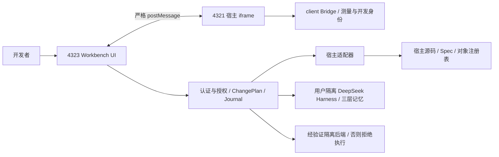
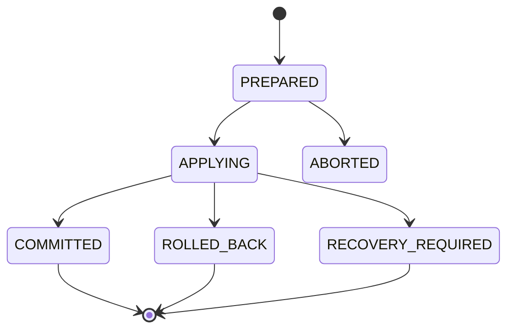

# Atelier：常驻伴生开发工作台架构与产品核心白皮书

文档版本：1.0。代码核对日期：2026-10-20。适用仓库：atelier-ivorg-workspace。本文可单独导入 NotebookLM；文中的“当前实现”“接入接口”“演进方案”是不同的完成状态，不能互相替代。

## 1. 产品定位：项目的常驻伴生工作台

Atelier 是面向前端项目的本地伴生开发环境。它把真实预览、页面与转场拓扑、空间选区、源码身份、结构化架构说明以及受授权约束的 Agent 变更流程放在同一个工作台内。其目标是让开发者从“这里是什么、为什么这样工作”持续走到“这里应该怎样改变、如何验证、如何撤销”。

浏览器 DevTools 擅长检查某个运行时节点、样式和网络请求。Atelier 进一步维护页面之间的引用关系、可复用动效的定义与调用、运行态选区对应的源码锚点、跨文件变更的审阅记录，以及每个使用者可以做什么。二者可以共存。Atelier 不替代编译器、浏览器或版本控制，也不把 Agent 的文字解释当作项目事实。

“理解项目一切”是一种产品方向，工程上的含义是：尽可能从受控文件、对象注册表、AST、版本化 Spec 和可信运行时测量构造有出处的上下文。未被支持的语法、动态生成的路由、过期的几何测量和未声明的审美意图，都必须显式暴露为未知。项目记忆不能升级为文件写入权限。

### 1.1 三种工作入口

1. 空间入口：选择现有组件或空白区域，提供位置、邻居、网格及源码版本上下文。
2. 对象入口：选择页面、组件、转场定义或某一次调用，从全站架构钻取到具体行为。
3. 文档入口：修改自然语言与结构并存的 XML Spec，查看结构差异和受约束的修改计划。

Analyze、Explain、Modify 共享同一套对象和证据，但权限不同。Analyze/Explain 不应为了“看一下”执行源码写入；Modify 必须形成受校验的 ChangePlan，经预览和授权后进入事务。

## 2. 物理边界与依赖方向

本轮已建立 npm workspaces，只有一个根 package-lock.json。根目录负责集成测试、构建编排和桌面组合发行；引擎与业务是不同的包。

```text
packages/
  atelier/
    bin/atelier.mjs
    src/workbench-core/
    src/workbench-server/
    src/workbench/
    src/dev-studio/
    src/adapters/ivorg/
  client/
    src/preview-bridge.js
    src/astro.js
    src/vite.js
    src/motion.js
    build.mjs
apps/
  ivorg-website/
    src/
    public/
    astro.config.mjs
    workbench/atelier.host.json
    workbench/motion-registry.js
    workbench/objects/ivorg.object.json
    workbench/specs/ivorg.spec.xml
scripts/
src-tauri/
docs/
```

`@atelier/workbench` 拥有服务、编译与事务内核、编辑器 UI。`@atelier/client` 是宿主接入入口，公开 Astro 集成、Vite 插件和浏览器 Bridge。`@ivorg/website` 拥有全部业务页面、正文模型、品牌样式和素材。

现有 dev-studio 的 MotionBaker、source-engine、context-capture 等属于引擎历史资产，已一并移动，避免它们通过相对路径继续依赖业务目录。IVORG 特有的 L3 规则和动效映射被放入 adapters/ivorg；旧内核入口通过兼容导出保留原测试契约。它们的存在不是“所有项目都具有 IVORG 页面”的证明。

依赖方向是宿主开发配置 → client → workbench 的公开接口。业务运行脚本不导入 workbench-core、workbench-server 或页内工具栏。根桌面工程是“引擎加官方宿主演示”的组合发行，而不是引擎必须依赖 IVORG 才能导入。

当前各包为 private workspace 包，未发布到 npm；“@atelier/client”表示本工作区内的实际包名，不是已经公开发布的产品。

## 3. In-Project Attachment：接入现有项目

### 3.1 宿主必须提供的事实

宿主描述位于项目自身的 workbench/atelier.host.json。当前字段包括 schemaVersion、profile、projectId、framework、specFile、registryFile、routes、sourceFiles，以及可选的 layoutFile、motionModule。路径全部相对宿主根目录，不相对 Monorepo 根目录。

这样，`src/pages/index.astro` 在迁移前后仍指向同一个业务文件。物理外层目录变为 apps/ivorg-website，不需要重写所有 canonical sourceRef，也不应为兼容旧绝对路径保留第二份业务源码。

配置校验拒绝父目录遍历、反斜线路径、错误的 canonical 目录以及无效路由。缺少显式描述时，只允许在规范目录中发现唯一 Spec/注册表；出现多个候选必须要求配置，不能猜一个。未注册的写入 profile 返回 HOST_WRITE_ADAPTER_UNAVAILABLE，而不是放宽路径限制。

### 3.2 Astro 接入：当前完整演练路径

宿主 astro.config.mjs 导入 `@atelier/client/astro`，在 COMPANION_P1=1 时启用。集成负责开发期源码身份、版本清单、Bridge 注入和宿主动效注册模块。普通业务构建不携带 Bridge 或开发身份标记。

从仓库根执行 `npm run dev:workbench`，集成启动控制面 4323 与真实 Astro 预览 4321。执行 `npm run dev` 则启动纯业务预览。启用编辑能力仍受 P4 认证、角色、计划审批与 CAS 限制；启动开发服务不是绕过权限的方式。

### 3.3 Vite 接入：当前只读能力

`@atelier/client/vite` 是实际的 serve-only Vite 插件，要求 loopback host。它注入文档版本、路由描述和客户端模块，提供 `/__companion/preview-state`，输出 sourceMapping=false、readOnly=true。它同时剥离预览请求中的 Cookie 与 Authorization，避免控制面凭证意外进入宿主页面中间件。

这一层使普通 Vite 项目可以接入版本化预览和浏览器测量。它没有实现 React JSX、Vue SFC 或 Svelte 的稳定 AST 反写与源码身份生成。因此不能把“插件正常启动”解释为“任何前端框架均可安全 Apply”。本轮新增测试启动了真实 Vite 服务验证该边界。

### 3.4 独立 script 与 Next.js 的边界

client 包可通过 build.mjs 生成 ESM 浏览器分发文件，供宿主受控开发资源加载。单独插入一个脚本不能凭空生成可靠源码锚点：宿主还需要版本清单端点、可信路由映射和编译器身份适配层。

Next.js 的 App Router、Server Components、动态段和流式输出需要专用适配。本轮支持框架识别与文件盘点，尚未提供 Next 编译插件、RSC 解析器或 React 写入引擎。对这些项目应保持只读，不复用 Astro AST 偏移假装兼容。

| 能力 | Astro 官方宿主 | 通用 Vite | Next.js / 其他 |
| --- | --- | --- | --- |
| 文件与框架盘点 | 已实现 | 已实现 | 已实现基础盘点 |
| Astro AST 路由/组件证据 | 已实现 | 非 Astro 文件不适用 | 不提供 React AST 转换 |
| Bridge 开发接入 | 已实现 | 已实现只读插件 | 需宿主端点与适配 |
| 稳定源码锚点与写入 | IVORG 注册策略已验证 | 禁用 | 禁用 |
| 自动迁移为 Astro | 不提供无人审阅转换 | 不提供 | 不提供 |

## 4. 双 Origin 与桌面进程架构



父窗口不读取 contentDocument。acceptBridgeMessage 校验 origin、source、epoch、nonce 及消息结构；postMessage 使用精确目标 Origin，不允许 `*`。iframe 重建时生成新会话，旧 source 或旧 epoch 的迟到帧不再有效。页面身份和消息 pathname 必须一致，不能只相信 iframe.src 已更新。

HTTP 的 `/src/workbench-core/...` 等少量旧静态资源 URL 被保留为协议入口，但文件从 packages/atelier 读取。它们不是宿主目录中的物理副本。服务端模块不通过静态资源路由公开。

Tauri 组合发行仍使用真实 HTTP 根 Origin 4323，iframe 4321，不将根 Origin 改成私有协议。便携 Node 管理器拥有两个 worker；正常退出和管理器断连都触发所属进程清理。端口已被占用时拒绝启动，不接管、不终止其他用户服务。桌面原生引导读取本地 bootstrap 凭据，通过认证后注入 HttpOnly Cookie；凭据不进入脚本或安装资源。

脱机表示本地 UI 和内核不需要外部服务器。外部模型 Provider、未本地缓存的业务字体、Docker 镜像和模型并不因此自动获得离线能力。本轮拆分验证了独立资源目录内的 Node/Astro 启停；旧版安装器不是本次拆分后的重新打包证明。

## 5. SpatialSelection：先坐标，再解释内容

选区以几何事实为首要数据，而不是必须命中 DOM 才成立。当前结构包含 selectionId、raw 矩形或多边形、viewport/document/canvas/container 坐标、normalized、变换与滚动信息、frameEpoch、sourceRevisions、objectIds、runtimeSourceIds，以及 empty/pick/box/lasso 模式。

普通采样使用 2px 量化，以减少鼠标抖动导致的无意义差异。关键写操作前重新测量，矩形各分量偏差不得超过 1px，且 epoch 与源码版本仍一致。服务还检查字体就绪和测量新鲜度；过期测量不能被 Agent 自信的描述替代。

网格推断来自 computed CSS track 尺寸与元素边界，不来自屏幕截图猜列数。方向邻居按容器与空间距离产生候选及置信度。隐式轨道、dense 重排、垂直书写、旋转/斜切矩阵和非可逆变换不应被当作普通横排 Grid 精确反解；遇到不支持条件应降级、要求重选或澄清。

空白插入分为三步：识别可承载容器；根据邻居与网格获得插入候选；生成显式 ChangePlan。坐标不直接等于 AST 中的字节偏移。候选的 sourceId、父子关系及修订必须在真实源码重新确认。若只能确定“追加到容器”，应如实预览该结果，不能宣称精确还原所有 CSS 布局意图。

## 6. 面向对象拓扑与稳定身份

核心对象含 PageObject、ComponentObject、ComponentZone、TransitionObject，以及转场的 Definition、Binding、Instance 三个层次。

| 层次 | 含义 | 身份与作用 |
| --- | --- | --- |
| TransitionDefinition | 可复用动画算法与参数模板 | 稳定 definitionRef |
| TransitionBinding | 从某页面/入口到目标页的一次调用关系 | 稳定 bindingId；可覆盖参数 |
| TransitionInstance | 某会话实际观测或烘焙的实例 | sessionId + instanceSeq，不能用随机显示标题冒充身份 |

多个绑定可以指向同一目标页面，也可以复用同一动画定义。宏观图允许把调用聚合成 Bus，以降低视觉噪音，但展开后必须保留每个实际 bindingId，不能把同端点边合并成不可区分的一条线。

导航图可以有环，例如 HOME→NEWSLETTER→HOME。继承图和包含图分别用 DFS 三色标记检查回边，遇环拒绝；不能为了通过导航环而关闭全部循环检测。参数类型、范围、引用目标和继承类型均单独校验。

当前官方宿主 canonical 图有 104 个对象，其中 3 个 PageObject、5 个 ComponentObject、4 个 TransitionObject、5 个 TransitionDefinition、16 个 TransitionBinding、2 个声明式 TransitionInstance；15 个绑定启用。启用绑定中 td.wipeCover 被复用 12 次。这些是示例项目的事实，不是引擎固定容量。4 条邻接指三页线性分页的两个方向，与完整链接集合或动画定义数不同。

## 7. MotionBaker 与无导航 Fixture

MotionBaker 把指定动画状态烘焙为可重复 seek 的帧。Fixture 使用 session 局部 mulberry32、seed 和 poster deck 游标，不修改全局 Math.random，也不使用共享的跨用户海报游标。相同 bakeKey 应得到相同 checksum 与帧读取；reroll 更换种子，不保证有限海报集合中每次抽到不同海报。

转场舞台展示起点与终点的切片、遮罩与解码，严禁为烘焙调用真实 navigate。实例观测与业务路由运行是两个边界。宏观相机的 pan、zoom、pitch、yaw 和返回焦点保留；下钻时暂停背景输入和呼吸，避免舞台操作推动背后的星图。

浏览器中的真实测量、重复 seek 和内核 checksum 是不同证据。测试有内核通过不等于当前桌面 Webview 的人工框选已完成；验收报告必须分别记录。

## 8. 防御性变更与事务

### 8.1 源码编辑

Astro 编辑通过解析后的锚点、magic-string 最小切片和 UTF-16 偏移工作。append 使用 closingElement.start；空容器不把内容塞进 opening tag；自闭合元素使用显式 expandSelfClosing。偏移变换后重新解析 AST 并 remap 身份，歧义或失绑定必须阻止 Apply。

版本号单调递增，旧计划不能因文件内容碰巧相似而获得新版本授权。ChangePlan 包含目标、前置版本、操作、差异与风险；对象锁、路径白名单和审批摘要由服务器重验，不能只依赖前端按钮 disabled。

### 8.2 Journal 状态机



单 writer 锁与进程内排队控制并发。逐文件 CAS 同时比对预期修订与真实内容，不符合时返回 409。文件系统没有承诺跨文件的原子 rename；Journal 用持久化意图、快照和已应用步骤实现可恢复事务，因此不能宣传为操作系统层面的多文件瞬时原子提交。

回滚只在文件仍等于事务写入后的预期值时进行。发现第三方编辑则进入 RECOVERY_REQUIRED，并保持只读，不能把别人的修改覆盖回去。Undo 是有自身前置条件和修订的逆事务，不是无条件恢复备份。

### 8.3 隔离预览

dry-run 在临时 before/after 快照中校验 AST、对象锚点与结构差异，不执行生产树写入。SSR 构建只能使用经过验证的容器后端，并核对锁文件摘要和运行镜像标签；Monorepo 宿主使用其所属 workspace 的根锁文件。没有后端时只能报告 static-ast、ssrExecuted=false，不能把静态校验伪称真实构建预览成功。

## 9. NL-Wireframe、Spec Diff 与双向同步

Spec 外层标签承载确定性结构：页面、区块、链接、转场定义/调用、参数、契约和源码身份；Description 内的自然语言承载设计意图。XML 先做语法/结构 L1，再做引用/图约束 L2，业务特殊契约由宿主 L3 适配器校验。

本轮保持 IVORG v1 namespace 与 canonical 文件字节一致，避免迁移目录顺手引入协议大版本。XML 和对象 JSON 中的 sourceRef 都是宿主相对路径。

结构字段修改可形成确定性 Spec Diff。Description 变更仅产生 planFromProse 请求，由 Agent 提案、AST 引擎校验；散文不会被直接执行为源码修改。源码观察结果也不能自动覆盖人类的意图描述，必须保留基线并区分观察值与计划值。

三方合并以 base、ours、theirs 为输入；冲突决策与摘要绑定，变更后需重新计算。审阅者看到 Before/After Structural Diff、受影响文件、失绑定风险及验证状态，再决定是否批准。L3 中“示例 Newsletter 文本不可丢失”等规则属于 IVORG 适配器，而非通用编辑器强制所有网站都有 Newsletter。

## 10. 多用户、Agent 与三层克制记忆

### 10.1 身份与授权

当前有 owner、editor、reviewer、viewer 角色；会话、CSRF、Origin、策略修订、对象锁和高风险再认证共同保护服务端操作。用户隔离指权限、会话与上下文作用域，不意味着已经实现 CRDT 多人实时共同编辑。文件写操作仍遵守单 writer 事务。

依据用户追加裁决，伴生 Agent 的默认基础现为官方 DeepSeek Harness，而非 Pi RPC。Atelier 通过 DeepSeekHarness TypeScript SDK 启动专用 Cordis 组合，复用其 session、system-prompt、tools registry 和 agent loop。当前兼容并实际验证 SDK 0.1.0-rc.5，本机源码版本为 47f943859bef60e4160492346772ded9b24f765a；未修改上游 checkout。

SDK 的 session/prompt 只返回入队 messageId，不是模型结果。上游 SDK 先订阅、确认 inbox receipt，再持续消费至所拥有会话的 idle；Atelier 为每次 prompt 使用独立 sessionId，并额外要求已提交的 root turn/end 为 completed。截断、blocked、缺失终止事件和 provider error 均不当成功。响应只允许经 validateAgentResult 校验的解释/分析或类型化修改提案。

专用组合只挂载 SDK server、DeepSeek provider、禁用工具的 agent spine 与 JSONL persistence。没有 shell、文件编辑器、MCP、skills、subagent 或任意用户 patch 注入。这里的无工具模型不需要在 Windows 裸跑 CodeAct；真正脚本执行仍必须经既有隔离沙箱门禁。不能直接使用上游带 danger-full-access 的 minimal coding 示例。

上游 wire 当前没有单 prompt cancel；取消和超时会关闭本任务拥有的 runtime，经 SDK 的有界退出阶梯回收进程。每用户的 runs、sessions 与 quota checkpoint 位于 .companion/agent/users/<userId>/，上下文恢复前重新核对源码事实。环境仅传递必要 OS 字段及所选 DeepSeek 凭据/端点，拒绝 NODE_OPTIONS、DSH_CORDIS_CONFIG 和无关 Provider 密钥。

运行配置保存在宿主本地 .companion/agent/runtime.json，不随包发布；配置脚本核对 SDK 版本并固定六个构建入口的摘要，检测入口变化要求重新配置。这是入口一致性检查，不是整个上游依赖闭包的安全证明。未配置时明确拒绝，不暗中回退 Pi。PiAdapter 仅作为历史兼容模块保留，其原协议测试继续运行。

本轮使用真实官方 SDK、Cordis loop、DeepSeek provider 和两个独立用户运行会话；仅将推理 HTTP 端点替换为本地 SSE 夹具，验证没有发送工具 schema、Unicode 正确及会话落盘。没有调用外部付费模型，也没有向真实业务 Apply。协议和版本依据见 [官方 SDK 文档](https://github.com/deepseek-ai/deepseek-harness/tree/master/packages/sdk/client)，具体配置与测试见 DSH_AGENT_IMPLEMENTATION.md。

### 10.2 第一层：append-only 事件

`.companion/events/event_log.jsonl` 保存序号、用户/项目作用域、事件、前项摘要和当前摘要。选区、操作、对话与 Apply/Undo 反馈形成可追踪历史。写入刷新和链校验能够发现截断及不一致；哈希链不是外部签名或不可篡改硬件，拥有整个磁盘改写权的人仍可能重建整条链。

### 10.3 第二层：类型化参数槽

`.companion/memory/slots.json` 保存受 schema 限制的字体、审美 token、动效曲线/时长、组件模式和对象锁。解析优先级为 instance > binding > definition > project > user。对象锁等硬规则不因高优先级个性偏好而解除。每次任务确定性注入，避免从几十页聊天中随机猜测偏好。

### 10.4 第三层：CodeAct 与派生检索

Agent 可为明确任务生成索引整理、检索或分析脚本，但执行必须进入可验证隔离后端。当前方案使用固定 Linux 容器身份、无网络、只读根、非 root、drop ALL、no-new-privileges、资源限额以及受限输入/输出挂载。CodeAct 默认约 256MiB、64 PID、1 CPU；SSR 预览是独立的约 512MiB/128 PID 限制。它们不是 Windows 裸 Node 的“软沙箱”。无可验证后端就 Fail-Closed，返回不可用，不退回本机 shell 执行不可信脚本。

node:sqlite + FTS5 与触发器维护可重建的检索索引。授权、锁与源码写入只认磁盘事实；索引命中不能授予访问其他用户记录的能力。输入数据、脚本、输出和审计记录应留在对应任务/用户受控目录，不能把整个宿主或用户 HOME 挂入容器。

### 10.5 务实终止边界

三层系统解决“发生过什么”“已明确的偏好是什么”“如何在权限内检索结构事实”。它不解决跨会话强猜未声明意图、不维护重型向量图数据库来营造全知感、不从记忆推导写权限。证据不足时提出具体澄清，例如目标容器、保留内容或期望布局，而不是追加更多自治循环。

## 11. 辅助旧项目迁移到 Astro Islands

本轮 CLI `atelier analyze --project <目录>` 不运行宿主脚本；忽略生成目录、依赖和符号链接。它识别框架、盘点源码，对 Astro 文件实际解析 AST，列出组件标签、元素数量和页面路由模式。动态路由模式不等同已枚举的运行时 URL。

迁移建议采用逐页 strangler 路径：先记录真实内容/路由/外链和交互依赖，再区分静态内容与必须在浏览器运行的 island；保持 URL 与阅读顺序，迁移一个页面并做 SSR/CSR 内容与行为对照；最后复用受审阅计划修改结构。不要为了使用 Astro 把所有组件都 `client:load`，也不要把框架转换简化为替换文件扩展名。

React hooks、Vue 响应式状态、Next 服务端数据与授权逻辑都需要适配规则和人工决策。当前 CLI 输出迁移步骤，不自动转换这些语法。未来应以每框架的解析器、路由证据、依赖分析和负向回归用例逐项解锁写能力，而不是扩大现有 Astro 写入白名单。

## 12. 从空白画布生成新项目的演进路线

空白画布首先需要项目级意图：受众、内容来源、页面列表、导航、交互、技术约束与视觉方向。没有这些事实，坐标只是摆放建议。建议先生成 PageObject/ComponentZone 的可审阅蓝图和自然语言 Spec，再选择最小可运行模板。

当前 Journal 面向受控的既有目标文件，不应将其描述为已具备任意 createFile/scaffold。新增文件事务需要额外的根目录能力、大小写碰撞检测、不存在前置条件、原子创建、恢复记录和删除的逆事务；模板依赖安装与构建也必须受隔离策略约束。

分阶段演进如下：第一阶段只生成不写入的对象图/Spec 与文件清单；第二阶段加入经审阅的新文件事务，在隔离目录构建；第三阶段以一个真实页面作为闭环，将内容、路由、视觉和可访问性验收后再扩展；第四阶段为不同框架实现带证据的 adapter。未批准的商业文案、图片版权、账号和外部发布不由 Agent 自动填补。

## 13. 证据、测试与边界声明

核心保持 P1 30、P2 31、P3 33、P4 32，共 126 项测试；旧内核 53 项及 MotionBaker 27 组/693 断言保持原契约。新增 workspace 测试关注真实目录边界、可改名的 canonical 路径、未知 profile 拒绝写入、真实 Vite 接入、只读 AST 盘点和 Monorepo 锁文件定位。独立桌面资源测试验证双进程身份、认证和退出释放端口。

测试入口与本轮实际结果见 WORKSPACE_SPLIT_REPORT.md。文件移动逐项对应 WORKSPACE_MIGRATION.json。历史浏览器验收报告仍引用其当时路径，不能将旧截图直接算成本轮新结构的浏览器实测。本轮没有执行真实业务 Apply、外部模型 Provider 生成或部署，也没有重新宣称此前待人工的 Alt+S 端到端操作已通过。

## 14. 代码索引

| 主题 | 当前仓库路径 |
| --- | --- |
| 对象与 Spec | packages/atelier/src/workbench-core/objects/ |
| 空间与结构修改 | packages/atelier/src/workbench-core/changes/ |
| Legacy 烘焙/定位内核 | packages/atelier/src/dev-studio/ |
| 事务与预览 | packages/atelier/src/workbench-server/journal.js、preview.js、preview-backend.js |
| 宿主发现与路径 | packages/atelier/src/workbench-server/host-config.js |
| Bridge | packages/client/src/preview-bridge.js、packages/atelier/src/workbench-core/bridge.js |
| 用户与记忆 | packages/atelier/src/workbench-server/auth.js、event-log.js、memory.js、sandbox.js（slots 同在 memory.js） |
| 默认 Agent / 配额恢复 / 历史兼容 | packages/atelier/src/workbench-server/dsh-adapter.js、agent-service.js、quota-recovery.js、pi-adapter.js |
| IVORG 专项策略 | packages/atelier/src/adapters/ivorg/ |
| UI 与相机 | packages/atelier/src/workbench/shell/ |
| 白皮书的业务配套 | docs/IVORG_WEBSITE_SPEC.md |

这份产品模型的关键是可追溯、可拒绝、可审阅、可恢复。通用化的工作应优先扩大可靠证据与适配覆盖，再扩大可执行操作的集合。
