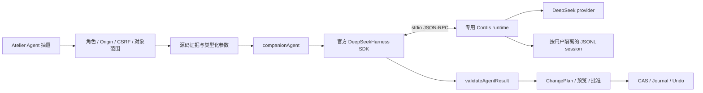

# Atelier Companion：DeepSeek Harness 基础切换

日期：2026-10-20。状态：默认运行框架已切换；真实 Harness + 本地推理端点验证通过；未调用外部付费模型。

## 架构裁决

用户要求将伴生 Agent 的基础改为 DeepSeek Harness。本次不是把 Pi 的 provider 名称换成 DeepSeek，也不是把 Harness 默认的 Web UI 嵌入 Atelier。agent-service 的默认 startClient 现为 startDsh；由官方 TypeScript SDK 启动 Harness/Cordis，Atelier 保留自己的 UI、权限总线、上下文构造、结构提案校验和 Journal。



## 上游事实与版本

核对的上游为 [deepseek-ai/deepseek-harness](https://github.com/deepseek-ai/deepseek-harness)，本机已有构建 checkout，Git revision 为 `47f943859bef60e4160492346772ded9b24f765a`，SDK package version 为 `0.1.0-rc.5`。本次只读其文档与构建资产，没有修改上游、全局 Git trust 或上游配置。

官方 [SDK client](https://github.com/deepseek-ai/deepseek-harness/tree/master/packages/sdk/client) 与 [JSON-RPC server](https://github.com/deepseek-ai/deepseek-harness/tree/master/packages/sdk/server) 的关键语义：session/prompt 返回入队 messageId；会话 notification 持续发送，idle 不是单 prompt 的模型结果；wire 没有单 prompt cancel。上游仍在 preview，升级必须重新验证，不能用未固定的 latest 替代当前接口。

## 实际组合

每个任务生成受控的 JSON 格式 Cordis 配置（JSON 是 YAML 子集），只有四个插件入口：SDK server、DeepSeek LLM、agent spine、JSONL persistence。绝对模块路径转为 file URL，解决 Windows ESM 对盘符路径的限制。

spine 明确禁用 workspaceContext、runtime-context 注入、skills、bash、jobs 与 goals。不挂载文件编辑器、shell executor、subagent、MCP、任意宿主 patch 或默认 Web bundle。实际请求验证 tools 数量为零。上游带 danger-full-access 的 coding 示例没有直接用作产品配置。

模型只能读取 Atelier 提供的证据，并返回 analyze/explain 或类型化 modify 提案。真正的修改仍由已有 validateAgentResult 核对 evidence、file、anchor、expectedRevision，后续经审批和事务。CodeAct 不借此次框架切换获得裸本地执行通道，原 Fail-Closed 沙箱约束继续有效。

## 生命周期、失败与隔离

- 每次 prompt 使用新的 SDK sessionId，明确拥有从入队到 idle 的活动区间；另外要求 root turn/end 为 completed。max-tokens、blocked、缺少完成事件和空回答均拒绝为成功。
- 单用户任务不重叠；不同用户拥有独立 runs、sessions、checkpoint。用户 ID 不能包含路径字符，目录链中的符号链接被拒绝。
- 取消和超时调用 SDK close，关闭本任务拥有的 runtime，而不是发送不存在的 prompt-cancel RPC。SDK 负责有界 shutdown/EOF/TERM/KILL 退出阶梯。
- adapter 限制单 notification 大小、总计 8MiB 与 50,000 条通知，超限终止 producer；这不是对上游全部内存分配的形式证明。
- 环境采用白名单，仅传必要 OS 字段及 DEEPSEEK_API_KEY / DEEPSEEK_BASE_URL；禁止 NODE_OPTIONS、DSH_CORDIS_CONFIG、无关模型密钥与启动钩子。
- provider 内部 maxRetries=0，将额度反馈交给 Atelier 的持久化恢复层，避免两套等待策略叠加。429 保留 provider Retry-After；用户局部 checkpoint 先写入，再探测，恢复前重新核对 Git/源码事实。
- 未配置 Harness、版本不匹配或入口摘要变化时明确拒绝，不偷偷切回 Pi。入口摘要不是整个依赖闭包的安全证明；配置的 checkout 本身必须可信。

目录结构：

```text
宿主/.companion/agent/
  runtime.json
  users/
    alice/
      runs/<任务UUID>/cordis.yml
      sessions/
      checkpoint.json
    bob/
      runs/
      sessions/
      checkpoint.json
```

## 配置与运行

从本工作区根目录执行：

```powershell
$env:DSH_HARNESS_PATH = "<已构建的 deepseek-harness checkout 绝对路径>"
npm run agent:configure
npm run test:agent
npm run test:dsh:runtime
npm run dev:workbench
```

DSH_HARNESS_PATH（或 --harness 参数）指向本机已构建的上游根；两者都缺失时脚本以 DSH_ROOT_REQUIRED 退出。可用 --project 指向其他宿主，--model 指定模型。配置存入目标宿主的 .companion/agent/runtime.json，已被忽略，不提交绝对机器路径或凭据。本机官方宿主配置已生成。

实际 Provider 使用环境变量 DEEPSEEK_API_KEY；可选 DEEPSEEK_BASE_URL、COMPANION_DSH_MODEL、COMPANION_DSH_MAX_TOKENS。COMPANION_DSH_ROOT 是显式的运维覆盖方式；不设置时使用配置文件。默认 output cap 8192，可配置范围 256–49152；这是单次输出上限，不是整段会话的总账单上限。

配置/测试不自动读取别的项目 .env，不复制其他应用的密钥，不安装或改写上游 checkout。现有独立桌面安装器没有内置该 checkout；桌面运行环境需要单独配置可信 Harness 与模型凭据。没有这些依赖时本地 UI 仍可用，Agent 明确不可用，不伪称端到端离线推理。

## 实测证据

`scripts/dsh-adapter.test.mjs`：13/13 PASS，覆盖环境、禁用工具组合、Unicode、非完成 turn 拒绝、quota、取消、deadline、并发限制、通知限额、目录隔离、缺失配置不回退及提案只读验证。

`scripts/dsh-runtime-smoke.mjs`：实际启动官方 SDK、官方 Cordis runtime、官方 DeepSeek provider 与持久化插件；只将模型 HTTP 换成本地 SSE 测试服务器。两个独立用户完成调用，另测 429 与在途取消，总计 4 个本地请求，tools=0，Unicode 与落盘通过。它没有使用假 Pi 协议冒充 DSH，也没有消耗真实模型额度。

原 PiAdapter 的 10 项测试保留为兼容回归；agent-service 默认路径不再导入 Pi。公共 quota-recovery 提取后由 DSH 与历史 Pi 模块共同使用。本轮同时要求既有 126 + 53 + 27/693 门禁保持全绿，结果归档见 verification/workspace-split/。

新增/修改入口：packages/atelier/src/workbench-server/dsh-adapter.js、quota-recovery.js、agent-service.js、pi-adapter.js；scripts/configure-dsh.mjs、dsh-adapter.test.mjs、dsh-runtime-smoke.mjs；Agent 抽屉只改运行框架标识与取消文案，没有重新调整已封存美术。

仍未宣称：外部模型质量验收、真实业务 Apply/Undo、新版桌面安装器重新打包、跨用户协作编辑、无容器的 CodeAct 执行。后续真实模型验收应先做 Analyze/Explain，再在可丢弃宿主中验证 Modify；不能拿真实社团页面作为未经审阅的试写目标。
