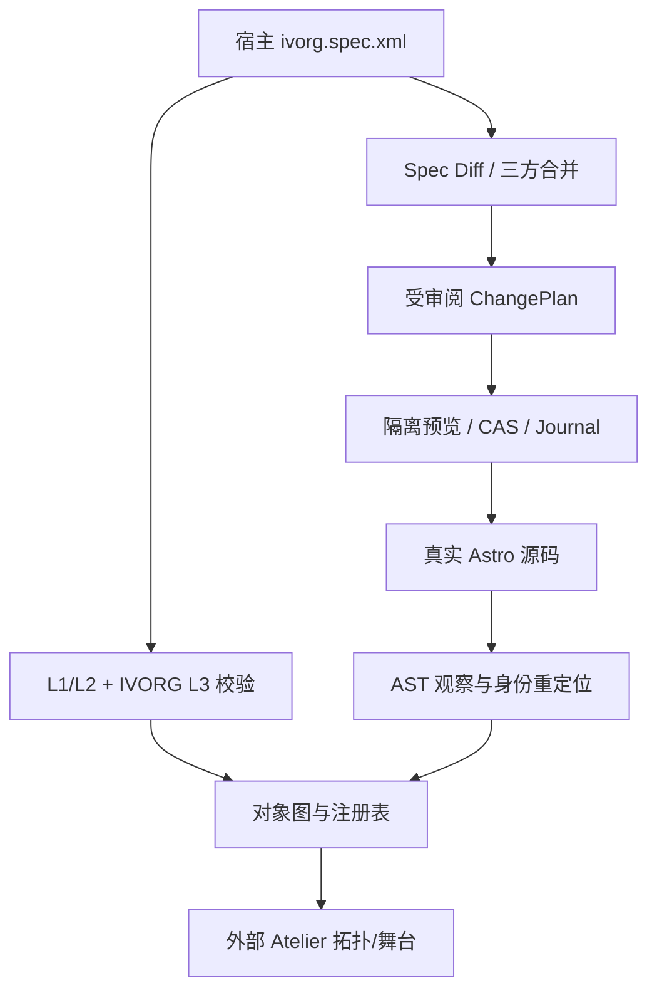

# IVORG Display Website：展品、品牌与官方沙箱业务白皮书

版本：1.0。核对日期：2026-10-20。宿主包：@ivorg/website。宿主根目录：apps/ivorg-website。本文面向独立的业务知识库，不要求读者先了解 Atelier 内核。内容状态分为“真实数据”“示例内容”“当前实现”“后续设计”，不得将后两者混写为已经上线的功能。

## 1. 品牌定位与内容原则

IVORG 的展开名称为 Illinois Vocaloid Research Group。当前品牌数据标示 UIUC，社交标识为 illinois_vocaloid。网站服务于 Vocaloid/虚拟歌声创作、音乐企划与社团交流，以主打唱片、活动和通讯组织内容。名称及归属是仓库内提供的品牌事实，不代替外部机构的独立认证或法律授权。

网站的视觉宣言为“SYNTHESIZE THE UNHEARD”。它把音乐制作中的合成、层叠与解码，转译为大字构成、精密坐标、唱片目录和具有节奏的页面切换。官网应首先帮助访客理解社团与作品，其次提供风格体验。编辑器的星图、准星、权限面板和诊断信息不属于对公众展示的品牌内容。

### 1.1 内容来源与可信度

真实唱片和活动数据由社团提供的封面、封底、歌词/署名装帧及海报转录。当前数据入口是 src/lib/release.js；字段来源记录保存在仓库 docs/resources/content-draft.json。原始大型 resources 不进入发布包，也不应因文档提及而自动提交。

未知值保持缺省。当前没有音频文件、BPM、逐曲制作人、声音合成引擎及中文专辑名的可靠来源，不得用模型猜测填满表格。封底的印刷日期也不能在未获确认前直接写成官方发行日。

Newsletter 目前是明确标示的 illustrative demo，而不是真实出版历史。搜索引擎元数据、界面说明和后续文案不能把示例日期包装成社团已经举行或发布的事实。

## 2. 视觉系统与设计规范

整体采用构成主义与近未来先锋平面语言：极粗巨大标题、强烈疏密对照、有限高亮色、细线网格、坐标标注、唱片编号及瑞士式数据表。主画面应具有明确的内容层级，微型技术排版不能压过标题、作品和可操作链接。

公共字体配置使用 Syne、Oswald、Inter、Noto Sans SC 与 JetBrains Mono 的组合；当前部分字体来自 Google Fonts，离线时使用回退字体。不能宣称所有字体均已本地打包。中英文标题、正文与元数据分别承担情绪、阅读和定位功能。

品牌主题由公共外壳样式与各页样式共同实现。src/styles/shell.css 是用户已有的视觉资产，本轮拆分保持其内容哈希不变。Atelier 控制台的浅色实验室、黄铜刻度和星尘属于开发环境美术，不能反向覆盖官网主题。

### 2.1 动态设计纪律

动效承担入场、聚焦和路由反馈，不能让访客必须等待复杂动画才能阅读。页面退出和 Astro swap 时必须取消旧动画、移除监听、停止 RAF；重复访问不应叠加处理器。减少动态偏好与站点动效开关应获得尊重。

海报视差使用阻尼而非直接复制鼠标偏移；滚轮在正文可继续滚动时优先交给内容。只有达到页面边缘且满足阈值时才触发分页。修饰键、表单输入和已有交互目标应保留浏览器习惯。

## 3. 三页信息架构

| 编号 | 路由 | 稳定页面对象 | 当前职责 |
| --- | --- | --- | --- |
| 01 // HOME | / | page.home | 品牌宣言、主打唱片与活动聚焦、入口导航 |
| 02 // DISCOGRAPHY | /discography/ | page.discography | 真实唱片、7 首曲目与署名、封底信息 |
| 03 // NEWSLETTER | /newsletter/ | page.newsletter | 三期示例索引、双栏阅读、主题切换 |

项目使用 Astro 7.3.8，静态输出与 trailingSlash=always。Astro ClientRouter 负责增强切换，不以手写单页路由替换真实页面。构建产物包含三条可独立请求的静态页面。

公共 SiteLayout 提供导航、页码、时钟、字带、网格检查、动效开关、噪点和 PageWipe 容器。src/scripts/app.js 负责 Astro 生命周期的挂载/清理，home.js 和 newsletter.js 承担各页交互。

## 4. 01 // HOME：极简宣言与真实企划聚焦

首页以“SYNTHESIZE / THE / UNHEARD.”的大字排版建立第一视觉重心，并用真实唱片封面、曲目表及活动海报形成第二层内容。它不是将通用假图片、随机专辑或无出处日期拼成的展示模板。

主打企划是 IVORG Index Zero。首页海报卡片采用前后层叠与鼠标视差；阻尼收敛让用户感到在观察一件物理展品。pointerleave 恢复目标状态，聚焦过的卡片可保持合理前后顺序。控制器在页面生命周期内拥有状态，退出时清理，不能在下次路由进入时继续复用失效 DOM。

页面角标与坐标读数提供精密测绘的语气，但不应暗示真实的空间定位或传感器能力。进入 Discography 的标题按钮、主打海报与导航是不同入口，它们可以复用同一转场定义；它们在对象层仍保留各自调用身份。

HOME 的验收重点是宣言可读、真实封面可辨、访客知道去哪里看作品、层叠交互无卡死、键盘链接可达，以及减少动态下仍能获得完整信息。不能仅以“动效看起来很复杂”作为验收。

## 5. 02 // DISCOGRAPHY：瑞士曲目矩阵与实体唱片展陈

### 5.1 当前真实唱片

当前仅有一张已提供数据的唱片：IVORG Index Zero，图形标题 IVORG INDEX[0]，目录号 IVORG-0001，格式 CD / STEREO，装帧标示 Made in China。封底印刷 26.08.24，数据中 dateISO 为 2026-08-24，但 dateConfirmed=false，因此应称“印刷日期”，不称已确认发行日。

| 序号 | 曲名 | 时长 |
| --- | --- | --- |
| 01 | Mirror of Traces | 2:31 |
| 02 | ra1n.drops | 3:28 |
| 03 | The Zeroth Reunion | 4:48 |
| 04 | Gnostalgic | 3:47 |
| 05 | Minty Bloody Tears | 3:09 |
| 06 | Moonlight | 4:57 |
| 07 | New Journey! | 3:16 |

曲目对象保留封套上的原拼写与演唱署名，包括 ra1n.drops 中的数字 1；不为显示统一擅自修改艺术家印刷名。总时长由 seconds 求和，不在多个页面维护独立手写总计。

专辑级音乐署名为 Antistar、Koeri、MySxan、Vantasy；母带署名 Vantasy、Antistar；美术与设计 MySxan。Voice 署名与逐曲 vocals 来自各自装帧位置，不应为了看起来整齐而合并成同一种“音源引擎”字段。

### 5.2 版式与交互现状

页面使用真实封面、SVG 唱片线稿、黄色高亮与精密表格组织作品。瑞士式曲目表强调编号、曲名、时长和演唱信息的稳定对齐。塞壬唱片/绝区零式信息密度是视觉参考，不代表本站复制其品牌、数据接口或音频系统。

目前创作者署名主要为文本排版，并非已经实现可交互创作者胶囊。唱片轮廓是展示元素，不是播放按钮。当前没有专辑页播放器、AudioContext、音频预览或全局音频条；页面明确说明音频尚未提供、实体 CD 目前无线上音源。

### 5.3 创作者胶囊与音频系统的后续规范

用户提出的创作者胶囊、Web Audio 合成器预览和全局音频条属于后续业务功能，应在得到真实素材与范围批准后实施。

创作者胶囊应来自真实 credits，包含显示名、角色及获授权的外链；没有逐曲制作人来源就只在专辑级展示。胶囊不能暗示每位署名参与每一首曲目。

若增加合成器演示，必须标注“合成音色演示”，不能把振荡器声音包装成原曲试听。真实唱片试听需要授权音源、来源说明与可播放 URL。浏览器音频须由用户手势解锁，采用统一音频状态和单一活动播放器，避免 Astro 路由后多个声音叠加。全局条应提供暂停、当前曲目、时间与可访问标签，切页是否继续播放须作为显式产品决策。

未有音源时保持当前“无播放器”状态，比生成一个永远无法播放的控件更诚实。未来验收包括 autoplay 限制、暂停/恢复、音量、路由清理、媒体失败与键盘操作；这些测试不在本轮拆分的已通过声明中。

## 6. 03 // NEWSLETTER：印刷社论风归档与一致正文模型

### 6.1 内容与版面

Newsletter 采用期刊索引加正文的双栏结构，细线与大字标题形成瑞士印刷社论感。读者从左侧期号/标题/日期定位文章，在右侧阅读 deck、引文、章节和可选技术表格。窄屏布局应保持内容顺序，不因双栏概念强制水平挤压。

当前示例期号为 04、03、02，日期分别为 2026.10.12、2026.09.06、2026.06.21，涉及秋季 synth workshop、放映与专辑活动、多人写作等示例主题。它们明确标记 DEMO ISSUES / ILLUSTRATIVE CONTENT，不是经社团确认的出版档案。正式上线真实期刊时，应逐项替换示例并保留内容来源。

### 6.2 SSR 与 CSR 的 parity 契约

“奇偶校验”在此应理解为渲染一致性 parity，而不是按奇数/偶数期号使用不同正文。src/lib/reader-contract.js 是单一正文结构定义：readerTree 产生带 text/element 节点的类型化树。首次 SSR 由 ReaderNodes.astro 渲染；切换期刊时 CSR 的 buildReader/renderTree 以相同树建立 DOM。

段落允许纯文本，或显式的 text/link segments。文本保持文本节点，不把自然语言解析成 HTML。链接仅允许受校验的站内路径或锚点，拒绝 javascript: 和协议相对地址。SSR 与 CSR 都不以 innerHTML 或 set:html 执行内容。

共享树包含 reader-kicker、h2、deck、blockquote、章节编号、段落、可选 technical-table 和 NEXT footer。技术表格固定 PARAMETER / SETTING / INTENT 三列；NEXT 按当前期刊数组循环。初始 SSR 展示第一项，客户端切换不能改变同一期文章的文本、链接或阅读顺序。

现有 parity 测试实际构建 Astro 页面，将三期 SSR 与 CSR 的文本节点及 href 序列做对照。仅比较整段 textContent 不足以发现链接被合并、标点错位或段落结构漂移；共享树与对照证据共同保护内容契约。

### 6.3 阅读交互

期刊按钮维护 aria-pressed 与 aria-controls，正文标题有稳定目标，NEXT 按钮提供含下一期名称的标签。纸张/暗夜模式改变阅读材质，不改写正文。切页清理处理器，防止每次 Astro swap 多触发一次阅读器切换。

## 7. 宿主动效注册表：业务拥有算法，工作台拥有观测

src/scripts/motion.js 拥有实际业务动效，src/scripts/home.js 拥有首页阻尼/视差控制器。业务模块不为编辑器引入内核文件。home.js 公开业务控制器访问接口，app.js 只处理业务输入锁事件；这使业务可单独运行。

仅在开发接入时，workbench/motion-registry.js 导入这些业务能力，通过 `@atelier/client/motion` 注册给引擎。历史 dev-studio 录制事件到业务输入锁的映射也在这个宿主适配模块内，而不是散落在每个页面。离开页面或 HMR 时清理适配订阅。

### 7.1 定义与调用的真实关系

当前启用调用的定义分布为：td.wipeCover 12 次，td.wipeUncover 1 次，td.decodeHeadline 1 次，td.entranceHome 1 次。td.readerReplace 有定义，但其对应 Newsletter NEXT 绑定 disabled，因为阅读器替换是同路由内部更新，不应自动伪造跨页转场。

这些定义把遮罩、解码和入场与入口路径分离。HOME 到 DISCOGRAPHY 的 CTA、海报、导航和分页可以复用算法，同时保留不同 bindingId。Bus 只是工作台的呈现聚合，不改变业务链接，也不把所有入口都改成一种不可辨识的事件。

导航关系允许有环。线性分页邻接为 HOME↔DISCOGRAPHY↔NEWSLETTER，共四条有向邻接；导航链接还允许 HOME 与 NEWSLETTER 直接互达。不能用“只有四条邻接”断言整个网站只有四个超链接。

### 7.2 分页保护

当前页面切换逻辑包含滚轮累计、空闲重置、进入后的短暂解锁、边缘检测和触摸阈值，避免正文中的普通滚动变成跳页。已实现的参数包括 wheel step 300、idle 520ms、arm delay 700ms、swipe 110、edge 96；它们是当前行为记录，不是通用工作台强制所有宿主采用的标准。

## 8. 作为 Atelier 官方沙箱的契约

宿主 canonical 文件为 workbench/specs/ivorg.spec.xml 与 workbench/objects/ivorg.object.json。它们随宿主版本控制，而非存放在通用引擎包内。workbench/atelier.host.json 指明它们的位置、路由映射、受观察源码与动效模块。

Spec namespace 仍是 urn:ivorg:companion:spec，保持 v1 兼容；本轮目录拆分不顺便改 XML 协议或对象 ID。Spec 与注册表中 src/... 均相对 apps/ivorg-website，原有锚点不因外层 Monorepo 路径变化而重命名。

Spec 修改不意味着自动无条件重写业务页面。结构字段形成候选操作；Description 散文只触发 planFromProse。任何变更仍须经过 AST 校验、对象锁、审批摘要、当前版本比对和事务。遇到源码与 Spec 同时变化时做三方合并，冲突不能用“以最新聊天为准”静默覆盖。

IVORG 的特定硬规则位于引擎 adapters/ivorg：包括 Newsletter 渲染约束、保护结构和业务动效映射。它们是首发沙箱的策略，不是把 IVORG 源文件复制进每个未来用户项目的模板。

### 8.1 PreviewBridge 的安全边界

控制面在 127.0.0.1:4323，宿主预览在 127.0.0.1:4321。工作台通过严格 postMessage 得到选区与测量，校验 origin/source/epoch/nonce；不读取 iframe.contentDocument，不用通配符目标。生产构建没有 data-ds-id、data-cw-id、控制面脚本或开发 RPC 残留。

预览所见不自动获得写权限。正式验收不点击 Apply 时，读页面、时间轴、Spec 与对象解释都不应写入业务。后台授权与事务依然是最终门禁。

## 9. 目录、构建与部署职责

宿主 src/pages、components、layouts、styles、lib、scripts 和 public 已实际移动至 apps/ivorg-website。旧原型目录归档于 legacy，不作为当前页面实现。根目录 scripts 维护集成测试、素材处理与构建编排；resources 保留原始大素材，docs 保留出处与历史验收。

从 Monorepo 根执行 npm ci 安装一次；npm run dev 启动纯业务，npm run build 生成 apps/ivorg-website/dist，npm run preview 查看静态构建。npm run dev:workbench 同时启动编辑器和带 Bridge 的开发预览。两种模式不能同时抢占同一端口；已占用时应先确认所属进程，不强杀其他服务。

部署对象是宿主 dist 静态文件，不是整个 Monorepo，也不是 packages/atelier。安装器是本地开发工具发行物，与面向公众的官网发布不同。当前没有在本轮执行远程部署、Git 推送或业务内容发布。

## 10. 后续业务路线与验收标准

第一优先级是把示例 Newsletter 替换为经确认内容，核对唱片日期及缺失元数据，保留来源。第二优先级是增强作品和创作者的可读结构，在有足够数据时再增加多专辑矩阵与胶囊。第三优先级才是音频：取得许可、提供真实文件、确定跨页播放策略，再实现统一播放器和可访问控制。

未来任何业务增量都应同时检查三条线：公众能否理解且正常阅读；SSR/CSR 与无 JavaScript 路径是否仍保留完整内容；Atelier 的对象注册表、Spec 与源码身份是否仍对应。不能为满足沙箱演示而牺牲正常业务站点。

本轮验收覆盖既有 126 项 Workbench、53 项旧内核、27 组/693 MotionBaker 断言及生产残留门禁；另有 workspace 和前端集成测试。它没有新增真实音源，也没有执行外部模型或业务 Apply。详细移动与测试记录见 WORKSPACE_SPLIT_REPORT.md 和 WORKSPACE_MIGRATION.json。

## 11. 业务源码索引

| 内容 | 当前仓库路径 |
| --- | --- |
| 首页 | apps/ivorg-website/src/pages/index.astro |
| 唱片页 | apps/ivorg-website/src/pages/discography.astro |
| 通讯页 | apps/ivorg-website/src/pages/newsletter.astro |
| 公共外壳 | apps/ivorg-website/src/layouts/SiteLayout.astro |
| 真实品牌/唱片/活动 | apps/ivorg-website/src/lib/release.js |
| 示例期刊 | apps/ivorg-website/src/lib/data.js |
| 共享阅读树 | apps/ivorg-website/src/lib/reader-contract.js |
| SSR 节点渲染 | apps/ivorg-website/src/components/ReaderNodes.astro |
| 生命周期/动效 | apps/ivorg-website/src/scripts/app.js、motion.js、home.js、newsletter.js |
| 图片 | apps/ivorg-website/public/artwork/ |
| 宿主适配与双向契约 | apps/ivorg-website/workbench/ |
| 内容来源 | docs/resources/content-draft.json |

IVORG 的核心价值是作品与社团自身。Atelier 为它提供更安全的修改与观察方式；两者分仓式的责任边界，使官网能够独立演进，也让工作台有机会成为真正可接入其他项目的通用工具。
