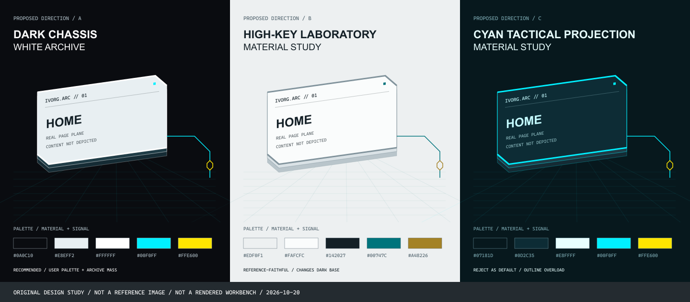
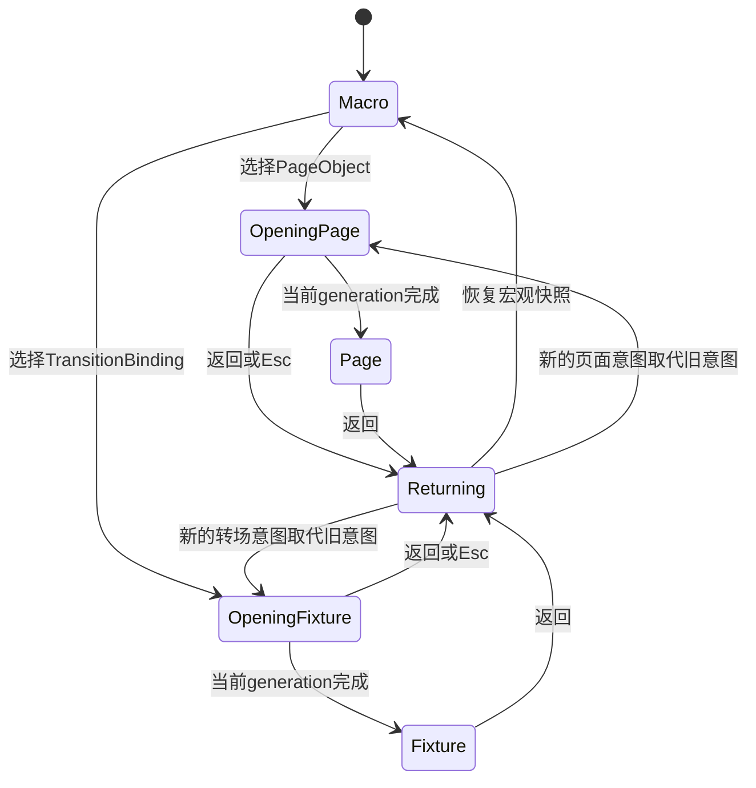
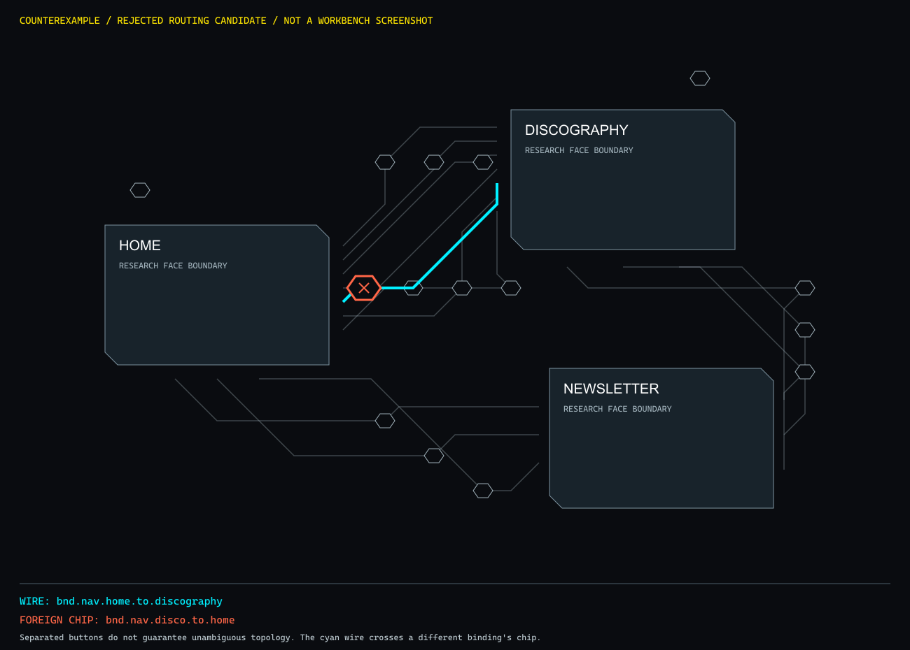

# RhineLabUI 对标研究与 Workbench 视觉转译

状态：研究完成，带图实施策划案待用户批准。2026-10-20。新界面尚未实施。

本轮只研究、制作参考材料与策划，不修改 `src/workbench/shell/`、core/server、业务源码及用户 `src/styles/shell.css`。此前明亮观测仪报告属于历史版本，不能代替本轮审美验收。

## 1. 研究问题与证据规则

目标不是把圆形换成多边形后再次宣布“科技感完成”，而是回答：三页与十五个绑定，如何获得可辨识的实体层次、稳定的空间关系和可操作的档案台体验？

证据分四类：作者项目原图、官方当前网页实测、第三方转引的作品画面、我们自己的设计提案。四类分别标注；概念图不能冒充官方截图，源码有某个参数也不能证明肉眼效果已经成立。

研究窗口起点为2026-10-20 09:13 America/Chicago，目标在约11:15整合。记录实际工作与取证时间，不将调度间隔计为连续编码时长。

## 2. 已核实的原图

### R1：档案阵列——借鉴实体秩序与空间密度

[作者仓库](https://github.com/LBEILC/RhineLabUI)；[截图采集说明](https://github.com/LBEILC/RhineLabUI/blob/main/docs/media/README.md)。作者说明这组1600×900截图采于2026-09-09；它是参考图，不是本轮最新运行截图。

直接观察：同构档案的薄边、接触阴影与遮挡构成纵深；画面的大块明度很安静；界面文字不附着在每一个斜面上。最值得借鉴的是统一投影和清晰选中层级，而不是把所有装饰细节堆到三个节点上。

转译约束：我们的数据只有三个页面，不复制无限档案墙；保留三件有身份的档案实体，将“重复秩序”用在底层格栅、端口和索引，而不是凭空制造页面。

### R2：档案抽取——借鉴从空间到阅读的切换

直接观察：实体模型与阅读区分工清楚，正文保持正面、稳定的二维排版。档案内部确有明显圆环，这与“所有元素都必须直线”并非同一命题。

转译约束：删除我们现有的圆形页面外轮廓；不把参考模型的环形零件误读为页面节点形状。进入编辑时让真实网页回到正面大视窗，不能让用户在倾斜的网页上编辑。

### R3：拆解视图——借鉴结构层次，不复制零件

转译方向：背板、信息面、可选轮廓三层足够表达页面档案厚度；不引入无实际功能的螺钉阵列、光学环与仪器零件。避免以模型复杂度代替产品信息层次。

### R4：终末地官网——当前实证与概念设想分开

[当前官方网页](https://endfield.gryphline.com/en-us)已在浏览器只读访问。2026-10-20首屏实际为版本主题人物宣传构图，采用明亮画面、较粗标题、侧栏导航和小型技术标注，不能把它描述为当前正在运行的“三张悬浮卡片＋无限网格”。本轮截图先保存在 `.companion/rhine-research/endfield-official-20261020.jpg`。

适合转译的是大字与小字的反差、导航的边缘组织、明暗留白；不复制人物宣传页的主体面积，也不把品牌KV当编辑器背景。

### R5：MAGI——作为几何与状态语法的辅助参考

[转引文章](https://note.com/akih/n/nf2653fde5f63)。这张是MAGI画面参考，不标为WILLE原图，也不标为官方网页截图。借鉴三节点关系、连线端口和状态文字；拒绝满屏警告色与持续闪烁。

## 3. 必须纠正的参考误读

1. 作者DESIGN.md的基准是暖灰白、黑字与杏金，不是统一的青蓝霓虹。本轮的#0A0C10、#00F0FF与#FFE600来自用户明确指定的转译配色。
2. 右上/左下斜切、六边形网纹和大面积青色，不能一概归为原仓库已有特征。它们必须分别证明对我们的实体识别、状态或层次有帮助。
3. 搜索尚未核实“翠玉梦境”对应的独立官方概念站；不把名字相近的活动、同人站或游戏截图写成该官方专题页。
4. 检索到的《孤星》活动菜单包含宇宙圆环，反而接近本次明确排除的方向；只作反例，不作主构图依据。
5. “近未来”不能由粒子数、发光强度、HUD字符数量衡量。三者都会与页面内容争夺注意力。

## 4. 源码证据：空间真实不等于材质真实

作者仓库文本已固定到commit `12cc5e4013acb9408f753ff71de6b8492299b7c8`，只读文本快照及清单位于 `.companion/rhine-research/`。

|问题|已核实事实|对本项目的影响|
|---|---|---|
|为什么原项目有实体感|Three.js实体、光照、地面、透射材质共同参与；并非CSS边框|不能承诺仅加rotateX就得到同等物理材质|
|原项目如何处理拖拽|archive-drag.ts反演投影方向，避免将屏幕位移误当世界位移|共享坐标与输入变换必须纳入方案|
|如何保持平稳|motion.ts使用保留速度的阻尼，ui-transitions.ts处理打断与反向|不应重启一串固定tween或排队动画|
|CSS3DRenderer限制|官方文档明确无Three材质/几何系统，且只支持100%浏览器与显示缩放|不能把它当成无代价的WebGL替代品|
|裁切与3D的冲突|CSS规范中的clip-path、filter、opacity等分组属性可能使preserve-3d子树扁平化|斜切裁切应在叶子面，不放在整个空间根节点|
|网页能否直接变WebGL纹理|drawImage接受的图像源不包含普通iframe；HTMLTexture也不等于跨Origin截图通道|保持真实缩略网页时，必须明确DOM与3D的分工，不读取contentDocument|

技术来源：[原项目scene.ts](https://github.com/LBEILC/RhineLabUI/blob/main/src/scene.ts)、[archive-drag.ts](https://github.com/LBEILC/RhineLabUI/blob/main/src/archive-drag.ts)、[motion.ts](https://github.com/LBEILC/RhineLabUI/blob/main/src/motion.ts)、[Three CSS3DRenderer](https://threejs.org/docs/pages/CSS3DRenderer.html)、[MDN transform-style](https://developer.mozilla.org/en-US/docs/Web/CSS/Reference/Properties/transform-style)、[MDN drawImage](https://developer.mozilla.org/en-US/docs/Web/API/CanvasRenderingContext2D/drawImage)。这些是工程边界，具体推荐待比较后定稿。

已另行进入[作者公开演示](https://rhine.lubeiluchen.cc/)，实际看到档案抽取后的模型与正文双区，点击返回后档案入口重新可见。当前运行截图为`.companion/rhine-research/rhine-live-detail.jpg`；不能以截图本身替代完整动画帧时或所有交互的验收。

## 5. 当前仓库的真实数据与旧验收盲点

从现有XML对象图只读统计：三页、十五个绑定。其中HOME→DISCOGRAPHY为5条：三个内容入口、一个导航入口、一个滚轮翻页入口。其余为HOME→NEWSLETTER 2、DISCOGRAPHY→HOME 2、DISCOGRAPHY→NEWSLETTER 2、NEWSLETTER→HOME 1、NEWSLETTER→DISCOGRAPHY 1，以及HOME和DISCOGRAPHY各1个pageLoad原地绑定。

因此不能把十五个绑定误合并成三条没有身份的连线；两个pageLoad也不能画成错误的页面跳转。它们可转译为档案上方的独立初始化接口。

自我批判：上一版binding-interactions.json检查了进入transition、起终点标题、帧数、preview.src和返回相机，却没有保存实际选中bindingId。五个同向入口标题相同，这份记录不足以排除“点到了同端点的其他入口”。新门禁必须核对预期与实际bindingId，不能把旧记录直接当作身份命中证明。

上一版前端测试还把“镜片层存在”“Fresnel参数存在”当成了视觉证据；这些只能证明实现存在，无法证明审美成立。新阶段须将接口回归、点击正确性和人工美术验收分开记录。

## 6. 研究完成索引

已完成下文§7投影/缩略图反证、§8四条渲染路线比较、§9真实绑定与路由研究、§10三种材质方向、§11交互与性能门禁、§12反方角色自审。自审由主Agent执行，不冒称独立第三方审计。

最终交付：[带参考图的策划案](WORKBENCH_RHINE_PLAN.md)、[证据分级与复算说明](verification/rhine-research/README.md)、[固定来源与哈希清单](verification/rhine-research/reference-sources.json)。研究阶段没有改写运行中的4323界面；未来产品验证仍需批准后执行。

## 7. 第一轮几何反证

`.companion/rhine-research/projection-study.mjs`只读现有对象图与布局，输出可复算的几何估计，不运行浏览器，也不计入126项产品回归。

|估计项|结果|设计含义|
|---|---|---|
|旧信标最小屏幕中心距：1280×800|16.68px|若使用32px命中面，会明显重叠；仅做世界坐标距离断言不够|
|1440×900 / 1920×1080|19.39px / 23.83px|大屏同样不能默认认为所有入口彼此独立可点|
|320×200矩形面积 / 直径180圆形面积|约2.52倍，尚未扣除切角与标牌|斜切窗能增加有效画面，但不等于正文可读|
|1280宽网页缩到320宽|16px正文只剩4px，80px标题约20px|缩略图负责页面识别；正文必须进入真实大视窗阅读|
|320×200预留40px标牌后的等比contain|页面可见区约256×160|必须在完整取景、裁切、标牌占用间明确选择，不能同时声称都满幅|
|一阶阻尼tau=180ms|约539ms到95%、829ms到99%|“180ms阻尼”不是180ms结束；鼠标跟随应单独调校|

估计采用固定1300×760研究坐标、中心(650,380)、perspective=1200和Rx·Ry投影。8°/-5°时三个等大面板的包围盒宽度最大/最小约1.12；18°/-14°约1.35；32°/-25°约1.65。大角度会让同等级页面显著失衡，不是越斜越有高级感。以上不包含宿主缩放、CSS布局边缘和浏览器合成误差，实施后仍需实际截图与命中验证。

## 8. 第二轮：渲染路线比较与有条件裁决

### 8.1 硬约束优先级

首先保证真实4321预览、15个稳定绑定身份、键盘/鼠标可达以及独立Bridge边界，再讨论透射和折射。宏观场景允许透视，进入页面编辑后必须回到正面二维舞台。不能为了WebGL材质，改成三张通用截图或伪造网页排版。

当前服务用固定资源映射并保持script-src self、frame-src仅4321。引入新前端依赖仍需同源打包与既有资产入口接入；“随便从CDN引入Three.js”既不是当前可运行方案，也不符合保持服务契约的范围。

### 8.2 四条路线，不混淆两个“3D”概念

|路线|空间投影/厚度|真实iframe|材料与遮挡|主要成本|本轮判断|
|---|---|---|---|---|---|
|原生DOM/CSS 3D，分层斜切面＋3D线段|可建立共享三维坐标与有厚度的层，不只是2D位移|保留脚本禁用、inert的实际页面|表面反射为近似；裁切和3D扁平化须规避|3D端口/线段姿态、投影后命中与缩放验证|优先做可证伪的小样，暂定首选|
|Three.js纯WebGL场景|实体、透视、光照最统一|普通跨Origin iframe不能直接成为实时网页纹理|真实PBR可用，但网页内容进入纹理有硬障碍|截图/代理/实验API将改变约束或不满足浏览器能力|在保持真实网页要求下不作为首选|
|WebGL实体/总线＋DOM网页合成|可同时保留3D外壳和网页|可以保留|DOM和WebGL不自动共享深度；透明层排序、遮挡和点击需自管|同一相机双投影、遮挡策略、资源与context生命周期|若原生小样达不到实体感，再作为明确升级路线|
|Three CSS3DRenderer|DOM三维投影，非Three材质|可以保留|没有Three几何/材质能力|官方说明只支持100%浏览器和显示缩放|不因名字含Three就默认更正确；当前不选|

这里“原生CSS 3D”的真实之处是透视坐标、相对深度和投影；它不是物理玻璃路径追踪。反过来，使用WebGL也不保证美术更好：三个平面加泛光，仍然可能只是昂贵的发光后台。

### 8.3 对“HTMLTexture能否直接解决”的补查

Three.js现有HTMLTexture文档确实提供HTML元素纹理接口，不能简单说“HTML永远不能变纹理”。但[Chrome官方HTML-in-Canvas说明](https://developer.chrome.com/blog/html-in-canvas-origin-trial)明确列出跨Origin iframe内容不受支持。因此即使采用该实验方向，也不能拿它跨过4323/4321隔离去捕获真实网页；本轮不以启用浏览器实验开关作为交付前提。此结论比泛泛地引用drawImage限制更直接。

### 8.4 首选方案必须先通过的反证门

提出原生CSS 3D首选，不等于已经证明它足够好。批准实施后，首先只做独立前端小样，通过以下门槛才继续完整美术实现：

- 同一姿态/缩放下，节点端口和总线端点使用同一世界变换；测得屏幕接缝误差目标不超过1 CSS px。这个数是待测预算，尚未验证。
- 拖拽、指针锚定缩放、100%/125%/150%浏览器缩放及不同DPR下，点中的绑定身份正确。若发生三维投影与2D相机计算失配，不能只扩大透明命中面掩盖。
- 卡片三层厚度在静帧可辨，去掉持续动画后仍有实体关系；若只能依赖鼠标晃动和泛光证明立体感，美术小样FAIL。
- 原生方案的代价若演变成自造通用3D引擎，立即停止扩张，转为评估WebGL＋DOM合成，向用户说明范围变化；不为维护最初选型强行堆复杂度。

### 8.5 CSS 3D结构与输入必须怎么分工

二维相机的pan/zoom放在外层；共享perspective与空间姿态放在其内；卡片背板、信息面、端口和总线以同一三维数据描述。这样外层缩放是屏幕仿射变换，现有指针锚定公式才有机会继续成立。若把perspective放到pan/zoom之外，就必须重推输入逆变换，不能直接复用旧公式。

`preserve-3d`根节点不做整棵子树的斜切裁切、透明度动画或滤镜；斜切与纹理只放在叶子表面，透明背景用带alpha的颜色表达。边角卡榫作为独立兄弟层，避免被表面clip-path切掉。规范依据见[CSS Transforms 2分组属性](https://www.w3.org/TR/css-transforms-2/#grouping-property-values)。不能只检查getComputedStyle仍写着preserve-3d，就断言实际合成没有扁平化。

3D总线不是把屏幕SVG斜一下便改名：要么总线与端口真正共用三维线段坐标，要么明确声明是屏幕空间技术拓扑层。正交/45°约束定义在世界坐标；透视后屏幕角度会变化。若同时要求世界坐标45°和所有视角下屏幕也45°，两者一般不能兼得。

鼠标位于节点、信标、菜单或正在拖拽时暂停装饰性姿态追随，避免追着移动目标点击；键盘聚焦使用稳定姿态。底层ViewStack保持原契约，额外姿态快照在外壳会话内保存，不写业务模型或记忆系统。

### 8.6 对首选的第一轮反驳

原生CSS 3D路线最大的风险，是“为了省一个引擎，自己拼出更难维护的半个引擎”。因此只服务三个档案、十五个有身份接口和有限的机能线段，不扩张为任意模型查看器，不承诺真实折射，不支持通过任意自由旋转从背面编辑网页。上述边界若不能满足用户对实体感的最低期待，应该升级路线，而不是继续在CSS里叠高光。

## 9. 第三轮：十五个绑定的走线与命中实验

### 9.1 先保留身份，再组织视觉

真实数据为13个跨页绑定＋2个pageLoad原地绑定。跨页视觉按三对页面组织：HOME/DISCOGRAPHY 7条、HOME/NEWSLETTER 3条、DISCOGRAPHY/NEWSLETTER 3条，保留每条方向与bindingId。两个原地绑定放在对应档案的初始化接口位，仍可单独进入Fixture，不能伪装成跨页连线或删除。

“总线”只是一种视觉通道，不是把七个TransitionBinding合并成一个新业务对象。定义复用、绑定覆写和实例身份继续使用现有对象图。

### 9.2 首次方案失败：通用路由器不等于好构图

研究脚本bus-study.mjs尝试10单位格点、八方向A*、页面外扩12单位禁入区、重复网格压力代价。十三条路均可达且为0/45/90度走线，但压缩后仍有221段，单条最多34次转折，并有10个多绑定共享网格点。**否决作为视觉方案**：它证明“能连上”，没有证明“工业秩序”，很可能把弧线乱团变成折线乱团。

### 9.3 修正方案：有限通道与显式接口位

第二份corridor-study.mjs使用同样的档案位置和芯片位置，限制每条路分为源端口→接口芯片→目标端口两部分，每部分至多两个正交/斜向段；选择不穿过外扩面板的候选。研究模型结果为13条、50段、每条至多4段，外扩矩形采样均未穿越。

这只是三页专用的布线候选，不是产品实现，不意味着交叉、标签或实体厚度已经解决。若日后页面增加，应重新评估布局；不将这组手工坐标包装成通用路由引擎。

### 9.4 投影后的命中预算

十五个芯片放在三个独立通道区及两个初始化位。对1280×800、1440×900、1920×1080，pitch为6/8/10度、yaw为-7/-5/-3度，共27组投影估计，最小芯片中心距约46.73 CSS px，全部位于安全边距内。它为32px圆形命中面提供了几何余量，也超过32px正方形对角线；**不是原生浏览器hit-test通过证明**。

芯片可见图形约10–12px，交互面至少32 CSS px，触控条件提升至44px并重新检查间距。标签不随世界相机缩成6px小字；默认仅短索引与触发类别，悬停/聚焦显示业务名称、方向与定义。机器ID保留在细节层，不能只用模糊的起终点标题代替身份。

### 9.5 必须改变的点击结构

整条线路不再放进一个可点击SVG大group，让浏览器对路径包围盒中心猜点击位置。真正的交互目标是有唯一bindingId的独立芯片按钮；总线、数据包、刻度和标签均不抢指针。页面入口同样使用可聚焦的完整面板目标，缩略iframe保持禁脚本与pointer-events:none。

验收逐个点芯片，读取详情层中的实际bindingId，与预期做精确相等断言；十五项必须一一对应。测试还覆盖相邻芯片边界、缩放/姿态极值、快速切换、Tab/Enter及返回焦点。控件名称使用可理解的入口名＋方向，技术ID可以通过可访问描述补充。

### 9.6 还不能声称解决的问题

- 研究路由仍可能交叉或共享部分线段；交叉处无连接圆点，必要时用断线桥表达跨越，不能误导成新增路由节点。
- 默认应降低非选线路亮度，聚焦时只强调对应入口、端点与方向。不能靠让十五条线全部高亮来掩盖可追踪性差。
- 数据包沿折线按累计弧长匀速移动，不按段号等分时间，否则短段会突然变慢、长段突然加速。装饰流动不冒充真实RPC活动。
- 此轮只做数学/格点研究，没有浏览器合成、GPU性能、原生命中、字体遮挡或125%/150%宿主缩放证据；实施时必须补测。

## 10. 第四轮：三种视觉方向与明确取舍

下图是本轮原创的**材质/轮廓研究示意**，不是作者参考图、真实网页截图或已运行的3D小样。它没有描绘页面内容，只用于比较明度块、厚度、边框与信号的关系。真实页面在实施时仍由4321 iframe呈现，不能用图中的文字面板代替。

### A：暗色机架 × 冷白档案实体——有条件推荐

保留用户指定#0A0C10空间底色；三个页面成为冷白信息面、窄深青侧边、薄背板组成的档案视窗。明亮感主要来自大块真实网页与冷白标牌，青色只标识可交互边缘、聚焦端口与有限总线；黄色只表示当前选中或需要注意的绑定。页面不再按首页青、唱片黄、通讯白轮流染成三团星云。

参考组合：R1的实体层次与静态秩序、R2的正面阅读区域、终末地当前网页的大字/小字反差。采用约320×200的外框研究基准，右上和左下各切12–18px，真实内容叶子面裁切，背板和角卡榫独立。用约4–8px可见侧边表示厚度；不让三件档案像三堵厚墙。

主要风险：如果仍然只剩发光边框和深色内部，它会退化为方向C；如果将整个面板涂成白色遮住真实网页，它又违反真实缩略图约束。前者靠静帧实体评审否决，后者靠真实iframe与页面内容核对否决。

### B：通透白色实验室——更接近原项目，但不作为默认

浅冷灰空间、黑字、同色透明档案与细微背光，最能保持原作者“安静的实验室”明度关系。减少暗底霓虹的诱惑，也能让大字与技术小字形成清楚层级。

它的关键问题不是技术，而是**改变了用户明确指定的深色主底**；因此只作为可选方向，不擅自替换A。还需防范真实浅色网页与浅色环境融为一体，应靠边缘/侧面而非大阴影保持实体分离。

### C：黑青战术投影——作为反例，拒绝默认采用

以MAGI的几何关系和密集状态语法作辅助，但若将青色用于每个面板轮廓、所有网格、所有文字和持续流动数据包，全部信息会争夺相同注意力。这种方案容易从“科研档案台”退化为普通赛博监控屏。

只保留其状态语言：明确的选中、不可用、冲突和执行中。正常浏览不进入“全系统警报”，不让橙红或黄色充满日常界面。警告必须来自真实状态，不能用随机闪烁或伪造数值制造忙碌感。

### 10.1 比较表：判断而非伪造评分

|维度|A 暗机架/白档案|B 高明度实验室|C 青色战术投影|
|---|---|---|---|
|遵守用户当前深色底要求|是|否，需另选|是|
|接近作者原图的明度组织|转译，保留亮实体|最接近|较远|
|内容主体与技术标注分层|可做清楚|可做清楚|容易混为同级|
|适合长时间阅读/结构编辑|进入正面舞台后可用|可用，注意白底分离|持续高饱和易干扰|
|最大失败方式|又变回发光空框|无边界的一片灰白|廉价霓虹/警报常驻|
|本轮裁决|有条件首选|保留备选|否决默认|

没有用户观察数据时，不写“审美得分92”之类数字。矩阵是可解释的设计判断，不是用户研究结论。

### 10.2 真正可复算的色彩检查

palette-contrast.json记录了不透明平面色的对比计算：白字/#0A0C10约19.57:1，次级字#AAB9C1/暗底约9.71:1，墨色#142027/冷白面#E8EFF2约14.27:1；但青字#00F0FF/冷白面只有约1.21:1，白字/青底只有约1.41:1。

因此亮青不用于浅色标牌上的小字；主操作使用青底深墨文字，浅色实体上使用深墨标签。黄色激活条也使用深字，不能把“高亮色”误当成任何背景上都可读。半透明叠层、抗锯齿、真实页面背景仍需实测，这不是完整WCAG验收。对比规则参考[W3C Contrast Minimum](https://www.w3.org/WAI/WCAG22/Understanding/contrast-minimum.html)；本方案32px/触控44px命中预算是自己的更宽裕目标，不冒充WCAG 2.5.8统一要求44px。

### 10.3 要删除的东西与要留下的克制

实施时物理删除巨大曲面目镜、同心圆门户、球面反射覆盖、星云径向光晕、持续星尘与光子球；不要用display:none把旧视觉永久埋在新样式下。地面使用远近衰减的规则点阵/网格，提供尺度和方向，不再承担“星空气氛”。

角卡榫、精密刻度、六边纹理只为识别实体表面，不能全屏铺满；纹理不压在真实网页正文上。默认结构线不做泛光，选中线路才增强。标题使用大字并留出完整净空，微型标牌不能挤到主网页视窗里。

HUD将原先由鼠标位置换算的RA/DEC替换为实际相机Pitch/Yaw、Zoom与真实Bridge状态；不把装饰坐标伪装成测量数据。字体写出真实可用的系统回退；当前没有已落地的Inter/Oswald/JetBrains Mono字体资产，不能只在font-family写名字便声称精确采用了它们。字体资源若成为硬性标准，应在既有同源资源与CSP约束内另做落实设计，不从外站静默加载。

## 11. 第五轮：交互状态、编辑稳定性与性能预算

### 11.1 内容状态与呈现状态分离

核心ViewStack继续只管理macro/page/transition及既有viewport；外壳增加独立的呈现控制器，管理settled/opening/closing、当前意图和递增generation。进入动画不发起业务导航，不以动画完成回调偷偷调用navigate。

图是待实施状态设计，不是对现有代码已完成的声明。动画只负责呈现，不拥有对象身份、权限或Fixture随机状态。

### 11.2 可打断的含义必须具体

|事件|应发生的行为|必须拒绝的失败方式|
|---|---|---|
|打开过程中再次选择|保留最近有效目标，从当前视觉状态接续；旧generation回调失效|动画排队、旧目标完成后覆盖新目标|
|打开过程中返回|从实际进度反向收束，取消旧完成回调|先闪到全开状态再关闭|
|烘焙期间返回|作废当前展示generation；迟到结果不写新场景|离开后重新出现旧时间轴或抢焦点|
|重复点击同一芯片|不重复压入ViewStack，不重复创建iframe/绘制循环|一次返回仍滞留在重复详情层|
|页面内切换三模式|保留页面身份、Spec草稿和真实预览DOM；页签焦点可达|切模式就重载网页、覆盖未提交草稿|
|后台标签恢复|重新建立帧时采样窗口，从稳定状态恢复|积累时间差导致数据包或播放头跳过整段|
|资源/Bridge失败|显示真实离线状态和可用重试入口，保留本地上下文|模拟在线灯、无限加载、擅自重新登录|

Web Animations的cancel会取消效果并可能拒绝finished Promise，不能只取消后不处理旧回调。可使用generation/AbortController隔离生命周期；“保留当前状态接续”的原则来自作者ui-transitions.ts，但不复制其300/200ms当成我们未经验证的最佳参数。[MDN cancel说明](https://developer.mozilla.org/en-US/docs/Web/API/Animation/cancel)。

### 11.3 宏观快照恢复的精确定义

保存panX/panY/zoom、实际平滑后的pitch/yaw、选中bindingId/pageId、焦点入口与autofit标志；不是保存鼠标目标角度。外壳用会话内Map维护额外呈现信息，不扩写核心对象JSON和记忆系统。

视口尺寸相同时，返回要求相机值与姿态一致，聚焦原入口，微型iframe节点保持同一实例。若在详情中改变窗口大小，保留世界中心和缩放意图并按新视口重新取景；不声称不同画幅能同时保持完全相同的屏幕像素位置。此分支须单独测试，不能偷偷重新执行默认fit覆盖用户意图。

### 11.4 鼠标、键盘与触控

- 宏观拖拽仅从空白区开始；pointercancel/lostpointercapture清理状态。按下或聚焦目标时冻结姿态追随，实际命中以唯一按钮为准。
- 滚轮默认缩放，以指针为锚点；编辑iframe内的滚动继续属于网页，不能被外壳全局wheel监听截走。宏观方向键仅在画布本身聚焦时平移，不截取文本编辑器按键。
- Tab顺序为账号/工具→三个页面→按明确顺序排列的绑定接口→辅助拓扑。Enter/Space均可激活；Tooltip也能由焦点获得，不只支持hover。
- Esc按最内层弹层、抽屉、工作区返回的优先级处理；IME组合输入和文本控件自己的取消不触发外层导航。返回后把焦点还给开启者。
- 触控取消鼠标姿态追随，接口目标提升至44px，并重新排布/检查，不能把32px数学模型直接当成触控验收。
- 正面页面舞台保持足够大；进入后宏观层inert，离开时恢复。账号铭牌显示真实角色，而非固定写OWNER。[MDN inert说明](https://developer.mozilla.org/en-US/docs/Web/HTML/Reference/Global_attributes/inert)。

### 11.5 真实网页、Agent与选区的布局冲突

大预览、右侧Agent和窄视口不可能同时无限占满。宽屏可使用不遮挡主要操作的并列区；1280档默认收拢Agent，开启时明确压缩/覆盖策略并提供一键还原，不能把网页再次挤成邮票。

如果抽屉开启导致预览iframe尺寸变化，旧SpatialSelection测量可能失效。创建插入/修改计划前仍通过现有PreviewBridge请求新测量，接受当前epoch/nonce的结果；重测失败就阻止使用旧坐标，而不是猜测偏移。布局重构不能绕过既有fresh()/remeasure路径，也不能读取contentDocument。

LIVE/X-RAY/NL-SPEC保留既有能力。Fixture使用独立视觉舞台，清楚显示“Fixture源/目标”与当前真实预览的区别；烘焙/seek/reroll不改变主iframe.src。新主题的青色行动Token不得无意改变Fixture所代表的转场语义；动效数据、Seed、deck游标与bakeKey仍由既有内核决定。

### 11.6 减少动态与静态观测

减少动态时保留稳定的基础透视和实体厚度，关闭鼠标追随、呼吸位移、持续数据包、线条生长与大幅推进；状态可直接切换或短暂淡变，不牺牲功能。手动静态观测与系统prefers-reduced-motion均可生效。

页面不可见时停止自有rAF和装饰循环；恢复时不重复注册。进入页面或Fixture时暂停宏观绘制，保留对象和微型iframe实例；不要为暂停动画反复卸载/加载网页。参考[MDN减少动态](https://developer.mozilla.org/en-US/docs/Web/CSS/Reference/At-rules/@media/prefers-reduced-motion)与[Page Visibility API](https://developer.mozilla.org/en-US/docs/Web/API/Page_Visibility_API)。

### 11.7 性能预算——全部是待测目标

|项目|候选预算/验收方式|不能据此声称|
|---|---|---|
|姿态跟随|先试一阶tau约70–100ms，约210–300ms到95%；指针/焦点冻结|未经实际输入测试就“丝滑”|
|开合动画|先试280–420ms，支持打断；减少动态直接收束|开合耗时等同API/烘焙耗时|
|正常帧更新脚本|目标P95≤2ms，本机1440×900持续操作窗口|这是GPU耗时或所有机器都达60fps|
|帧间隔|目标本机稳定窗口P95≤20ms，并保留长间隔原始样本|删除慢帧后宣布稳定|
|静止状态|姿态收敛后停止无效样式写入；静态模式零自有动画循环|浏览器/iframe绝对零CPU|
|生命周期|重复20次下钻返回后仍只有3个缩略iframe、1个主预览，无多余监听/循环|仅靠单张截图排除泄漏|
|响应|本地焦点/选择反馈目标100ms内；异步工作单独显示状态|承诺所有Agent请求100ms内完成|

三档尺寸分别记录条件、样本数、DPR、系统/手动动态设置、浏览器缩放与完整原始分布。新方案可能不再有Canvas粒子绘制，届时应删除旧“Canvas CPU/particles”标签，改为实际测量的脚本更新/主线程信息，不沿用不再对应实现的漂亮数字。

### 11.8 必须保持的产品门禁

实施后重跑126项P1–P4、53项旧基线、27组693断言、生产构建/零残留、Bridge静态检查；当前研究未修改产品，因此没有虚构一次新的全量PASS。新增前端验证覆盖：真实bindingId逐项命中、姿态/缩放极值、快速反向与重复点击、返回快照、模式草稿保留、减少动态、隐藏恢复、循环/iframe数量以及抽屉尺寸变化后的重测。

现有“Fresnel存在”“两层镜片存在”测试应随明确移除旧外观而更新为新视觉契约，但不能通过删除底层126项或放宽安全断言来凑绿。审美单独做人工Gate；功能测试通过不再等价于视觉方案获得接受。

## 12. 第六轮：反方角色自审与修订裁决

这轮由同一主Agent转换为反方视角，主动寻找首选方案的反例；没有委托第二模型或外部架构师，因此不称为独立第三方审计。

### 12.1 真正找到的反例：50段候选仍不能直接交付

counter-review.mjs复查corridor-study的每条线路与其他绑定的芯片，对27组投影计算屏幕距离，并检查共线重叠。

结果：发现**8组“无关线路侵入其他芯片16px半径”组合、4对线路共线重叠**。其中一条HOME→DISCOGRAPHY导航线直接穿过DISCOGRAPHY→HOME导航芯片的中心。即使十五个按钮彼此不重叠，用户仍会把该芯片误认为属于经过它的线路。

因此第二份候选的“13条可连、50段、芯片间距合格”只证明局部几何事实，**拓扑可读性门禁仍FAIL**。没有把这个失败换成截图中的低亮度或漂亮颜色掩盖，也不在策划案里把50段候选列为已验收布线。

### 12.2 由反例推动的路由规格修订

批准实施后的布线小样必须把所有非本绑定芯片的屏幕安全区作为禁入区，而不只避开页面矩形；自己的芯片则是必经锚点。路由选择应综合路径长度、转折数、交叉与共享段，先规定有限通道，再求路，不从全平面无约束A*开始。

可以采用带方向状态的八方向路由，转折有显式代价，并对转折数设上限；这属于待验证的实施方案，不伪称研究脚本已经实现或证明最优。最重要的硬条件是：不穿过无关芯片、不穿过页面有效面、端口真实相连、方向正确、绑定身份唯一。

发现共线共享段时，要么拆成可区分通道，要么明确画成有成员关系的总线，并在聚焦时分离对应入口；不能让一条无说明的重叠线代表多个独立入口。交叉使用断线桥且不增加逻辑节点。若有限画布不可满足约束，应重新摆放接口/档案、增大可平移的世界范围或明确重排；不得静默压小命中面、藏掉绑定、改动路由语义。

小样Gate将同时输出：绑定数量和ID一一对应、屏幕命中区冲突、线路-无关芯片侵入、页面穿越、端点接缝、交叉/共享段清单，以及静帧美术审阅。**没有一项“最少线段数”可以替代这些门禁。**

### 12.3 对推荐方向A的系统性反驳

|反方问题|为什么可能失败|修订或退出条件|
|---|---|---|
|白色档案会不会又成三张墓碑？|如果只把圆窗拉成矩形、底色仍厚重，造型变了但层次没变|只保留三个有实体身份的视窗；以真实页面、薄侧边与留白为主，不为15绑定加大卡片|
|CSS 3D会不会再次只有假立体？|旋转一个平面不提供接触、厚度和一致遮挡|静帧、停止动态后仍须可辨实体；不达标就评估WebGL/DOM升级，不继续加滤镜|
|为什么不直接Three.js？|它能统一实体与光照，但不能自动把跨Origin网页变纹理，也不自动解决DOM合成|先验证真实内容约束；引擎升级有明确原因，不以库名为质量保证|
|高纯青是不是仍会廉价？|过多饱和线条与发光抢走网页层级|默认冷白/墨色明度块，青色只作功能信号；不对每层边框持续泛光|
|所有线都45度是否更清楚？|复杂图换成折线仍会交叉、错归属，实验已给出反例|以端口、身份和通道为主，45度只是世界坐标语法|
|微型技术文字是不是又成噪音？|机器ID和假状态只是装饰，缩放后不可读|保留真实角色/相机/Bridge状态；必要标签屏幕字号稳定，详细ID按需呈现|
|大标题会不会遮内容？|版面张力若占满工作区，就破坏编辑器用途|三档实测标题/接口/预览不相交；缩窄时优先收拢副标，不缩小核心操作|
|Agent抽屉会不会让预览变邮票？|1280宽无法容纳满尺寸预览加430px抽屉|默认收拢，开启有明确空间策略；尺寸变化后重新测量选区|
|研究示意是否证明美术已完成？|本轮PNG只画材质截面，没有真实网页、浏览器透视或动态|明确标为提案；不据此宣称效果PASS，实施先小样审美Gate|
|既有126项绿是否足够？|底层测试不覆盖审美、图形遮挡或浏览器命中|保留底层回归，另做原生点击、投影与人工视觉验收|

### 12.4 有意接受的折中与明确不承诺

接受桌面有限倾角，不做自由绕行的模型查看器；接受表面反光的视觉近似，不承诺真实网页光学折射；接受缩略图负责识别，正文进入大舞台阅读；保留三页的真实数量，不用无限档案制造虚假规模；允许视口变化后按世界锚点恢复，而不承诺跨画幅逐像素不变。

不接受模糊真实网页、缩小可操作区换取密度、以整条路径大包围盒充当独立芯片、用随机数假冒系统状态、把未核实的同人图标为官方、用通过的结构测试覆盖失败的美术评审。

### 12.5 研究完成与产品完成的边界

本轮可以交付一份有参考出处、数学反例、选型理由和可证伪门槛的策划案；它不等于新界面已经完成，也不保证首个小样必然被接受。批准后的第一步应是证明轮廓/实体/命中方案成立，再进入完整外壳替换。失败时保留原因与截图，修正首选或升级路线，而不是重复宣称“这次科技感拉满”。
