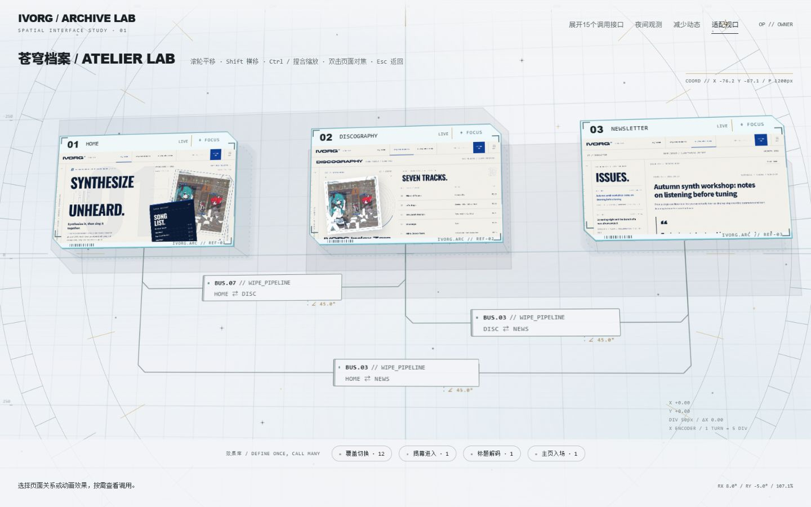
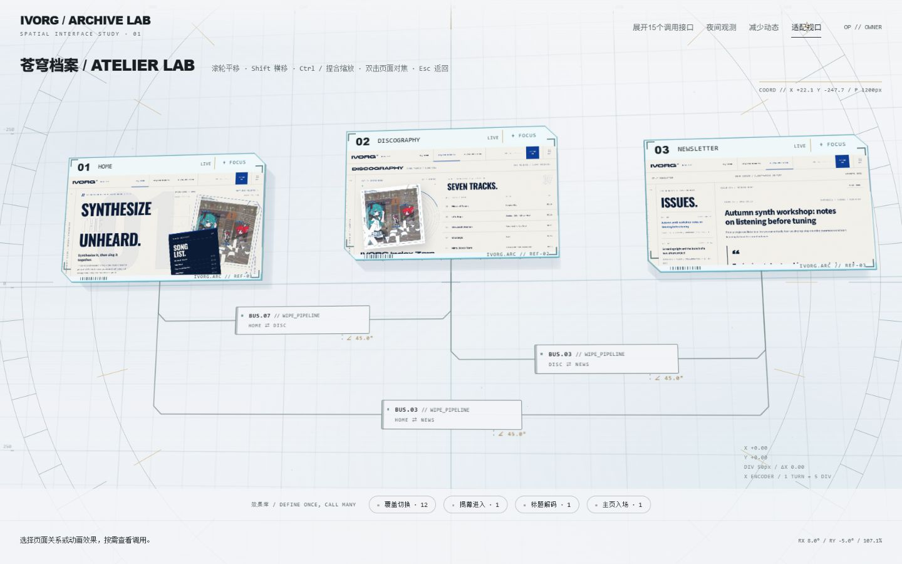
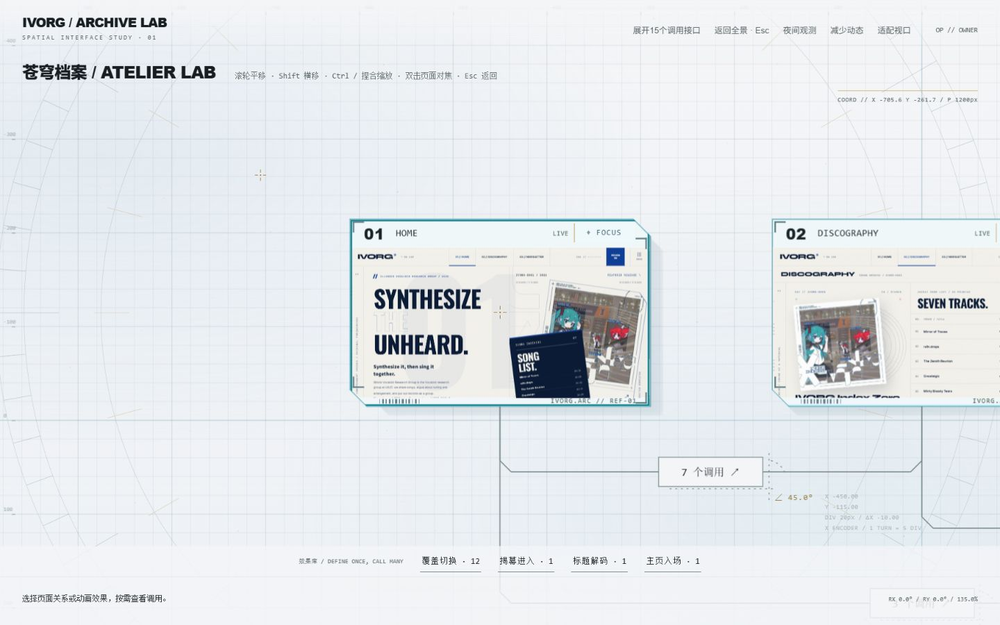
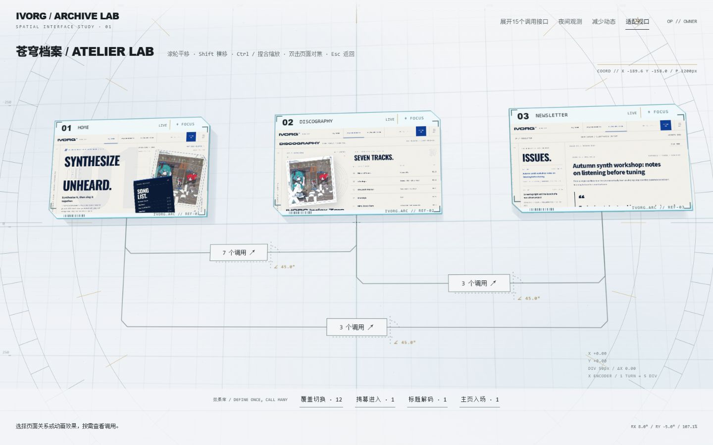

# Atelier Lab：空间相机与中央测绘准星验收

## 最新空间重塑：同 Y / 驻波深度 / 测绘星尘

三张卡片的布局 Y 统一恢复为 110px。深度公式为 `z(i,t)=18*sin(2*PI*t/7.5+phase[i])`，固定相位为 `[PI/2,-asin(1/3),PI/3]`，起始深度约为 `[+18,-6,+15.59]px`，完整周期 7.5s；不叠加 Y 动画。投影后的屏幕高度会随真实透视略有变化，并非布局 Y 错位。

浮沉最多更新 30 次/秒，仅更新三个实体及其阴影、连接竖线和角部引线；网格/微尘 Canvas 不因浮沉每帧重绘。Z 越高，落地阴影越扩散、越淡。页面对焦、减少动态、系统 reduced-motion、隐藏标签页时暂停；恢复后续接原相位，销毁时取消动画。对焦锁住当前 Z，避免检视时漂移。

两块 45°斜切构成背板固定于 Z=-40px，深炭灰填充 alpha .055、边线 alpha .12。三组半透明地面框也在 Z=-40px，每张卡片两个真实底部角引出空间投影线；其平面投影偏移为 X+12 / Y+12，Z 方向随实体深度连接，避免把二维装饰线误当作三维锚点。

64 颗测绘微尘改为屏幕半径 1.2–1.8px：石墨 `rgba(15,18,22,.45)` 与黄铜 `rgba(200,168,107,.5)`；每七颗附一组细十字星芒。继续保留三层相机视差。Bus 形态保留，主标、代码及方向字号统一 10px。

三档真实浏览器截图与读数见 `verification/rhine-camera/standing-wave-evidence.json`。均测得三个 Y=110px、两块背板、三个地面框、64 颗微尘和 10px Bus 字号。实测连续样本 Z 随时间变化；减少动态前后时间值完全相同；对焦暂停且中心误差约 0.031px；28 个接线基准最大误差约 0.077px。截图仅代表采样瞬间，周期与振幅另有确定性自动化测试。

38 项前端测试 PASS；完整 P4 门禁仍为 PASS：126 项 Workbench、53 项旧基线、27组/693项烘焙断言、构建、Bridge 静态检查及生产零残留。日志在 `verification/rhine-camera/wave-logs/`。底层与用户 shell.css 未改动。

## 后续微雕验收（2026-10-20）

以下为最新造型，后文保留首次验收记录。中央准星已按用户要求换为 32px 外接框的连续细十字线；独立鼠标图标维持 18px。

- 三条汇总总线改为微型工业芯片：`BUS.07 // WIPE_PIPELINE`、`BUS.03 // WIPE_PIPELINE`，方向微标区分连接对象。实际定义含 wipeCover / wipeUncover，未伪造 POSTER_EXPAND 定义。悬停边框实测为 `rgb(0,229,255)`；点击第一条仍展示 7 个真实调用。
- 微尘从 180 颗收敛至 64 颗，三层深度，绘制半径限制 0.6–1.0 CSS px；低透明度深灰与冷金交错。沿用独立底层 Canvas，共享网格相机变换，不增加常驻重绘。
- HOME / DISCOGRAPHY / NEWSLETTER 的 Y 为 118 / 92 / 114px，中间页 Z 抬升 12px；保持实体厚度 6px。总线锚点同步跟随 Y，Z 高差由真实竖向接线补齐。对焦使用含 Z 的投影中心修正。
- 底部四个效果定义收为弱边框胶囊标签，附微型状态点，保留真实定义复用次数及原点击行为。

真实浏览器证据 `verification/rhine-camera/polish-evidence.json`：1280×800、1440×900、1920×1080 三档对焦中心偏差均小于 0.04px；28 处总线接缝最大误差 0.087px；15 次接口点击与实际 bindingId 逐一匹配。37 项前端测试通过；P4 完整门禁退出码 0（126 + 53 + 27组/693断言、构建、生产残留与 Bridge 扫描全部 PASS）。新门禁原始日志位于 `verification/rhine-camera/polish-logs/`。受保护目录及用户 shell.css 未改动。

验证日期：2026-10-20。入口：`http://127.0.0.1:4323/?study=rhine`。
本轮在获批的方向 B 小样中迭代；默认工作台入口和底层 API 保留。仅修改 Workbench 前端、开发构建脚本、测试及验证文档。

## 最新交互裁决

- 大刻度环保持正圆：SVG 外接框宽高均为 `112vw`，不拉伸成椭圆，超出视口直接裁切。刻度环位于页面卡片后方。
- **中央准星**为独立的 18×18px 前景层，位于刻度环中心，不跟随鼠标。拖拽时仅跟随刻度环的微小悬挂偏移，松手回到中心。
- **鼠标图标**独立保留：18px 精密十字图标跟随真实鼠标，按钮悬停、拖拽和按下具有细微反馈。
- 中央准星通过真实 `elementFromPoint()` 对屏幕投影后的按钮命中测试；对准页面时复用鼠标悬停边框。移走后解除高亮。支持页面、对焦按钮、调用接口与关系汇总节点。不会自动点击、选中或切换路由。
- 两个准星均为 `pointer-events:none`，`aria-hidden=true`；保留原生按钮及键盘操作。中央命中以 requestAnimationFrame 合并，仅在相机、悬挂偏移、视口或界面变化时重测，不设置常驻轮询循环。

## 相机与机械反馈

相机源文件：`src/workbench/shell/rhine-camera.source.js`。使用本机安装的 GSAP core，经 `node scripts/build-rhine-camera.mjs` 编入现有 renderer 资产；没有新增外部脚本来源或修改服务端资产路由。`--check` 检测源文件与生成产物一致性。

普通滚轮 Y 平移 Y，Shift+滚轮 Y 平移 X；触控板 deltaX/deltaY 均保留。line 单位按 16px、page 单位按画布高度换算。Ctrl+滚轮/浏览器捏合 wheel 按指数比例缩放，限制 0.25–3.5。

以画布内指针点 s、当前 pan p、zoom z 计算世界锚点 `q=(s-p)/z`；动画的每一帧都令 `p'=s-q*z'`，避免仅终点正确而缩放途中漂移。空白左拖和空格+左拖均平移；文本输入不被空格快捷键拦截，拖拽后的意外点击被抑制。

双击卡片或 FOCUS 将相机以 450ms GSAP 过渡推到 1.35 倍、正面姿态。Esc 恢复原全景快照。途中切换目标、Esc、拖拽均会取消旧动画；调整窗口大小时保持世界中心，不回放过期动画。

机械悬挂独立于真实相机：拖拽跟随约 0.16s，偏移上限 X18px / Y12px、转角 1.2°；松手用约 0.7s 弹性回中。滚轮平移有短促惯性，缩放产生正负 1.8% 呼吸后回中。减少动态模式将装饰保持居中，不影响准确相机状态。

## 空间材质

高明度浅冷灰实验室底色，三块真实脚本禁用 iframe 缩略图、6px 斜切实体、冷青轮廓和金属卡榫。背景网格按逆投影计算四个视口角的世界边界，随相机移动向四周延伸；1/2/5 自适应间距控制线数。边缘刻度、主轴与编码盘读数均来自真实世界 CSS 像素，未伪造毫米精度。

180 颗程序化微尘分布在三个 Z 深度，按相机距离做透视与平移视差。Canvas DPR 上限 2；相机停止后不持续重绘。`dustCpuP95` 仅记录微尘绘制 CPU 时间，不能解释为 GPU 帧耗时或全页面 FPS 达标证明。

## 实际浏览器证据

最新中央准星验证见 `docs/verification/rhine-camera/center-reticle-evidence.json`：

| 视口 | 中央准星中心 | 尺寸 | 圆盘外接框 | 实际命中 |
| --- | --- | --- | --- | --- |
| 1280×800 | 640,400 | 18×18 | 1433.60×1433.60 | page.home |
| 1440×900 | 720,450 | 18×18 | 1612.80×1612.80 | page.home |
| 1920×1080 | 960,540 | 18×18 | 2150.40×2150.40 | page.home |

三档均验证：适配全景时中心无目标；对焦 HOME 后只有一个中央悬停目标，底下真实元素仍为 `.rl-page-select`，鼠标图标位于另一个位置且可见。实际截图：

此前相机验证保存在同目录 `browser-evidence.json`：三档共 9 次页面对焦/返回及 45 次 bindingId 实际点击。这份历史证据早于最终准星补丁，其旧截图不能用来代表最新造型。最新补丁另有上述三档截图与 JSON。原生普通滚轮与拖拽已有验证；**本工具未可靠组合实体 Shift/Ctrl 与滚轮，物理触控板捏合也尚未验收**。这些输入映射通过真实 GSAP 控制器自动化测试，但不冒称已完成硬件手势验收。

## 回归结果

最终完整门禁退出码 0，原始输出在 `docs/verification/rhine-camera/logs/`：

| 检查 | 结果 |
| --- | --- |
| 前端相机、小样及默认工作台测试 | 37/37 PASS |
| P1 / P2 / P3 / P4 | 30 + 31 + 33 + 32 = 126 PASS |
| 旧基线 | 53/53 PASS |
| MotionBaker | 27/27 组、693/693 断言 PASS |
| 生产构建、零开发残留、Bridge 静态扫描 | 全部 PASS |

`src/workbench-core/`、`src/workbench-server/` 无改动。用户 `src/styles/shell.css` 原有改动保留，文件 SHA256 仍为 `dcef24ac0ec2ffdac1b936cc644c4bb33e9494e58c6f7807b6a71d11b8da2d5e`。

## 手动复核

1. 拖动画布使页面经过中央小准星，观察边框亮起；继续拖离后取消高亮。小准星不跟随鼠标，独立鼠标图标仍跟手。
2. 双击任意页面或点 FOCUS，检查居中推近；Esc 返回。普通滚轮上下移动，Shift 横移，Ctrl/捏合以指针缩放；实体修饰键和触控板手感需由实际设备复核。
3. 大圆环外围裁切，拖拽、滚轮及缩放有轻微阻尼回中；减少动态模式应关闭装饰悬挂，保留可用导航。
