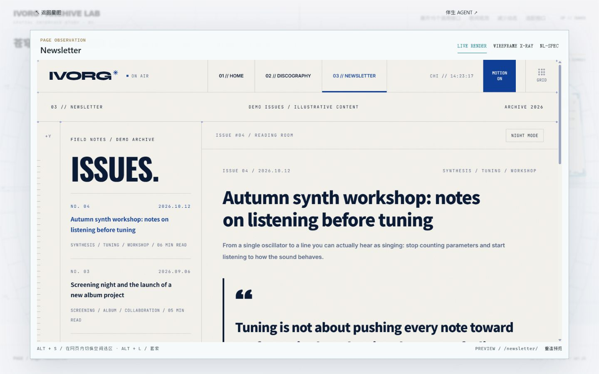
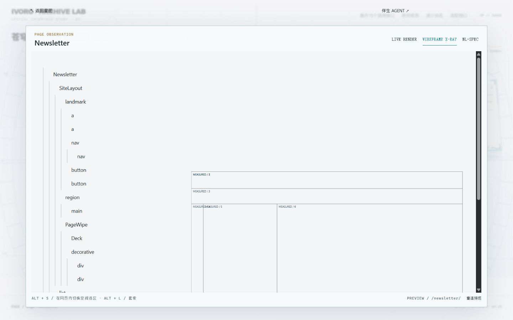
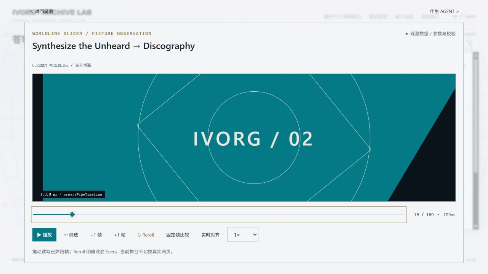

# Atelier Lab：美术封存与下钻舞台联调验收

日期：2026-10-20。入口：`http://127.0.0.1:4323/?study=rhine`。

结论：**页面与转场下钻主链通过；Alt+S 空间框选保留人工验收项。** 本轮没有向业务源码 Apply 修改，也没有把未执行的操作标为已验证。

## 美术封存

本地封存标签：`workbench-art-baseline-20261020`，对应提交 `86ca0fc`。哈希及截图清单见 `verification/rhine-camera/ART_BASELINE.json`。本轮宏观星图的布局、材质、网格、星尘与 Z 轴呼吸不作美术调整。

新增的专用样式被包在 styles.css 的 `Interaction integration only` / `END RHINE INTERACTION INTEGRATION` 标记之间。自动化测试移除这段后，逐行比对封存标签中的样式，除空行和换行符外完全一致。下钻舞台采用独立层，不改变宏观画面样式规则。

## 接通的交互

- **页面**：单击卡片进入已有的 90vw×88vh 页面舞台；双击仍用于相机对焦。鼠标单击延迟 260ms，以便双击取消待执行的下钻；键盘激活直接打开。FOCUS 徽标继续保持原有相机行为。
- **转场**：展开接口直接选中真实 TransitionBinding，或从 Bus / 效果库的调用列表选择，再进入共享 Fixture 切片仪。
- **返回**：保留同一个宏观场景与 iframe 缩略图集合，暂停背景相机输入和 Z 呼吸，不销毁、重建宏观场景。支持原 3.5 倍相机状态，不套用旧星图视口栈 2 倍的限制。返回时恢复对象或调用行的键盘焦点。
- **页面三模式**：LIVE RENDER 使用真实 4321 页面；WIREFRAME X-RAY 使用对象树与经 PreviewBridge 验证的实测边界；NL-SPEC 接入既有 XML 读取及规划面板。
- **伴生抽屉**：下钻对象与树节点选择会同步当前目标和对象解释；保留三段式计划审阅和原有权限门禁。Esc 优先关闭抽屉，再返回星图。

## 修复的实际断点

1. Atelier 原先走独立小样分支，只显示选择文本。现复用现有工作台控制器、Bridge、Fixture、Spec 和 Agent 面板，不复制一套后端或协议。
2. 浏览器联调发现标题与 iframe.src 已更新时，实际预览仍可能停在旧页。切换目标页面时改为新建 iframe，再绑定该帧的 contentWindow 与新的 Bridge 会话；旧会话 dispose，旧帧消息无法通过新会话的 source / epoch / nonce 校验。目标路径同时参考 Bridge 已确认的真实 pathname，避免单纯相信 src 属性。
3. 切换预览时清除旧测量；空间选区消息仅在当前 PageObject 与消息 pathname 一致时转给 Agent，避免宏观视图或转场舞台接收旧页选区。
4. 修复浅色舞台中结构透视文字和测量线对比不足；规则仅作用于下钻层。

父页仍不读取 contentDocument，postMessage 使用明确的 PREVIEW_ORIGIN。Fixture 没有调用 navigate，也不会切换真实预览路线。

## 真实浏览器证据

原始断言：`verification/rhine-interaction/browser-evidence.json`。

| 检查 | 实际结果 |
| --- | --- |
| 1280×800 / 1440×900 / 1920×1080，逐页打开 HOME、DISCOGRAPHY、NEWSLETTER | 9/9 实际路径与 Bridge 路径一致 |
| 三模式：对象树、实测边界与完整 XML 读取 | 9/9 通过；首次 Spec 读取需等待异步完成 |
| 返回前后 panX / panY / zoom / pitch / yaw | 9/9 完全一致 |
| 15 个真实 TransitionBinding 下钻 | 15/15 正确身份、非空可用时间轴 |
| Fixture 期间预览 src | 15/15 未改变 |
| 重复 seek 到第 18 帧 | 画面及帧号一致 |
| 同 Seed 重烘焙 | bakeKey 与 checksum 均相同 |
| Reroll | Seed 2→3，bakeKey 改变；没有真实切页 |
| Agent 对象解释 / 未批准的 Apply | 对象上下文正确；Apply disabled |

Reroll 的 checksum 不要求每次不同。本次 seed 2 和 3 都抽到 poster 1，checksum 相同；已通过内核的 `createPosterDeck(seed,4).next()` 实际核对。有限海报集合允许碰撞，不能把“checksum 一定变化”当成随机性或正确性的判据。

## 自动化与保护范围

最终原始日志：`verification/rhine-interaction/logs/`。

- 前端：**42/42 PASS**，包含 2 项新增集成测试；实际运行真实 Rhine renderer 与共享工作台控制器，覆盖单击/双击分离、3.5倍返回、背景输入暂停、三模式、绑定身份、重复 seek、抽屉与两次 Esc 返回。旧前端测试仅补齐新建 iframe 所需的 DOM 模拟窗口代理。
- Workbench：**126/126 PASS**（P1 30、P2 31、P3 33、P4 32）。
- 旧基线：**53/53 PASS**。
- MotionBaker：**27/27 组、693/693 断言 PASS**。
- 生产构建、开发残留扫描、Bridge 静态安全检查：**PASS**。

本轮未修改 `src/workbench-core/`、`src/workbench-server/` 或业务源码。用户 `src/styles/shell.css` 的原有修改保留，SHA256 仍为 `dcef24ac0ec2ffdac1b936cc644c4bb33e9494e58c6f7807b6a71d11b8da2d5e`。

## 未冒充通过的项目与人工验收

**Alt+S 框选：待人工。** 浏览器工具无法向跨 Origin 的内嵌预览派发点击，报目标不可用；实测父页命中顶层元素确为 iframe，pointer-events 为 auto。重建预览修复真实页面切换后，工具仍无法派发点击。因此没有通过脚本伪造选区，也没有越过 Bridge 读取子页 DOM。现有 P2 的空间测量与消息协议自动化已通过，但不等于此次手动端到端选区已验收。

真实 Pi Provider 生成、真实业务 Apply / Undo 没有在本轮执行；本轮验证到对象解释、上下文与操作门禁，不宣称外部模型或真实写入已通过。

人工操作建议：

1. 点击页面卡片，切换 LIVE / X-RAY / NL-SPEC；选一个对象树节点，确认右侧 Agent 的目标正确，再返回星图核对视口。
2. 点 Bus、选择调用，拖动时间轴并 Reroll；确认主预览未切页，返回后仍在原来的画布位置。
3. 在 LIVE 真实网页内按 Alt+S、拖出空白选区，确认选区进入 Agent 且尺寸正确；**本次验收不点 Apply**。
