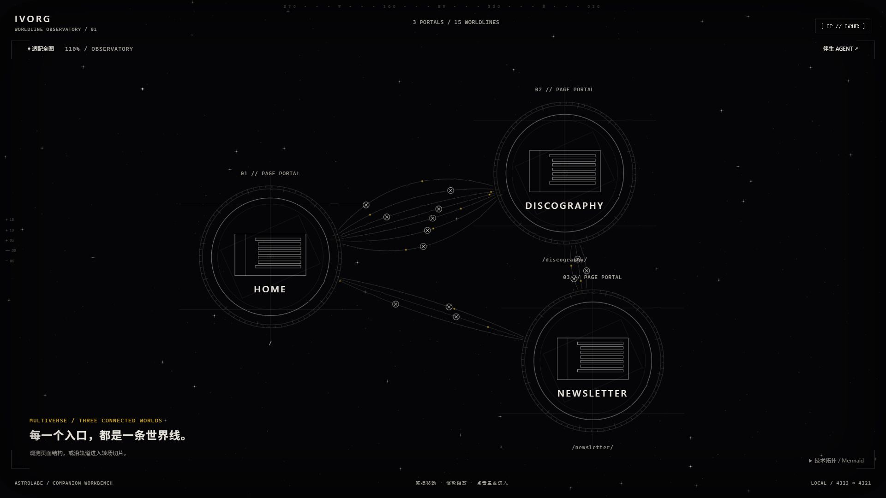
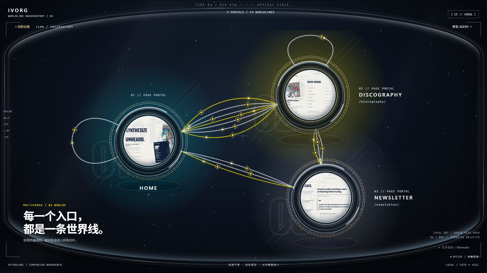
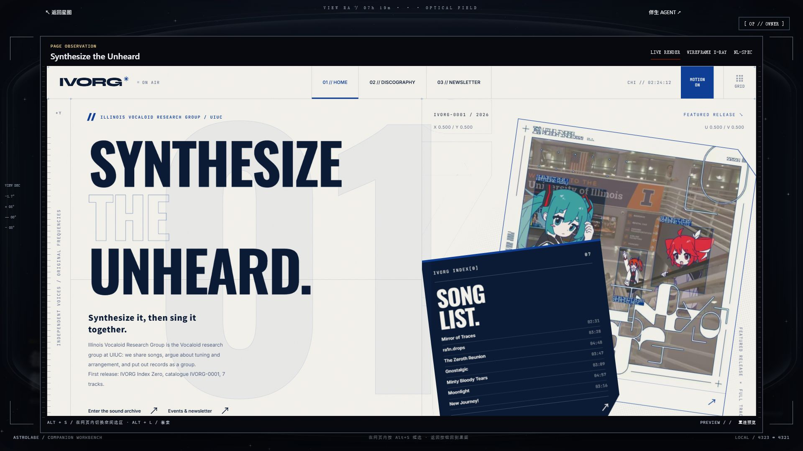
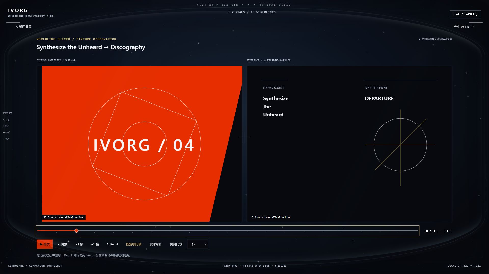

# Workbench 明亮真彩观测仪：交付自验报告

状态：实现与自动化验证完成；等待人工视觉验收。2026-10-20。原始输出、源码指纹及截图统一归档在 [verification/luminous](verification/luminous/acceptance.json)。

## 交付内容

三个无脚本真实网页圆形门户、双层刻度环、三色环境光、15条独立轨道及菱形信标、轨道光子、巨型空心数字、RA/DEC/EPOCH HUD、三档适配和静态观测均已实现。门户缩略图保持真实4321主题，没有修改用户业务配色。

本轮进一步建立远景冷色星尘、中景门户厚度与投影、近景曲面目镜的空间层次。镜面用Fresnel反射比例采样成SVG渐变，正面透明、边缘更亮。研究与近似边界见 WORKBENCH_OPTICAL_DEPTH_RESEARCH.md。

页面舞台保留90vw×88vh、LIVE/X-RAY/NL-SPEC三模式；Agent抽屉保留目标、解释、结构审阅；切片仪仅使用Fixture，不真实切页。新增精密刻度时间轴与菱形游标；保留原生range键盘操作。三模式支持方向键、Home/End及roving tabindex，打开页面/切片后转移焦点，背景宏观场景inert，返回时恢复。

技术拓扑在真实Mermaid 12运行中发现并修复两项兼容问题：将htmlLabels:false设置在根配置；只剥离当前renderId的精确前缀再识别节点。保持strict安全模式、18个节点的一一映射，拒绝脚本、foreignObject、根/子节点事件属性和外链href。实际浏览器点击技术图转场节点已进入正确Fixture，未改变preview路由。依据见[官方htmlLabels配置说明](https://mermaid.js.org/config/schema-docs/config-defs-flowchart-diagram-config-properties-htmllabels.html)。

## Refactoring UI 十项纪律落实

|纪律|本轮落实|
|---|---|
|视觉层级|三个真实页面为主，机器ID仅聚焦时显示|
|字体层级|大标题、门户名称、微型坐标分级|
|配色|曜石底、冷白、黄铜、亮黄；网页颜色来自真实页面|
|间距|分离顶栏、星图、左下主标、右下技术入口|
|按钮层级|删除平移按钮，账号折叠为状态铭牌|
|消除噪音|15个卡片替换为轨道信标，JSON折叠|
|空状态|连接、登录、离线与文档载入状态明确|
|阴影|用于门户厚度、接触位置及浮层层级|
|对比|关键文字冷白；机器信息弱化；减少动态可用|
|关系分组|页面聚合自身入口，转场沿连线独立选择|

这些是实现审查结果，未声称已通过完整WCAG审计。

## 自动化真实输出

命令：node scripts/luminous-archive.mjs。它依次执行P4累计门禁、HTTP/前端专项校验并归档原始输出；最新运行结果见 docs/verification/luminous/acceptance.json，全部自动化退出码0。

|检查|实际结果|
|---|---|
|P1/P2/P3/P4|30/31/33/32，共126 PASS|
|旧基线|53/53 PASS|
|MotionBaker|27/27组、693/693断言 PASS|
|生产构建|PASS|
|生产残留|17个产物文件扫描 PASS|
|Bridge静态安全|contentDocument=0、通配目标=0、固定postMessage目标=2、Fixture导航调用=0|
|最新前端专项|13/13 PASS：外壳10项＋原始预览脚本交互3项|

原始门禁输出：docs/verification/luminous/gate-*.txt；汇总：docs/verification/luminous/gate.json。HTTP证据含八个服务端实际响应的源码SHA256，三条预览路由200，以及实际读取的前端测试数13。

完整累计门禁已在运动阻尼、门户中心修正及方向性镜框高光落地后再次运行。core/server相对于本次视觉升级前的ce49056也无差异，保护检查覆盖已提交与未提交内容。

## 浏览器只读验收

- 15个信标均实际点击进入转场并返回，相机矩阵一致：binding-interactions.json。
- 最新一次先用键盘平移并缩放到121%，再逐一点击15个信标；每次返回均精确恢复translate(165px,30px) scale(1.21)，不是只验证默认视口。
- Newsletter真实网页、结构透视、NL-SPEC均已打开；架构文档显示结构基线一致。
- Agent抽屉实际打开三段内容；未在浏览器点击Apply。
- 重复seek末帧DOM一致；同Seed重烘焙checksum一致；Reroll改变checksum且Seed递增。preview.src始终保持Newsletter：slicer-interaction.json。
- 静态观测实际确认动画及镜片transform为none，采样标记STATIC。
- 三个目标CSS视口经DOM核对为1280×800、1440×900、1920×1080；三个缩略图均加载且位于视口内。新建默认100%缩放的同浏览器标签后，截图与CSS视口及相机倍率完全对应。见optical-viewports.json及verified-*截图。
- 技术拓扑实际渲染18个节点，script=0、foreignObject=0，节点选择正确：mermaid-runtime.json。
- 真实键盘验证LIVE→X-RAY→SPEC→Home返回LIVE，Tab进入preview；背景inert已核对：keyboard-navigation.json。

以上JSON及最终截图已复制到版本控制目录docs/verification/luminous/，本地派生原始历史保留在.companion/luminous-verification/。

## 真实截图、性能与验证边界

早期旧标签120%缩放导致工具截图裁切、填充及相机倍率变化，现已通过默认100%缩放的新标签解决。三档截图前后DOM尺寸、相机变换一致，DPR约1，直接保存浏览器JPEG，无裁剪或图像后处理。归档脚本用sharp只读元数据校验六张基准/最终图片尺寸并记录SHA256；另归档真实页面与切片舞台两张1920×1080截图。旧optical-calibrated等中间文件不作为最终证据。

浏览器键盘API在预览iframe返回“Keyboard focus root is no longer available”；框选快捷键的真实键盘验收标为NOT_RUN。真实Tab可进入preview，舞台中心命中iframe且pointer-events:auto，装饰层没有遮挡。原始preview-bridge.js在隔离DOM中执行的3项集成测试已验证Alt+S/Alt+L切换、空白框选锚点、容器变化后的归一化重测、外来init拒绝和清理。没有修改PreviewBridge接口；原生iframe内Alt+S留作人工确认，不冒充已自动通过。

实际记录：早期1920视口520粒子、240样本，rAF P95约12.60ms、Canvas CPU P95约0.30ms。后续工具环境记录rAF约1004ms，且document.hidden=false；原因尚未确定，可能涉及宿主调度。不能据CPU耗时宣称60fps，也不能据这一秒间隔断言Canvas绘制卡顿。

后续独立采样：1280×800为218样本、Canvas CPU P95 0.70ms；1440×900为42样本、0.90ms；1920×1080为82样本、0.60ms。三档都观察到长调度间隔；原始记录为pacing-per-viewport.json。

继续诊断：性能面板新增只在本页运行的Long Tasks/Long Animation Frames观测，记录计数和最大blockingDuration；不支持时明确显示unsupported。另提供可恢复的轻量光学模式，关闭装饰性滤镜以作对照，并重新开始采样。原理参考[Chrome官方Long Animation Frames文档](https://developer.chrome.com/docs/web-platform/long-animation-frames)和[W3C Long Tasks规范](https://www.w3.org/TR/longtasks-1/)。后续真实对照各240样本：完整光学rAF P95 12.30ms、Canvas CPU P95 0.40ms；轻量光学4.30ms/0.30ms；两者longtask=0、long-animation-frame=0、long gaps=0。这两个窗口已无一秒长间隔，不能推断旧问题的唯一原因。记录为frame-health-ab.json，测量后已恢复完整光学。

已修复原有误降级：≥250ms的间隔单独记录，不作为绘制过载证据；35–250ms持续慢帧会降至360粒子，恢复后回升520。镜框与星尘使用同一时间阻尼；鼠标静止时不重复写根样式。尺寸/可见性/静态模式切换会建立新采样窗口，不把不同条件的数据混合。隐藏时Canvas、光子和CSS刻度环均暂停。相应测试验证慢帧降级、长间隔不降级、恢复、样本分段与无重复循环。

## 保护与服务

4323控制面与4321预览由进程41592监听。本轮修改仅在前端外壳、专项测试与文档；没有业务Apply。用户src/styles/shell.css哈希仍为dcef24ac0ec2ffdac1b936cc644c4bb33e9494e58c6f7807b6a71d11b8da2d5e。

本地检查点包括781ae4a、0568fa0、091625e及5952412；最终交付独立提交，不包含用户shell.css。自动续接workbench按每30分钟建立，授权截止2026-10-20T11:32:34Z；交付自验完成后已由应用工具设为PAUSED，避免无实质优化空转。没有宣称能重启Codex进程或保证供应商额度自动恢复。

使用imagegen制作了一张内部光学概念稿，用于比较断续的方向性边缘高光。该图改写了部分业务内容和布局，因此不作为真实截图证据，也未被任何生产或开发界面加载。最终高光通过CSS渐变与复合遮罩实现，产品没有引入生成图片。

## 人工最终验收（不执行业务Apply）

1. 访问http://127.0.0.1:4323，核对三个真实彩色门户、透镜边缘与冷色层次；拖拽/缩放后点击任一轨道信标。
2. 在切片仪中拖动时间轴、逐帧、同Seed重烘焙与Reroll，返回确认相机恢复；真实网页路由不随Fixture切换。
3. 点击页面门户，在三模式间切换；在真实网页内按Alt+S做空白框选，查看Agent目标与结构差异，不点Apply。

最终交付范围是桌面光学观测隐喻，没有双眼立体渲染或WebXR头部追踪。美术最终接受由人工决定；性能记录为本机测量窗口，不能承诺所有设备固定帧率。
