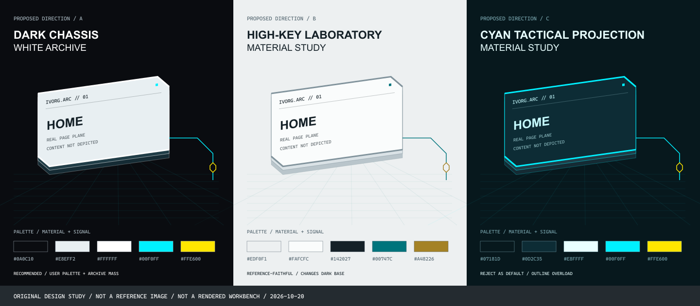
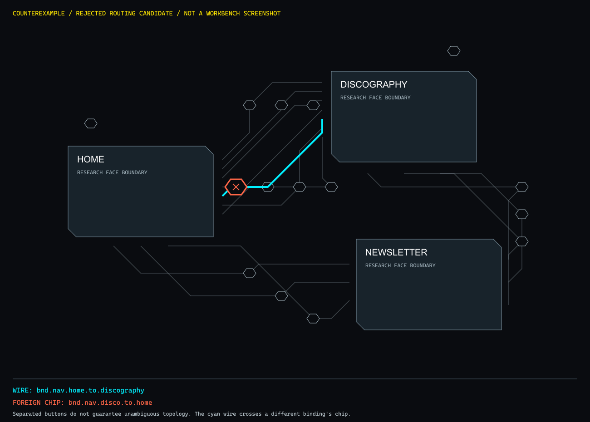

# Companion Workbench：莱茵生命机能档案台策划案

**状态：2026-10-20用户已批准方向B，并启动步骤1小样。以下以最新人工裁决为准；完整外壳尚未替换。**

采用 **B「高明度洁净实验室」**：浅冷灰/象牙白空间、三个有厚度的斜切真实页面视窗、共享三维投影与黑字排版。青/杏金只作功能信号。方向A保留为可切换的夜间观测模式。

本方案是对参考项目的转译，不宣称逐像素复刻，也不承诺CSS表面近似等于物理玻璃。详细来源、实验与反驳见[研究报告](RHINE_WORKBENCH_RESEARCH.md)。

## 1. 先看真实参考图

### 参考一：RhineLabUI 作者档案阵列

借鉴：实体薄边、接触关系、统一投影、安静的大块明度，以及主标题/微型索引的分层。我们的真实数据只有三个页面，不复制无限档案墙，也不制造虚假页面充数。

来源：[LBEILC/RhineLabUI](https://github.com/LBEILC/RhineLabUI)；作者说明这组原图采于2026-09-09，属于文档参考。源码研究固定到commit `12cc5e4013acb9408f753ff71de6b8492299b7c8`。

### 参考二：抽取后，实体与阅读区分工

借鉴：宏观阶段可以倾斜，进入内容阶段回到稳定的正面阅读。保留完整LIVE/X-RAY/NL-SPEC与Agent审阅能力，不让用户在倾斜的网页上编辑。

批判性区别：原模型内部确有圆环，但这不是我们页面外轮廓必须做成圆泡泡的理由；原作者基准更接近灰白/黑字/杏金，青黄配色来自本次用户要求，不能冒称原项目统一规范。

### 参考三：当前终末地官网的明暗与排版

来源：[官方网页](https://endfield.gryphline.com/en-us)。当前首屏为版本主题宣传构图；借鉴大字、细标注与边缘导航的反差，不把它伪称为当前正在运行的“无限三维网格档案台”。本轮未核实“翠玉梦境”对应的独立官方概念站，因此不引用同人图冒充该官方页面。MAGI仅作几何/状态语法辅助，图源与限制见研究报告R5。

## 2. 三种方向与最终人工裁决

以下为原创材质/轮廓示意，**不是参考原图、产品截图或已运行的小样；未描绘真实页面内容**。

|方向|具体形态|判断|
|---|---|---|
|A 暗色机架/冷白档案|#0A0C10底、真实页面、冷白标牌、薄深青侧面，青/黄用于功能状态|夜间观测备选|
|B 高明度实验室|浅冷灰空间、黑字、透明实体与微弱背光|用户正式批准，默认视觉方向|
|C 黑青战术投影|深青透明面、青色轮廓、密集技术信息|拒绝作为默认，容易再次变成霓虹监控屏|

不混合三种方向的所有装饰。尤其不把A的冷白实体、B的雾化、C的满屏发光同时叠上去。

## 3. 宏观界面：明确删什么、建什么

### 3.1 删除

物理删除巨大弧形目镜及球面反光层、三个同心圆门户、星云光晕、持续星尘与光子球；清理对应CSS与无用生成逻辑。不会继续通过追加覆盖样式把旧造型埋在下面。

### 3.2 三个真实档案视窗

- 外轮廓以约320×200研究基准展开，右上/左下12–18px的45°斜切；窄1px冷白边与有限角卡榫，不做厚重黑盒。
- 背板、信息面、边角/索引层形成约4–8px可见厚度。根节点保留3D上下文，裁切和半透明网纹只在叶子表面，不压在网页正文上。
- `IVORG.ARC // 01 · HOME`等短标牌体现项目自身身份；状态来自真实加载/Bridge状态，不使用随机在线灯。
- 保留三个固定路由的真实iframe：HOME、DISCOGRAPHY、NEWSLETTER；脚本禁用、inert、pointer-events:none、无主Bridge接入。点击由外层页面按钮接收。
- 取景优先保留各页标题、海报/唱片与杂志结构。缩略图负责识别，正文进入大舞台阅读；不宣称320px缩略图中的小字可以舒适阅读。

### 3.3 空间与排版

统一perspective以1200px为起点，基础pitch约8°、yaw约-5°，鼠标微动限幅约±2°，三件档案共享空间规则，不各自随机摇摆。规则地面点阵/网格提供尺度，近清远淡，不再使用星空来暗示纵深。

大标题与微型标注有明确反差，标题放在三档布局都能保留的净空区；不遮页面、端口或总线。必要文字保持屏幕可读字号，不随全图缩放成微型噪音。字体优先使用真实可用的系统回退；未配置字体资产时不假称已精确采用Inter/Oswald/JetBrains Mono。

## 4. 数据总线：身份比折角更重要

**实施中的人工调校：** 默认不显示15条调用线，而以3组页面关系（7/3/3个调用）呈现；动画效果单独作为可复用定义展示。当前12个入口共享`td.wipeCover`，另有3个效果各1次调用。点击关系或效果再查看调用列表；仅在显式展开审查时显示15个独立接口。收拢不合并或删除任何bindingId，也不改变定义/调用/实例契约。

当前仓库是**13条跨页绑定＋2条pageLoad原地绑定**。三对页面的跨页数为7/3/3；HOME→DISCOGRAPHY自身是5条，不能把“三个内容入口”误当成全部绑定。

每条保留bindingId、方向、trigger和definitionRef。原地绑定转为对应档案的初始化接口位，仍能单独进入Fixture，不画成错误的页面导航。

- 路线采用世界坐标中的0/45/90°有限通道；三维投影后的屏幕角度自然变化。
- 交互只在独立芯片按钮，线条、数据包、纹理不抢指针。可见芯片约10–12px，鼠标命中目标至少32 CSS px；触控44px需重新排布验收。
- 数据包按累计弧长匀速移动；默认线路克制，聚焦时突出对应方向与端点，不让所有线路同时争抢注意力。
- 交叉不表示连接，使用断线桥；共线共享段必须拆分或明确总线成员关系，不能含糊地叠在一起。

### 已主动否决的方案

首次格点A*虽然能连通，压缩后仍有221段，单条最多34次转折，否决。第二份50段候选虽然芯片间距合格，反审又发现8组无关线路侵入其他芯片、4对共线重叠，**同样不能直接作为最终布线**。

实施小样须把非本绑定芯片安全区纳入禁入区，并同时约束转折、共享段与端口连接。若空间不足就重排接口或场景，不压小命中面、不藏掉绑定。验收必须读取实际选中的bindingId逐项比对，而非只检查“进入转场页”或相同的起终点标题。

## 5. 渲染路线：有条件首选原生CSS 3D

|路线|收益|硬问题|裁决|
|---|---|---|---|
|原生DOM/CSS 3D|真实iframe、原生语义控件、共享投影与分层厚度；不新增引擎资源入口|不是PBR玻璃；必须验证扁平化、端口接缝及输入变换|先做可证伪小样|
|纯Three.js WebGL|实体/光照/深度统一|普通跨Origin网页不能直接成为实时纹理|不以牺牲真实网页换取材质|
|WebGL＋DOM合成|保留实体与真实网页的升级可能|双投影、遮挡、点击与资源生命周期需自管|原生小样不达标时再评估|
|Three CSS3DRenderer|方便组织DOM变换|无Three材质/几何，官方还列出100%浏览器/显示缩放限制|不因名字含Three而优先|

依据：[Three CSS3DRenderer](https://threejs.org/docs/pages/CSS3DRenderer.html)、[Chrome HTML-in-Canvas跨Origin限制](https://developer.chrome.com/blog/html-in-canvas-origin-trial)、[CSS 3D分组属性](https://www.w3.org/TR/css-transforms-2/#grouping-property-values)。HTMLTexture的存在不等于可以捕获4321 iframe。

相机pan/zoom置于外层，共享perspective/姿态置于内层；节点、端口、总线使用同一空间描述。preserve-3d根节点不直接施加clip-path、filter、低于1的opacity等会扁平化子树的属性。薄面透明度使用背景alpha，角卡榫单独成层。

首选不是结论先行：如果静帧仍像纸片、接缝或命中不可靠，或实现开始演变成自造通用3D引擎，就停止堆CSS，记录失败并评估升级路线。

## 6. 页面舞台、切片仪和Agent

页面入口展开至正面大舞台，保留LIVE/X-RAY/NL-SPEC。切模式不重建主iframe，不丢Spec草稿。Agent保持“目标→解释→结构差异”，技术JSON折叠；账号管理仍在真实角色铭牌中。

Fixture保留播放/倒放/逐帧/seek/同Seed重烘焙/Reroll及比较。所有画面由既有Fixture数据驱动，主预览路由不随其改变。新主题不改变Seed、deck、bakeKey或底层动画语义。

宽屏可容纳Agent并列，1280档默认收拢，展开策略不能让预览缩成邮票。若开合使iframe尺寸变化，使用现有PreviewBridge重测；不能沿用过期SpatialSelection，也不读取contentDocument。

## 7. 动态与输入约束

外壳呈现控制器与核心ViewStack分离，用generation作废旧完成回调。重复点击不重复压栈，快速切换保留最新目标，烘焙迟到不覆盖新场景。动画可从当前进度反向，不排队播完旧目标。

按下/聚焦目标时冻结姿态追随；编辑器内滚动和按键不被宏观画布截走。返回保存实际pan/zoom/pitch/yaw与焦点；同画幅精确恢复，改变窗口尺寸时按世界锚点恢复。系统减少动态或手动静态模式关闭持续运动但保留实体层次；隐藏时暂停自有循环。

开合280–420ms、跟随tau70–100ms、帧更新脚本P95≤2ms、稳定窗口帧间隔P95≤20ms均为**待测目标**，不是本轮已达成的性能结果。测量不能删除慢帧，也不能把脚本CPU耗时当GPU或固定60fps证明。

## 8. 自我批判：首选最可能怎么失败

1. **又成三张墓碑。** 所以只给三个页面实体，不为十五绑定加大卡片；以真实内容和薄边为主。
2. **只把平面斜过来。** 所以静止、关闭动画后仍须有可辨厚度与一致接触关系；否则小样FAIL。
3. **用青色泛光冒充高级。** 所以默认明度块主导，青/黄只承担明确功能；青字在白面上对比仅约1.21:1，不用于小字。
4. **布局数学正确却点错对象。** 旧验收没有保存实际bindingId，这个证据缺口必须补上。
5. **漂亮示意代替真实产品。** 本轮方向图没有网页与浏览器合成，只作为提案；不能拿它宣布界面已验收。

## 9. 批准后的实施顺序与停止线

|步骤|具体产物|继续推进的门槛|
|---|---|---|
|1 轮廓/投影/命中小样|三件真实斜切页面、15身份接口、静帧与动态证据|实体感成立；逐项bindingId正确；无无关芯片穿线；接缝目标≤1 CSS px；三档不遮挡|
|2 完整视觉替换|清除旧目镜/星盘/星尘；统一配色、字体层级、地面、HUD|真实页面保真；可读对比；停止动态仍有层次；不靠覆盖旧样式维持|
|3 舞台与生命周期整合|可打断下钻、三模式、Fixture、Agent、焦点/草稿/相机恢复|快速反向、重复点击、窗口变化、减少动态与隐藏恢复正确|
|4 回归与人工视觉验收|原始测试输出、三档截图、缩放/命中与性能记录|126＋53＋27组693断言、构建/零残留与静态安全通过；审美结论另记|

底层测试、安全、绑定身份任何一项失败即先修复；美术不成立也不能用功能全绿顶替。若小样需要改变既有服务/API或放弃真实iframe，属于方案范围变化，先说明具体取舍，不静默实施。

## 10. 验收证据如何防止再次“自说自话”

- 1280×800、1440×900、1920×1080真实截图；DOM画幅、DPR、相机值与截图对应，明确浏览器缩放。
- 对15个独立接口点击并读取实际bindingId；包含相邻边界和姿态/缩放极值，不只直接dispatch事件。
- 检查页面/线路/芯片/标签遮挡，以及线穿无关芯片、交叉和共享段；27组数学估计只作前置，不代替原生命中。
- 20次下钻返回后，3个缩略iframe＋1个主预览保持实例与数量；无积累循环。三模式、草稿、Fixture确定性、权限动作均复核。
- 保护`src/workbench-core/`、`src/workbench-server/`、用户`src/styles/shell.css`及业务源码；禁止通配postMessage与contentDocument读取；验收不Apply业务修改。
- 自动化结果、数学估计、真实浏览器结果、人工美术判断分别记录。当前新界面未实施，不在本方案中伪造新的产品测试PASS。

## 11. 本次审批范围

用户已批准**方向B及先小样后整合的路线**。A作为夜间观测可选，C不作默认；50段研究布线已否决。步骤1通过`/?study=rhine`独立入口展示，原工作台默认入口保留；核心、服务端与用户业务样式不得修改。步骤1证据见[小样验收报告](WORKBENCH_RHINE_STEP1_REPORT.md)。

附件：[完整研究与反方审查](RHINE_WORKBENCH_RESEARCH.md)、[参考来源清单](verification/rhine-research/reference-sources.json)、[研究证据与复算说明](verification/rhine-research/README.md)。
