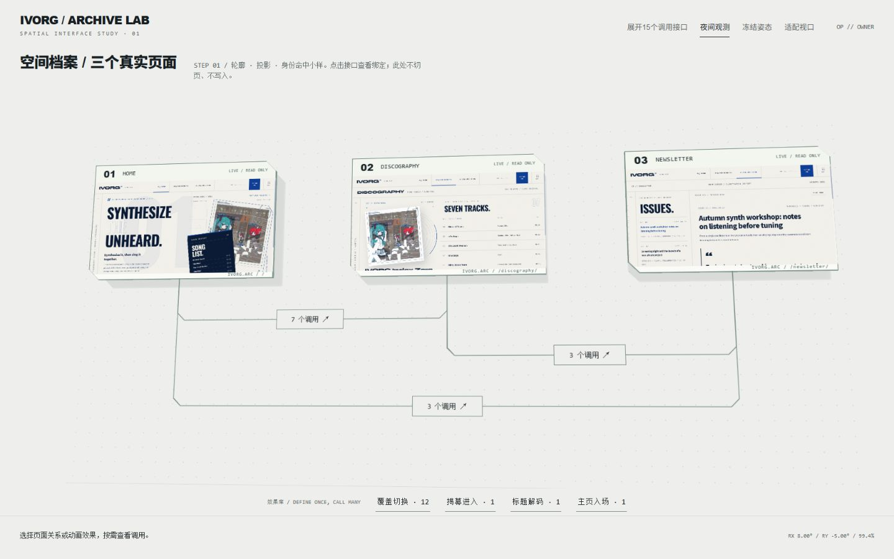
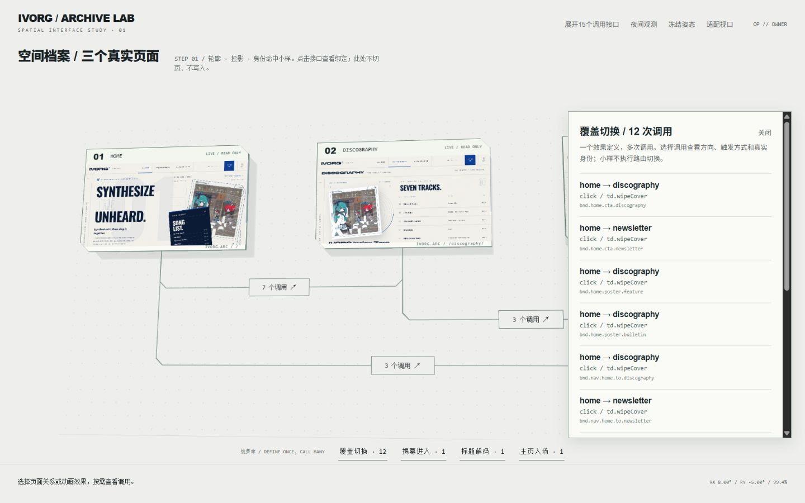

# Rhine Workbench / 方向B步骤1验收

2026-10-20。**步骤1工程门禁通过；视觉小样供人工审查，尚未铺开步骤2全局替换。**

入口：<http://127.0.0.1:4323/?study=rhine>。原工作台`/`保留。使用现有本地账户，未改变鉴权或服务端路由。

## 本轮实现

- 默认为浅冷灰/象牙白实验室，黑字、低对比深灰点阵与微量青/杏金状态信号；右上可切换夜间模式。
- 三个320×200世界坐标面板，6px模型深度、六条真实侧壁、斜切前后面与地面投影。6px指模型Z厚度，投影后可见边宽随倾角/缩放变化，不冒称每条边都占6个屏幕像素。
- 三个真实4321页面缩略iframe，脚本禁用、inert、禁止指针、固定路由白名单；没有假横线内容。
- 外层平移/缩放、内层共享1200px透视；有限俯仰/偏航，指针阻尼、焦点/按下冻结、隐藏暂停、减少动态支持。键盘方向键只在画布自身聚焦时调整姿态，不截走编辑控件输入。
- 原始有限通道使用0/45/90度线段与断线桥，15个绑定身份全部保留。不会使用研究中已否决的221段或50段候选。

## 用户中途调校：效果复用，不常驻十五条调用线

默认改为三组页面关系：HOME⇄DISCOGRAPHY共7个调用、HOME⇄NEWSLETTER共3个、DISCOGRAPHY⇄NEWSLETTER共3个。两个pageLoad调用通过效果库访问，不伪装成页面跳转。

效果库按`definitionRef`归并：`td.wipeCover`12次；`td.wipeUncover`、`td.decodeHeadline`、`td.entranceHome`各1次。点击效果或页面关系打开调用列表；列表选择仍返回真实bindingId。点击“展开15个调用接口”才进入完整走线审查。

这是一层显示组织，不合并定义/绑定/运行实例。一个定义可以被多次调用；每次调用的端点、触发条件与参数可以独立。**本步骤不提供参数编辑或新的时间轴，也未将12个现有cover调用伪称为12种不同动画。** 后续舞台整合应从选中效果进入公共Fixture，再从调用上下文预览覆盖参数；不创建12套重复动画代码。

## 浏览器测量与真实点击

浏览器截图尺寸与DOM viewport均逐项记录，DPR约1。点击通过浏览器locator/坐标输入执行；读取真实输出的bindingId，并非dispatchEvent直接调用处理器。

|视口|15个绑定逐项匹配|最小投影命中面|最大端口接缝|线路至无关芯片中心最小距离|
|---|---:|---:|---:|---:|
|1280×800|15/15|33.83px|0.073px|17.81px|
|1440×900|15/15|37.36px|0.081px|19.66px|
|1920×1080|15/15|47.76px|0.103px|25.14px|

另在1280×800检查姿态边界6.5°/-6.5°与9.5°/-3.5°，各15个绑定匹配，最小命中面33.34px，接缝最大0.074px；另外4次边缘坐标点击每次检查激活序号递增，Enter激活也检查递增。共75次逐项身份点击＋4次边缘激活＋1次键盘激活；额外效果库/列表点击不计入这75项。

28个端口接缝用同一三维上下文中的SVG端点与面板端点原生client rect测量，包含26个跨页端点与2个初始化端点。991个不绘制探针用于测量投影后的直线段：顺序探针之间计算屏幕线段距离，包含断线桥缺口作保守检查。表中距离是**线路到芯片中心**，不把它误称为离芯片边缘的净空；工程阈值16px。它不替代所有浏览器/显示缩放与触屏验收。

完整数据：[browser-evidence.json](verification/rhine-step1/browser-evidence.json)。截图包括三档默认/展开、夜间模式与效果调用列表。静帧已由Agent检查，实体侧边仍偏克制；是否达到用户期待的强度，留给人工美术验收，不用测试数量代替审美裁决。

## 实际发现并修复的问题

1. 顶部初始化接口透视后不足32px：改为42世界像素，其余接口38世界像素；不是仅改断言。
2. 透明的CSS3D空间容器挡住了倾斜按钮：原生点击无输出，elementFromPoint实际命中父容器。修复为空间容器pointer-events:none，独立按钮显式auto；随后重新跑全部身份点击。
3. 常驻十五条线妨碍阅读：按用户反馈改为三组关系＋四种效果库；详细接口保留为显式审查模式。

## 回归与安全

最终版本执行`node scripts/pipeline-gate.mjs P4`与UI测试命令，均退出0：

|门禁|实际结果|
|---|---|
|P1/P2/P3/P4|30＋31＋33＋32＝126/126 PASS|
|旧基线|53/53 PASS|
|MotionBaker|27/27组，693/693断言 PASS|
|小样＋既有视觉/控制器|14/14 PASS，其中4项新增路由/身份契约检查|
|生产构建|PASS|
|生产零残留|PASS，扫描17个产物文件|
|Bridge静态安全|PASS|

原始终端输出与退出码放在[logs/](verification/rhine-step1/logs/)，不是仅保存汇总。核心与服务端没有diff；用户`src/styles/shell.css`保持研究入口时SHA256：`dcef24ac0ec2ffdac1b936cc644c4bb33e9494e58c6f7807b6a71d11b8da2d5e`，未纳入提交。

修改文件仅开发前端：`src/workbench/shell/app.js`、`topology-renderer.js`、`styles.css`。新增` scripts/rhine-study.test.mjs`及本报告/取证材料；主策划案同步方向B与收拢裁决。未修改业务源码，未Apply，未启动老流水线或新自动化。

## 人工查看

1. 打开小样，观察真实三页、斜切侧边、洁净背景和默认三组关系；试夜间切换。
2. 点击“覆盖切换·12”，选择不同调用；完整bindingId、方向和触发方式应更新，但预览不真实切页。
3. 关闭列表后展开15个接口，逐项点击或用Tab/Enter；空白拖拽平移、滚轮缩放，聚焦画布后方向键检查姿态，使用“适配视口”复位。

步骤1完成并停在小样验收；步骤2全局视觉替换尚未执行。
